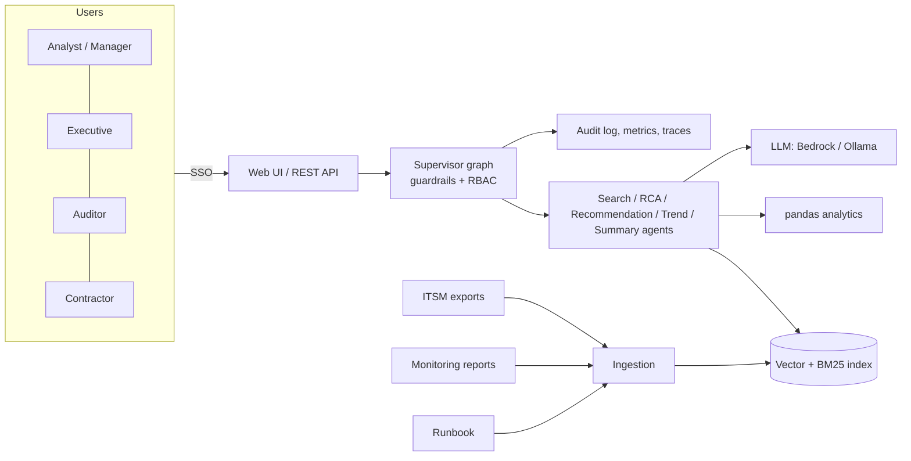

# 01 - Phase A: Architecture Vision

## Problem statement
Payment operations teams investigate failed, delayed and duplicate payments across ERP, payment gateway,
bank-file (ACH/wire) and SFTP interfaces. Root causes are buried in incident tickets, monitoring reports and
runbooks; the same issues recur, and month-end pressure hides trends.

## Business goals and KPIs
Targets below are **pilot targets to be measured**, not prototype results (ESTIMATE baselines to be captured in week 1 of the pilot).
| ID | Goal | KPI | Baseline | Target |
|---|---|---|---|---|
| G1 | Faster root cause | Median time to probable root cause | TBD (A: 45 min) | -40% |
| G2 | Fewer repeat incidents | Repeat-incident rate (same category/system in 30 days) | TBD | -20% |
| G3 | Earlier trend detection | Days from first rise to flagged trend | TBD | <= 7 days |
| G4 | Consistent reporting | Leadership summary prep time | TBD (A: 3 h/week) | <= 30 min |
| G5 | Safe | Payment-modifying actions executed by the AI | 0 | 0 |

AI quality metrics (from `eval/`): intent accuracy >= 95%; retrieval hit@6 >= 0.95; guardrail block precision/recall = 1.0 on the red-team set; numeric grounding violations shown to users = 0 unflagged; RAGAS faithfulness >= 0.85 with a strong judge (prototype could not obtain a faithfulness score with the 3B judge).

## Stakeholders and concerns
| Stakeholder | Concern | Influence |
|---|---|---|
| Payment ops analysts | Speed, trustworthy citations | High (daily users) |
| Operations manager (sponsor) | Fewer repeats, SLA | High |
| Finance executives | Concise, accurate health summary | Medium |
| Internal audit | Evidence trail, no hidden actions | High |
| Security / compliance | Bank data and PII exposure, SOX | High |
| Contracted IT support | Technical RCA without amounts | Low |
| IT / platform | Run cost, supportability | Medium |

## Scope
| In | Out |
|---|---|
| Search, RCA, recommendation, trend, summary over incidents, reports, runbook | Executing or approving payments, editing vendor bank data |
| RBAC, redaction, grounding, audit, metrics | Real-time payment-stream anomaly detection |
| Scheduled ingestion from ITSM/monitoring exports | Auto-creating tickets (Phase 2, human approved) |
| Web UI + REST API | Mobile app |

Constraints: read-only; data residency in approved AWS region; SSO mandatory; no PCI cardholder data in the corpus.
Assumptions: A-01 ~40 users; incident volume ~60/6 months scales to a few thousand per year; exports are available daily.

## High-level solution concept

## Statement of Architecture Work
Deliver an ADM-aligned architecture and a 6-month plan to move from prototype to a SSO-integrated, monitored,
AWS-hosted service with scheduled ingestion, an evaluation gate in CI, and an operations model. Sponsor: Operations
Manager. Architect: Enterprise Architect. Approval: ARB. Duration of architecture work: ESTIMATE 3 weeks (1 EA + 1 AI lead at 50%).

## Initial risk register
| ID | Risk | L | I | Mitigation |
|---|---|---|---|---|
| R-PAY-01 | Hallucinated root cause | M | H | Incident-ID and numeric grounding, citations, advisory label, feedback loop |
| R-PAY-02 | Bias toward frequent categories (popular failure types dominate retrieval) | M | M | Category filters, hit@k per category in eval |
| R-PAY-03 | Data leakage of bank/vendor data to LLM or contractors | L | H | Redaction, amount masking, Bedrock in-region, no training on prompts |
| R-PAY-04 | Model/data drift (new failure types, prompt/model updates) | M | M | Weekly eval, drift triggers (file 11) |
| R-PAY-05 | Vendor lock-in | M | M | `llm.py` abstraction, Ollama fallback |
| R-PAY-06 | Latency: prototype RCA ~150 s on CPU | H | M | Hosted model, caching, async UI |
| R-PAY-07 | Prompt injection through incident text | M | H | Input guard + treat retrieved text as data |

## Open questions
Baseline KPI values; sponsor budget ceiling; acceptable answer latency (A: p95 <= 20 s with a hosted model).
