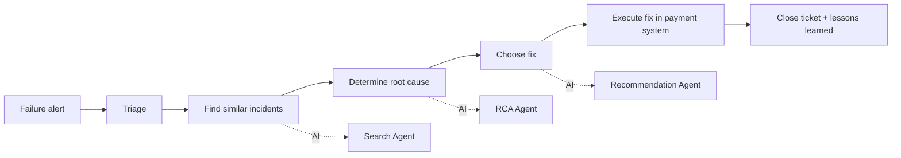
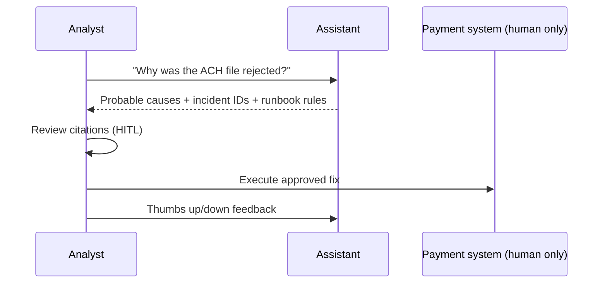

# 02 - Phase B: Business Architecture

## Capability map (current vs target)
| Capability | Current | Target | AI role |
|---|---|---|---|
| Incident triage | Manual ticket search | Similar-incident search with filters | Search Agent |
| Root cause analysis | Analyst experience, tribal knowledge | Evidence-cited probable causes | RCA Agent |
| Corrective action | Runbook lookup | Cited, rule-aware actions | Recommendation Agent |
| Trend monitoring | Spreadsheet at month-end | On-demand, numeric trends | Trend Agent (pandas) |
| Leadership reporting | Hand-written | Role-tailored summaries | Summary Agent |
| Control and audit | Ticket history | Audit log of every question and citation | Platform |

## Value stream: "Resolve a payment failure"

AI is inserted in C, D, E only. Step F stays human, in the systems of record.

## Process flows
**As-is:** analyst searches tickets by keyword, reads reports, asks colleagues, interprets runbook, writes up. 
**To-be:**

## Actors, roles, organization impact
| Actor | Role key | Impact |
|---|---|---|
| Payment ops analyst | `payment_analyst` | Less searching, more verifying |
| Operations manager | `operations_manager` | Trend visibility, fewer repeats |
| Executive | `executive` | Self-serve summaries; trend/summary only |
| Internal auditor | `auditor` | Evidence queries; no recommendations |
| Contracted IT support | `support_engineer` | Technical RCA, amounts masked |
No headcount change; analyst time shifts to verification. New role: AI Lead / prompt owner (0.5 FTE).

## Business use cases
| ID | Use case | Actor | Result |
|---|---|---|---|
| UC-1 | Explain a failure | Analyst | Ranked causes with IDs |
| UC-2 | Recommend actions | Analyst/Manager | Numbered actions citing rules |
| UC-3 | Check a trend | Manager/Exec | Numbers from pandas + narrative |
| UC-4 | Leadership summary | Exec | Executive-style summary |
| UC-5 | Evidence lookup | Auditor | Matching incidents |
| UC-6 | Technical RCA without amounts | Contractor | Masked answer |

## Business rules
| ID | Rule |
|---|---|
| BR-1 | The assistant is read-only; action commands are refused, process questions answered |
| BR-2 | Roles may run only their permitted intents |
| BR-3 | Amounts are shown only to roles with `can_view_amounts` |
| BR-4 | Bank numbers, emails and phones are never echoed |
| BR-5 | Every number and incident ID in an answer must exist in the evidence |
| BR-6 | Auditor role gets no recommendations (independence) |

## Human-in-the-loop and escalation
| Point | Human | Trigger |
|---|---|---|
| Acting on advice | Analyst | Always - AI is advisory |
| Low-confidence / fallback answer | Analyst | Answer flagged "fallback" or caveat shown |
| Guardrail denial | Manager | User needs a capability outside role - request via Security |
| Negative feedback cluster | AI Lead | >= 3 thumbs-down on one intent per week |
| Sev1 incident | On-call | Never delegated to AI |

## Gap analysis
| Baseline | Target | Gap |
|---|---|---|
| Static demo keys | SSO group-to-role mapping | Integration + role governance |
| Manual file drop | Scheduled ITSM/monitoring ingestion | Connector + schedule |
| Local 3B model, ~150 s | Hosted model, p95 <= 20 s | Model hosting + prompt tuning |
| Synthetic 60 incidents | Thousands, multi-year | Index scaling, dedup |
| Single-turn | Multi-step investigation | Checkpointer (Phase 2) |

## Open questions
Which process owner signs off BR-6? Are Sev1 incidents allowed in the corpus?
