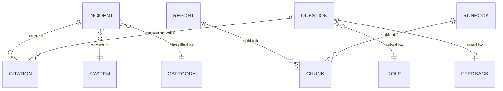
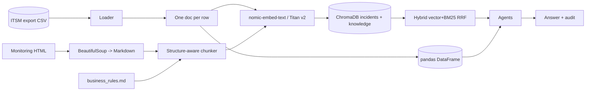
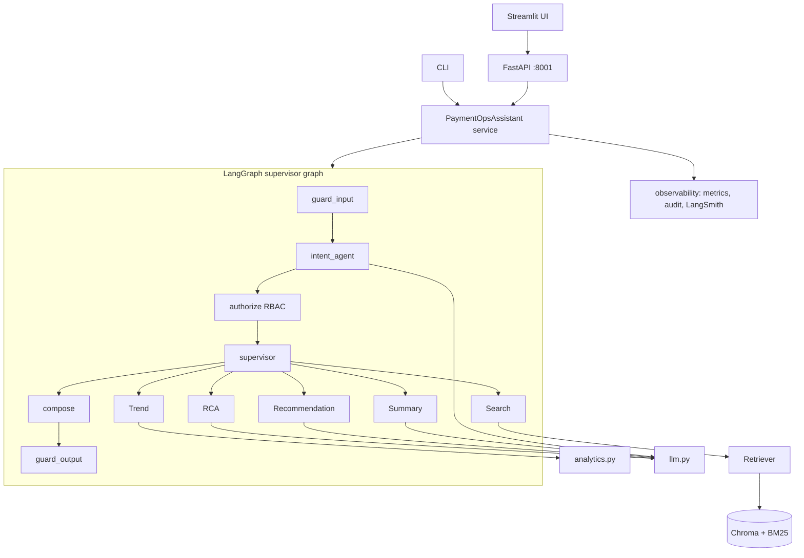
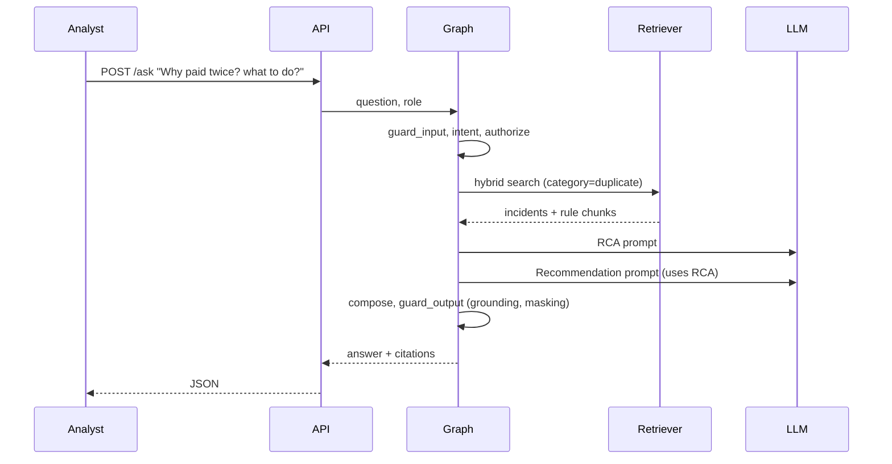

# 03 - Phase C: Information Systems Architecture

## 03a - Data architecture

### Conceptual model

### Logical / physical model
| Entity | Key attributes (from `incidents.csv`) | Physical store |
|---|---|---|
| Incident | id `PAY-INC-*`, month, system, payment type, category, severity, root cause, resolution, amount, MTTR | Chroma collection `incidents` (document = row text; columns = metadata); source of truth stays in ITSM |
| Knowledge chunk | doc id, section, doc_type (report / rule), header `Title (ID) > Section`, text | Chroma collection `knowledge` |
| Audit event | ts, role, question (redacted), intent, plan, citations, guardrail flags, latency | `logs/audit.jsonl` -> S3 + OpenSearch (target) |
| Feedback | run_id, score | LangSmith + audit log |
| Index fingerprint | embedding model + chunk settings | Chroma metadata; triggers rebuild |

### Sources, lineage and flow

### Data for AI
| Item | Design |
|---|---|
| Training / fine-tuning | None. No model is trained; prompts + retrieval only |
| RAG corpus | 60 incidents, 3 reports, 1 runbook (prototype); target several thousand incidents, ~100 reports |
| Chunking | Incident = 1 chunk; reports: never cross a section, tables whole (<= 2,500 chars), 800-char target, 100 overlap for long paragraphs |
| Embeddings | `search_document:` / `search_query:` prefixes (nomic); cosine; Titan Text Embeddings v2 on AWS |
| Metadata | category, system, severity, month, amount, doc_type |
| Retrieval | Hybrid vector + BM25 with reciprocal rank fusion, k=6 (sweep in `docs/DESIGN.md`) |
| Refresh | Nightly incremental ingest (ESTIMATE target); fingerprint mismatch triggers full rebuild |

### Quality, governance, privacy, security
| Topic | Rule |
|---|---|
| Quality | Required columns present; severity in {Sev1..Sev4}; MTTR numeric; duplicate IDs rejected; failed rows logged, not silently dropped |
| Classification | Incidents = Confidential; amounts = Restricted; reports = Internal; runbook = Internal |
| PII | Account/routing numbers, emails, phones redacted at ingest (target) and on input/output (exists) |
| Retention | Corpus: life of incident + 7 yrs (A: SOX); audit log 7 yrs; prompts/answers in traces 90 days |
| Encryption | TLS 1.2+ in transit; S3/EBS/OpenSearch encrypted with KMS CMK |
| Access | SSO group -> role; index access only from the API service role |

## 03b - Application architecture

### Component model

### AI architecture
| Topic | Decision |
|---|---|
| Model | Reasoning: Claude on Bedrock (target; see ADR-PAY-02) / `llama3.2` local for dev. Embeddings: Titan v2 / `nomic-embed-text` |
| Prompts | One template per agent in code, versioned in Git; prompt registry in Phase 2 (file 10) |
| RAG | Hybrid retrieval + category filter; contextual headers |
| Agents/tools | Deterministic plan per intent; tools = retriever, pandas analytics |
| Guardrails | Input: injection, action commands, PII. Output: numeric + incident-ID grounding, amount masking |
| Fallback | Keyword intent classifier; extractive RCA/recommendation; analytics table without narration |
| Caching | Semantic cache of (normalized question, role, index version) for 15 min (target); embedding cache |

### API catalog
| Endpoint | Method | Auth | Purpose |
|---|---|---|---|
| `/ask` | POST | `X-API-Key` (SSO JWT target) | Question -> answer, citations, outcome, run_id |
| `/feedback` | POST | same | Score a run_id |
| `/roles` | GET | none/admin | Role definitions |
| `/metrics` | GET | network-restricted | Prometheus text |
| `/metrics/summary` | GET | admin | JSON view |
| `/health` (target) | GET | none | Liveness/readiness |
Contract: `/ask` returns `outcome` in {answered, denied, blocked, fallback}; denied includes allowed intents.

### Integration patterns
Batch file/API pull from ITSM and monitoring (scheduled), OIDC for identity, OTLP/Prometheus for telemetry, REST for UI/backends.

### Top-5 journeys

Other journeys (compact): **J2 Trend** (intent -> Trend -> pandas -> narrate -> numeric grounding); **J3 Exec summary** (Trend -> Summary, executive style); **J4 Denied** (executive asks RCA -> authorize returns `denied` + allowed intents, no LLM call); **J5 Blocked** ("release this payment" -> guard_input refuses, audit logs guardrail category).

### Gap analysis
SSO/JWT; `/health`; persistent managed vector store; scheduled ingest; semantic cache; prompt registry; async job pattern for long runs.

## Open questions
OpenSearch vs pgvector vs Chroma server for the index (ADR-PAY-03)? Is vendor name PII for tokenization?
