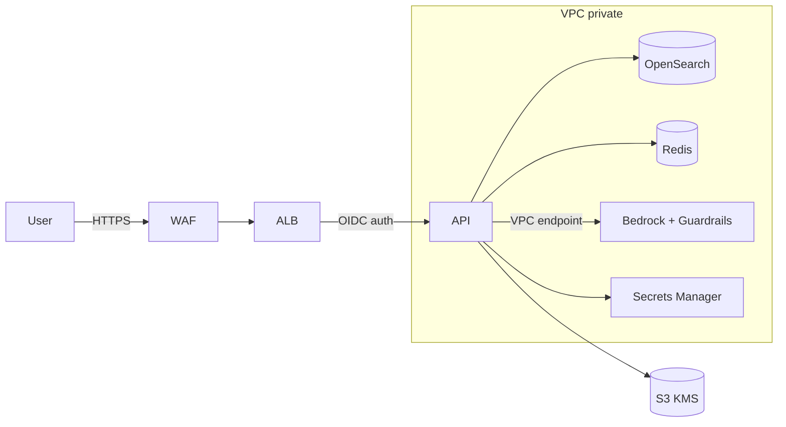
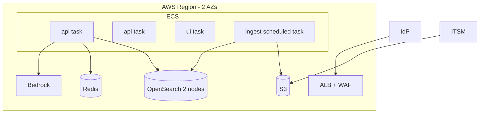

# 04 - Phase D: Technology Architecture

Target cloud: **AWS** (A-03). All sizing numbers are **ESTIMATE**.

## Infrastructure
| Layer | Choice |
|---|---|
| Compute | ECS Fargate: `api` (FastAPI, 2 vCPU/4 GB, 2-4 tasks), `ui` (Streamlit, 1 vCPU/2 GB, 2 tasks), `ingest` (scheduled task). No GPU: model served by Bedrock |
| Vector / search | OpenSearch Service (hybrid kNN + BM25) 2 x `m6g.large` (ADR-PAY-03) |
| Storage | S3 (raw exports, audit archive), EBS for OpenSearch |
| Cache | ElastiCache Redis (semantic + embedding cache) `cache.t4g.small` |
| Queue | SQS for ingest jobs and async long questions |
| Network | VPC, 2 AZs, private subnets for tasks, VPC endpoints for Bedrock/S3/Secrets, ALB + WAF, API Gateway not required (ALB sufficient) |
| Identity | Corporate IdP (OIDC) via ALB authentication; group claim -> role |

## Environments
| | Dev | Test | Staging | Prod |
|---|---|---|---|---|
| Data | Synthetic | Synthetic + masked sample | Masked prod copy | Real |
| Model | Ollama / Haiku-class | Bedrock small | Prod model | Prod model |
| Scale | 1 task, 1 OS node | 1 task | prod-like, 2 tasks | 2-4 tasks, 2 OS nodes |
| Guardrail strictness | Same | Same | Same | Same + alerts |
| Access | Developers | QA | QA + product | End users via SSO |

## Security architecture

IAM: task roles least privilege (invoke specific Bedrock models, read specific S3 prefixes). Secrets in Secrets Manager (LangSmith key). KMS CMK for S3/OpenSearch/EBS. Network zones: public (ALB), app (tasks), data (OpenSearch). WAF: managed rules + rate limit 60 req/min/IP.

## Observability
| Signal | Tool | Items |
|---|---|---|
| Logs | CloudWatch Logs (JSON) | request, guardrail events; audit log -> S3 |
| Metrics | Prometheus-format `/metrics` -> AMP/Grafana | existing `payops_*` metrics |
| Traces | LangSmith (or OTel) | per-node latency, tokens, retrieval |
| LLM monitoring | LangSmith + CloudWatch | latency, input/output tokens, cost per role, groundedness flags rate, intent fallback rate, thumbs ratio |

## HA / DR
| Item | Target (ESTIMATE, to be agreed) |
|---|---|
| Availability SLO | 99.5% business hours |
| RTO / RPO | 4 h / 24 h (index is rebuildable from S3 in ~1 h; audit logs replicated) |
| Backup | OpenSearch snapshots daily to S3; S3 versioning |
| Topology | Multi-AZ; DR region cold standby (IaC redeploy) |

## Capacity and sizing (ESTIMATE)
| Input | Value | Basis |
|---|---|---|
| Users | 40 | A-01 |
| Questions/day | 300 | 40 users x ~7.5 |
| Peak concurrency | 10 | 3% of daily in busiest 5 min x 40 s avg call |
| Tokens per question | 6,000 in / 600 out | RCA+Rec: 2 LLM calls with 6 chunks each |
| Corpus | 5,000 incidents x ~1 KB + 100 reports x 20 chunks = ~7,000 vectors x 1,024 dim x 4 B = ~29 MB | Trivial; OpenSearch is chosen for ops features, not size |
| API tasks | 10 concurrent x 1 task/4 concurrent -> 3 tasks | I/O bound, LLM wait |

## Deployment diagram

## Technology standards and alternatives
| Area | Choice | Alternatives rejected |
|---|---|---|
| Orchestration | LangGraph | Hand-rolled loop (no checkpointing), CrewAI (less deterministic) |
| Vector | OpenSearch | Chroma server (no managed HA), pgvector (weak BM25 hybrid), Pinecone (new vendor + data egress) |
| LLM | Bedrock Claude | OpenAI (extra vendor / data path), self-hosted Llama on GPU (cost, ops) |
| Hosting | ECS Fargate | EKS (overkill for 3 services), Lambda (cold starts, long calls) |
| IaC | Terraform | CloudFormation/CDK (team skill) |

## Open questions
Is the bank's approved region fixed? Is AWS the mandated cloud? Is a managed Grafana available?
