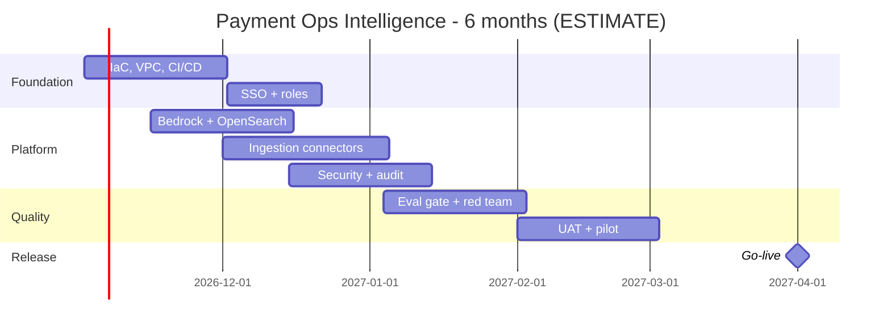

# 06 - Phase F: Migration / Delivery Planning

All figures are **ESTIMATE**. Rates are placeholders (A-04) - replace with finance rates.

## Team and allocation (FTE by phase)
| Role | Build (m1-4) | Harden (m5-6) | Run (m7+) | Notes |
|---|---|---|---|---|
| Product owner | 0.5 | 0.5 | 0.2 | Ops manager delegate |
| Architect | 0.5 | 0.25 | 0.1 | |
| AI/ML engineers | 2 | 1.5 | 0.5 | Agents, eval, prompts |
| Backend | 1 | 0.5 | 0.25 | API, ingestion |
| Frontend | 0.5 | 0.25 | 0.1 | Streamlit/UI polish |
| Data engineer | 1 | 0.5 | 0.25 | Connectors, index |
| DevOps/MLOps | 1 | 0.5 | 0.5 | IaC, CI/CD |
| QA | 1 | 1 | 0.25 | |
| Security | 0.25 | 0.25 | 0.1 | |
| UX | 0.25 | 0.1 | 0 | |
| **Total** | **8.0** | **5.35** | **2.05** | |

Skills gaps: Bedrock/Guardrails (medium), OpenSearch hybrid search (medium), LLM evaluation with strong judges (medium), payments domain (covered by ops SMEs).

## Cost (USD, ESTIMATE)
**People:** FTE-months x rate. Build 8.0 x 4 = 32 FM; harden 5.35 x 2 = 10.7 FM; total 42.7 FM x USD 12,000 blended/month (A-04) = **USD 512k** one-time.
Run: 2.05 FTE x 12,000 = USD 24.6k/month.

**Infrastructure monthly (prod; ESTIMATE, list prices vary by region):**
| Item | Sizing | USD/month |
|---|---|---|
| ECS Fargate | 3 api + 2 ui tasks ~ 5 x (1.5 vCPU, 3 GB) avg | 250 |
| OpenSearch | 2 x m6g.large + 100 GB | 400 |
| Redis | t4g.small | 30 |
| S3, CloudWatch, KMS, ALB, WAF, NAT/endpoints | | 350 |
| LangSmith (team) | | 100 |
| **Prod subtotal** | | **1,130** |
| Dev + test + staging | ~ 0.5x prod combined | 570 |
| **Infra total** | | **~1,700** |

**LLM usage:** requests/month = 300 x 22 = 6,600. Input 6,000 tokens -> 39.6M tokens; output 600 -> 3.96M. At ASSUMED USD 3 / 1M input and 15 / 1M output (verify current Bedrock pricing): 39.6 x 3 + 3.96 x 15 = 118.8 + 59.4 = **~USD 178/month**. Embeddings (Titan v2, ~5M tokens/month incl. re-ingest at ASSUMED 0.02 per 1M) < USD 1. RAGAS judge runs in CI: ~USD 50/month.

| TCO | 12 months | 3 years |
|---|---|---|
| Build people (one-time) | 512,000 | 512,000 |
| Run people (m7-12 = 6 x 24.6k; yrs 2-3 = 2 x 12 x 24.6k at 2.05 FTE) | 147,600 | 738,000 |
| Infra (1,700 x 12 / x 36) | 20,400 | 61,200 |
| LLM + eval (230 x 12 / x 36) | 2,760 | 8,280 |
| Licences/tools/security testing (one-time pen test 25k + 6k/yr) | 31,000 | 43,000 |
| Subtotal | 713,760 | 1,362,480 |
| Contingency 15% | 107,064 | 204,372 |
| **TCO** | **~821k** | **~1,567k** |

(The 12-month column includes 6 months of run staffing. The "~USD 0.6M build" in the package index = build people 512k x 1.15 contingency = ~589k.)

One-time: build people, pen test. Recurring: run people, infra, LLM, licences.

Optimisation options: Haiku-class model for intent and Search-only paths (-40% LLM); semantic cache (-20-30% calls); right-size OpenSearch to a single-node + snapshots outside prod (-USD 200/month); stop non-prod nightly.

## Roadmap and schedule

Milestones: M1 environments (wk 4), M2 MVP in staging (wk 12), M3 security sign-off (wk 16), M4 pilot (wk 20), M5 GA (wk 26).
Sprints: 2-week, 13 sprints; S1-2 foundation, S3-6 platform, S7-9 security/eval, S10-11 UAT, S12-13 hardening.
**Critical path:** IdP role mapping -> ITSM connector -> staging ingest -> security review -> pilot.

## Open questions
Are rates and contingency policy per finance? Is the 6-month date fixed (month-end blackout periods)?
