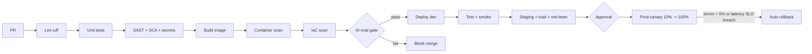

# 10 - CI/CD and MLOps / LLMOps

## Branching and promotion
Trunk-based: short-lived `feature/*` -> PR to `main`. `main` auto-deploys to **dev**; tag `vX.Y.Z` promotes dev -> test -> staging -> prod (manual approval before prod). Prompt and model-config changes are code and go through the same PR + eval gate.

## Pipeline


## Eval gate thresholds (fail the build below)
intent accuracy 0.95, retrieval hit@6 0.95, guardrail precision/recall 1.0, analytics checks 7/7, RAGAS context precision & recall 0.75; nightly (not per PR, cost): faithfulness 0.85 with a Bedrock judge.

## GitHub Actions (CI) - `.github/workflows/ci.yml`
```yaml
name: ci
on:
  pull_request:
  push:
    branches: [main]
permissions:
  contents: read
  id-token: write        # OIDC to AWS
jobs:
  test:
    runs-on: ubuntu-latest
    defaults: { run: { working-directory: 01-payment-ops-intelligence } }
    steps:
      - uses: actions/checkout@v4
      - uses: actions/setup-python@v5
        with: { python-version: "3.12", cache: pip }
      - run: pip install -r requirements.txt ruff pytest pip-audit bandit
      - run: ruff check .
      - run: pytest -q
      - run: bandit -r payops -ll
      - run: pip-audit -r requirements.txt
      - name: Secrets scan
        uses: gitleaks/gitleaks-action@v2
      - name: Eval gate (no LLM)
        run: python -m eval.run_eval --threshold-file eval/thresholds.json   # exits non-zero below threshold (to be added)
      - uses: actions/upload-artifact@v4
        with: { name: eval-results, path: 01-payment-ops-intelligence/eval/results }
  build:
    needs: test
    runs-on: ubuntu-latest
    steps:
      - uses: actions/checkout@v4
      - uses: aws-actions/configure-aws-credentials@v4
        with: { role-to-assume: ${{ secrets.AWS_CI_ROLE }}, aws-region: us-east-1 }
      - uses: aws-actions/amazon-ecr-login@v2
      - run: docker build -t $ECR/payops:${{ github.sha }} 01-payment-ops-intelligence
      - uses: aquasecurity/trivy-action@0.24.0
        with: { image-ref: "${{ env.ECR }}/payops:${{ github.sha }}", exit-code: "1", severity: "CRITICAL,HIGH" }
      - run: docker push $ECR/payops:${{ github.sha }}
  iac:
    runs-on: ubuntu-latest
    steps:
      - uses: actions/checkout@v4
      - uses: aquasecurity/trivy-action@0.24.0
        with: { scan-type: config, scan-ref: infra, exit-code: "1" }
```
Note: `--threshold-file` is a **planned** option of `eval/run_eval.py`, not in the repo yet (story US-PAY-12). Region and ECR variables are placeholders.

## CD (`.github/workflows/cd.yml`, outline)
```yaml
name: cd
on: { push: { tags: ["v*"] } }
jobs:
  deploy:
    strategy: { matrix: { env: [dev, test, staging] } , max-parallel: 1 }
    environment: ${{ matrix.env }}
    runs-on: ubuntu-latest
    steps:
      - uses: actions/checkout@v4
      - run: terraform -chdir=infra/envs/${{ matrix.env }} apply -auto-approve -var image_tag=${{ github.ref_name }}
      - run: python scripts/smoke.py --env ${{ matrix.env }}      # /health, one /ask per role, denied case
  prod:
    needs: deploy
    environment: prod           # required reviewers: Product Owner + Security
    runs-on: ubuntu-latest
    steps:
      - run: aws deploy create-deployment --application-name payops --deployment-config-name CodeDeployDefault.ECSCanary10Percent5Minutes ...
```
`scripts/smoke.py` and `infra/` are to be created (WP1).

## IaC structure (Terraform)
```
infra/
  modules/ network | ecs_service | opensearch | redis | iam | waf | monitoring
  envs/ dev | test | staging | prod   (tfvars + backend state in S3 + DynamoDB lock)
```

## Model, prompt and feature management
| Asset | Versioning | Where |
|---|---|---|
| Prompts | Git (templates in code) -> prompt registry (S3 JSON + hash) in Phase 2; hash logged in each trace | repo |
| Model | `LLM_MODEL_ID` config; change = PR + eval gate + ARB note | env config |
| Embedding model | Index fingerprint; change forces rebuild | Chroma/OpenSearch metadata |
| Index | Snapshot per release; `index_version` in audit | S3 |
| Eval datasets | Git, reviewed by AI Lead | `eval/datasets` |
| Feature flags | AWS AppConfig (semantic cache, recommendation intent per role) | AppConfig |

## Open questions
GitHub vs corporate GitLab/Azure DevOps? If different, the same stages port 1:1.
