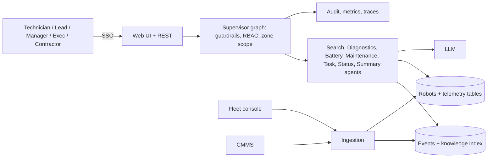

# 01 - Phase A: Architecture Vision

## Problem statement
A warehouse runs 40 autonomous mobile robots (AMRs) across four zones (Z1-Inbound, storage, pick, outbound).
Failures look alike on the fleet console, maintenance is calendar-based instead of condition-based, workload is
uneven, and shift reports are compiled by hand.

## Goals and KPIs
Pilot targets, not prototype results. Baselines to be captured in the first month (ESTIMATE placeholders in brackets).
| ID | Goal | KPI | Baseline | Target |
|---|---|---|---|---|
| G1 | Less unplanned downtime | Unplanned downtime hours / robot / month | TBD | -25% |
| G2 | Replace batteries before failure | Battery-caused stoppages | TBD | -50% |
| G3 | Balance utilisation | Std-dev of robot utilisation per zone | TBD | -20% |
| G4 | Faster diagnosis | Median time from alert to probable cause | TBD (A: 30 min) | -40% |
| G5 | Faster handover | Shift report prep time | TBD (A: 25 min) | <= 5 min |
| G6 | Safe | Safety-bypass advice given | 0 | 0 |

AI quality metrics: intent accuracy >= 90% (prototype keyword fallback 90.5%); retrieval hit@10 >= 0.95; guardrail precision/recall 1.0 (14 cases in prototype); zero ungrounded IDs shown; planted-pattern recall 3/3 in regression data; RAGAS context recall >= 0.9 (prototype 1.0 at k=10).

## Stakeholders and concerns
| Stakeholder | Concern | Influence |
|---|---|---|
| Robotics technicians | Correct diagnosis, fast | High |
| Shift leads | Workload moves they can trust, quick report | High |
| Fleet manager (sponsor) | Downtime, spend | High |
| Site leadership | Concise health view | Medium |
| Safety / EHS | No weakening of safety systems | High (veto) |
| Contract technicians' employer | Scope limited to their zone | Medium |
| IT security | Third-party access, logging | High |

## Scope
| In | Out |
|---|---|
| Diagnostics, navigation/Wi-Fi, battery, predictive maintenance, task rebalancing proposals, status, daily report | Controlling robots (move, reboot, firmware) |
| Zone-scoped RBAC, guardrails, audit, metrics | Real-time collision/safety logic |
| Batch + near-real-time telemetry ingestion | Replacing the fleet console or CMMS |
Constraints: advisory only; safety systems untouchable; contractors limited to Z1-Inbound. Assumptions: A-01 users; fleet console can export events and telemetry via API or file.

## Solution concept

## Statement of Architecture Work
Deliver the architecture and a 6-month plan to move from a static-snapshot prototype to an SSO-integrated, AWS-hosted service with scheduled/near-real-time ingestion, a CI evaluation gate and a safety-governed change process. Sponsor: Fleet Manager. Architecture work: ESTIMATE 3 weeks (EA 1.0 FTE + AI lead 0.5).

## Initial risk register
| ID | Risk | L | I | Mitigation |
|---|---|---|---|---|
| R-FLT-01 | Hallucinated diagnosis (wrong cause among 6 categories) | M | H | Event-ID grounding, first-action from guide, feedback |
| R-FLT-02 | Unsafe advice (bypass safety, restricted zone) | L | Critical | Input + output safety guardrails, red-team set, EHS veto |
| R-FLT-03 | Bias toward frequent event types in retrieval | M | M | Per-event-type eval, filters |
| R-FLT-04 | Contractor sees other zones | L | H | Zone scope in authorize, retrieval and analytics; test per layer |
| R-FLT-05 | Drift: new robot model/firmware changes failure patterns | H | M | Weekly eval, metadata filters on model/firmware, taxonomy review |
| R-FLT-06 | Stale telemetry gives wrong risk ranking | M | H | Show data timestamp; refuse if older than freshness limit |
| R-FLT-07 | Vendor lock-in | M | M | `llm.py` abstraction |
| R-FLT-08 | Overtrust: lead moves tasks without checking | M | M | Proposals show reasons and constraints; approval step |

## Open questions
Baseline downtime numbers; telemetry cadence of the fleet console; whether EHS accepts advisory output at all in the control room.
