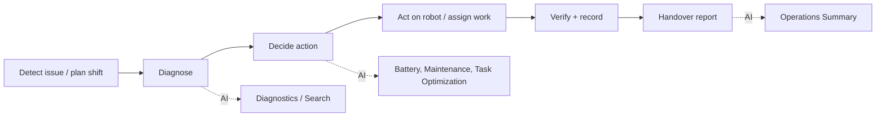
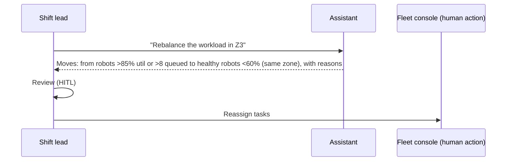

# 02 - Phase B: Business Architecture

## Capability map
| Capability | Current | Target | AI role |
|---|---|---|---|
| Fault diagnosis | Console alarms + tech experience | Evidence-based probable cause + first action | Diagnostics Agent |
| Network/navigation troubleshooting | Ad hoc | Searchable history by zone/error code | Fleet Search |
| Battery lifecycle | Scheduled swaps | Condition-based (slope, cycles, health) | Battery Agent |
| Maintenance planning | Calendar | Risk-ranked | Predictive Maintenance Agent |
| Workload balancing | Manual by lead | Proposed moves within zone | Task Optimization Agent |
| Fleet visibility | Console | Status by zone on demand | Fleet Status |
| Shift handover | Hand-written | Auto daily report | Operations Summary |

## Value stream: "Keep the fleet productive"

Step D stays human, done in the fleet console/CMMS.

## Process: as-is vs to-be (rebalance workload)

As-is: lead scans console, uses judgement. To-be: rule-based proposals with reasons; lead approves.

## Actors and organization impact
| Actor | Role key | Scope | Impact |
|---|---|---|---|
| Maintenance technician | `technician` | All zones | Faster diagnosis, proactive jobs |
| Shift lead | `shift_lead` | All zones | Rebalancing, daily report |
| Fleet manager | `fleet_manager` | All | Planning, vendor discussions |
| Site executive | `site_executive` | All | Summary, status only |
| Contract technician | `contractor_technician` | **Z1-Inbound only** | Scoped diagnostics |
No headcount change; AI lead / policy owner role at 0.5 FTE.

## Use cases
| ID | Use case | Actor |
|---|---|---|
| UC-1 | Diagnose a robot | Technician |
| UC-2 | Troubleshoot Wi-Fi / navigation in a zone | Technician |
| UC-3 | Find degrading batteries | Technician/Manager |
| UC-4 | Plan proactive maintenance | Technician/Manager |
| UC-5 | Rebalance workload | Shift lead |
| UC-6 | Fleet status | Lead/Exec |
| UC-7 | Daily fleet report | Lead/Exec |
| UC-8 | Zone-limited diagnostics | Contractor |

## Business rules
| ID | Rule |
|---|---|
| BR-1 | Battery: replace if health < 75% or cycles > 1,800; inspect if decline > 0.3%/day |
| BR-2 | Rebalance: sources > 85% utilisation or > 8 queued tasks; targets active, battery > 80%, utilisation < 60%, same zone |
| BR-3 | Risk score combines low health, cycles, PM age, battery decline, recent incidents |
| BR-4 | The assistant never executes or approves actions |
| BR-5 | Safety-system bypass and restricted-zone requests are always refused |
| BR-6 | Contractors see only their zones in answers, retrieval and analytics |

## HITL and escalation
| Point | Human | Trigger |
|---|---|---|
| Any operational change | Shift lead / technician | Always |
| Safety refusal | EHS | Repeated attempts by one user (>= 3/week) reported |
| Low-confidence diagnosis | Senior technician | Fallback outcome or no matching event |
| Critical battery / risk top 3 | Fleet manager | Daily report highlights |
| Robot in restricted area | EHS/control room | Never delegated to AI |

## Gap analysis
| Baseline | Target | Gap |
|---|---|---|
| Static CSV snapshot | Scheduled + near-real-time ingestion | Connectors, freshness checks |
| Demo keys | SSO groups with zone attribute | IdP claim design |
| Greedy rebalancing | Approved, learned weights (target) | Outcome data collection |
| Single-turn | Follow-up questions in a session | Checkpointer |

## Open questions
Is zone a property of the user in the IdP or maintained in the assistant? Who owns BR-2 thresholds?
