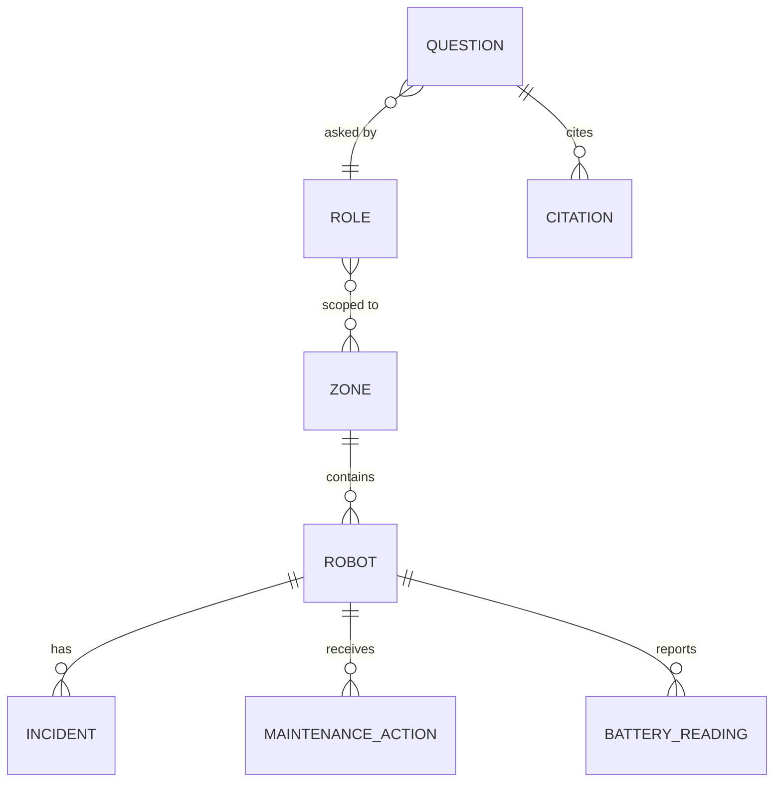
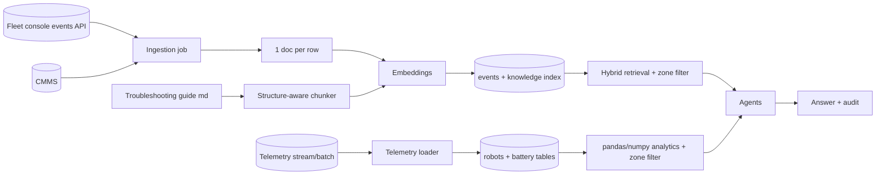
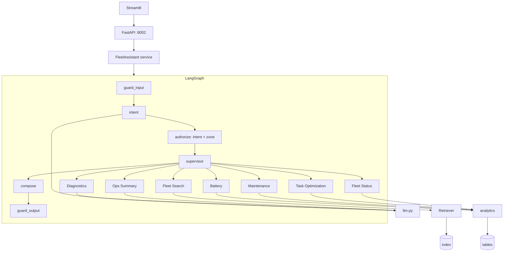
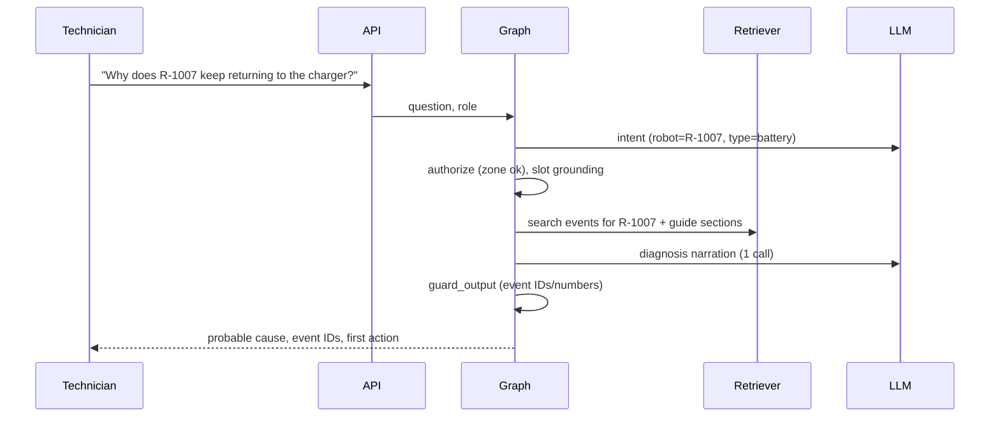

# 03 - Phase C: Information Systems Architecture

## 03a - Data architecture

### Conceptual model

### Logical / physical
| Entity | Attributes (from sample data) | Store | Embedded? |
|---|---|---|---|
| Robot (`robots.csv`, 40) | id, zone, model, firmware, status, utilisation, queue length, battery health, cycles, last PM | Table (pandas -> Postgres/Parquet) | No |
| Battery reading (`battery_telemetry.csv`, 1,200) | robot, date, health %, cycles | Table / S3 Parquet | No |
| Incident (`incidents.csv`, 90) | event id, robot, zone, model, firmware, event type, error code, severity, symptom, root cause, resolution, downtime | Chroma `events` -> OpenSearch | Yes (1 doc/event) |
| Maintenance action (`maintenance_logs.csv`, 60) | id, robot, zone, action, part | `events` | Yes (1 doc/action) |
| Guide chunk | doc id, section, content type (text/table) | `knowledge` | Yes |
| Audit event | ts, role, zones, question (redacted), intent, plan, citations, flags, latency | JSONL -> S3 | No |

### Lineage and flow

### Data for AI
| Item | Design |
|---|---|
| Fine-tuning | None |
| RAG corpus | 90 incidents + 60 maintenance docs + guide (prototype); target 2-3 years history (~5,000 docs, ESTIMATE) |
| Chunking | Row per event; guide sections of 700 chars; the error-code table kept as a single `table` chunk |
| Embeddings | `nomic-embed-text` (local) / Titan v2 (AWS), cosine |
| Metadata | event id, robot, zone, model, firmware, event type, error code, severity; list-valued zone filter |
| Retrieval | Hybrid vector + BM25 (RRF), k=10 (changed from 6 after RAGAS sweep raised context recall from 0.85 to 1.0) |
| Refresh | Events: hourly delta (target); telemetry: every 15 min (ESTIMATE); guide: on change |

### Quality, governance, privacy, security
| Topic | Rule |
|---|---|
| Quality | Telemetry freshness check (answers show "as of"); reject rows with unknown robot id; health 0-100; utilisation 0-100; duplicate event IDs rejected |
| Classification | Incidents, telemetry: Internal; guide: Internal; contractor view: zone-scoped subset |
| PII | Emails/phones in free text redacted on ingest and output |
| Retention | Events/maintenance 5 years (A); telemetry raw 13 months then monthly aggregates; audit 3 years; traces 90 days |
| Encryption | TLS in transit; KMS at rest (S3, RDS, OpenSearch) |
| Access | API role only; zone filter applied in code on every query path |

## 03b - Application architecture

### Components

### AI architecture
| Topic | Decision |
|---|---|
| Model | Bedrock Claude for intent/diagnosis/summary (target); `llama3.2` locally. Only 2 LLM calls per request (intent, final narration) |
| Prompts | Per-agent templates in Git; prompt hash in traces |
| RAG | Hybrid, filters by robot, event type, caller zones |
| Agents | 8; fixed plan per intent (see README table); analytics agents narrate numbers they computed |
| Guardrails | Input: injection, safety override, restricted zone, action commands, PII. Output: ID + number grounding, unsafe-advice withholding. Slot grounding |
| Fallback | Keyword intent; analytics tables without narration; extractive diagnosis (top event root cause) |
| Caching | Analytics results per (zone, 15-min bucket); embedding cache |

### API catalog
| Endpoint | Method | Auth | Purpose |
|---|---|---|---|
| `/ask` | POST | `X-API-Key` -> SSO JWT | Ask; returns answer, outcome, citations, run_id |
| `/feedback` | POST | same | Score a run |
| `/roles` | GET | admin | Roles and zones |
| `/metrics`, `/metrics/summary` | GET | network/admin | Metrics (`fleetops_*`) |
| `/health` (target) | GET | none | Probes |

### Integration patterns
Pull from fleet console (REST/stream) and CMMS (export) via scheduled jobs; OIDC; Prometheus/OTel; optional webhook to shift-handover tool (target).

### Top-5 journeys

Other journeys: **J2 Battery/Predictive** (Battery -> Maintenance agents compute slope/risk -> narrate); **J3 Rebalance** (Status -> Task Optimization -> proposals with reasons); **J4 Daily report** (Status -> Battery -> Maintenance -> Summary); **J5 Contractor denied** (robot outside Z1-Inbound -> `denied` in authorize, no retrieval).

### Gap analysis
SSO + zone claim; live ingestion; managed index; `/health`; session memory; approval workflow for proposals.

## Open questions
Postgres vs Parquet for tables at 5-minute telemetry (ADR-FLT-03)? Is robot ID PII-adjacent under works-council rules (operator linkage)?
