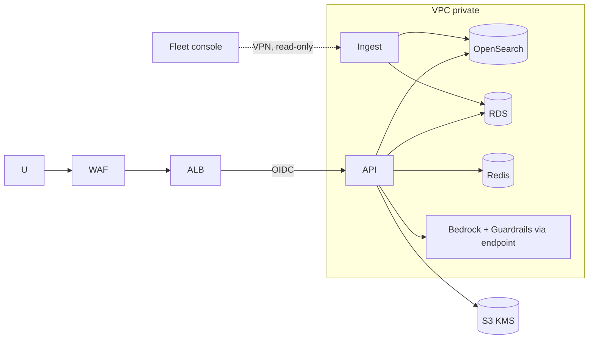
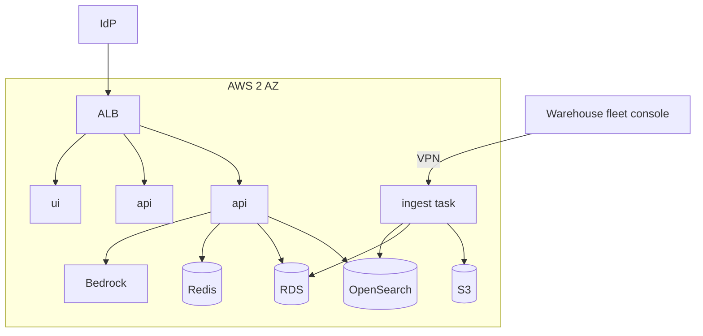

# 04 - Phase D: Technology Architecture

AWS target (A-03). All sizing numbers are **ESTIMATE**.

## Infrastructure
| Layer | Choice |
|---|---|
| Compute | ECS Fargate: `api` (2 vCPU/4 GB, 2-3 tasks), `ui` (1 vCPU/2 GB x2), `ingest` (scheduled), no GPU |
| Search | OpenSearch (hybrid), 2 x `m6g.large` |
| Tables | RDS PostgreSQL `db.t4g.medium` multi-AZ (robots, aggregated telemetry); raw telemetry in S3 Parquet queried by DuckDB/Athena (ADR-FLT-03) |
| Cache | ElastiCache Redis t4g.small (analytics cache) |
| Queue | SQS (ingest jobs) |
| Network | VPC 2 AZs, private subnets, VPC endpoints (Bedrock, S3, Secrets), ALB + WAF |
| Edge connectivity | Site-to-VPN (or Direct Connect) for fleet console export; read-only service account |

## Environments
| | Dev | Test | Staging | Prod |
|---|---|---|---|---|
| Data | Synthetic | Synthetic + replay of masked telemetry | Masked 30-day copy | Live |
| Model | Ollama / small Bedrock | Bedrock small | Prod model | Prod model |
| Scale | 1 task | 1 task | 2 tasks | 2-3 tasks |
| Fleet console link | none | mock | read-only sandbox | read-only prod |

## Security architecture

IAM least privilege per task; Secrets Manager; KMS CMKs; zones: public (ALB), app, data, site-link. WAF rate limit. Contractor identities in a separate IdP group with a `zone` claim.

## Observability
| Signal | Tool | Items |
|---|---|---|
| Logs/audit | CloudWatch -> S3 | request, guardrail events, zone denials |
| Metrics | `/metrics` -> AMP/Grafana | `fleetops_requests_total{intent,role,outcome}`, latency, blocks, fallbacks, feedback |
| Traces | LangSmith | per-agent latency, tokens |
| LLM monitoring | LangSmith + CloudWatch | tokens/request, cost per role, groundedness flags, safety refusals per user, data freshness lag |

## HA / DR
Availability 99.5% (24x7 shifts, so on-call matters; A-05). RTO 2 h / RPO 1 h for tables (RDS PITR), index rebuildable from S3/tables in ~1 h. Multi-AZ; DR region cold standby via IaC. Assistant outage must not affect robot operation (advisory design).

## Capacity (ESTIMATE)
| Input | Value | Basis |
|---|---|---|
| Users / questions | 60 / 250 per day | 4 questions per user per day |
| Peak concurrency | 12 | shift-change 10-minute burst, 20% of daily |
| Tokens/request | 3,500 in / 500 out | only intent + narration calls |
| Telemetry | 40 robots x 1 reading / 5 min = 11,520 rows/day = ~4.2M/yr x ~100 B = ~420 MB/yr | tiny; Postgres fine for aggregates |
| Vectors | ~5,000 x 1,024 x 4 B = ~20 MB | small |
| API tasks | 12 concurrent / 5 per task -> 3 | I/O bound |

## Deployment diagram

## Standards and alternatives
| Area | Choice | Rejected |
|---|---|---|
| Orchestration | LangGraph | Custom loops, CrewAI |
| Time series | Postgres + S3 Parquet | InfluxDB/Timestream (extra stack for 420 MB/yr), embedding telemetry (numbers must be exact) |
| Search | OpenSearch | Chroma server, pgvector |
| LLM | Bedrock Claude | Self-hosted on GPU |
| Hosting | ECS Fargate | EKS, Lambda |
| IaC | Terraform | CDK |

## Open questions
Is a site VPN available? Is cloud hosting acceptable to the site's OT security policy (data is IT-side, read-only)?
