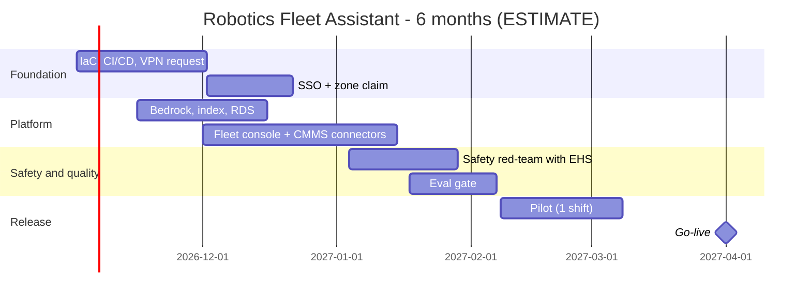

# 06 - Phase F: Migration / Delivery Planning

All figures **ESTIMATE**; rates are placeholders (A-04).

## Team (FTE by phase)
| Role | Build (m1-4) | Harden (m5-6) | Run (m7+) |
|---|---|---|---|
| Product owner (Fleet Manager delegate) | 0.5 | 0.5 | 0.2 |
| Architect | 0.5 | 0.25 | 0.1 |
| AI/ML engineers | 2 | 1.5 | 0.5 |
| Backend | 1 | 0.5 | 0.25 |
| Frontend | 0.5 | 0.25 | 0.1 |
| Data engineer | 1.5 | 0.5 | 0.25 |
| DevOps/MLOps | 1 | 0.5 | 0.5 |
| QA | 1 | 1 | 0.25 |
| Security | 0.25 | 0.25 | 0.1 |
| UX | 0.25 | 0.1 | 0 |
| Safety/EHS reviewer | 0.1 | 0.1 | 0.05 |
| **Total** | **8.1** | **5.45** | **2.25** |

Skill gaps: telemetry pipelines (medium), OT/IT networking (medium), safety-case writing (EHS).

## Cost (USD, ESTIMATE)
**People:** build 8.1 x 4 = 32.4 FM; harden 5.45 x 2 = 10.9 FM; 43.3 FM x 12,000 = **USD 519.6k**. Run: 2.25 x 12,000 = 27k/month.

**Infrastructure monthly (prod):**
| Item | Sizing | USD |
|---|---|---|
| ECS Fargate | ~5 task-equivalents | 250 |
| OpenSearch | 2 x m6g.large + 100 GB | 400 |
| RDS PostgreSQL | t4g.medium multi-AZ | 130 |
| Redis | t4g.small | 30 |
| S3, CloudWatch, KMS, ALB, WAF, VPN | | 330 |
| LangSmith | | 100 |
| **Prod** | | **1,240** |
| Non-prod (0.5x) | | 620 |
| **Total** | | **~1,860** |

**LLM usage:** requests/month = 250 x 30 = 7,500 (24x7 shifts). Input 3,500 -> 26.25M tokens; output 500 -> 3.75M. At ASSUMED USD 3 / 15 per 1M: 26.25 x 3 + 3.75 x 15 = 78.75 + 56.25 = **~USD 135/month**. Embeddings < USD 1. CI judge ~USD 50/month.

| TCO | 12 months | 3 years |
|---|---|---|
| Build people | 519,600 | 519,600 |
| Run people (12 mo: 6 x 27k; 3 yr: 6 x 27k + 24 x 27k) | 162,000 | 810,000 |
| Infra (1,860 x 12 / x 36) | 22,320 | 66,960 |
| LLM + eval (185 x 12 / x 36) | 2,220 | 6,660 |
| Tools, VPN setup, pen test | 30,000 | 42,000 |
| Subtotal | 736,140 | 1,445,220 |
| Contingency 15% | 110,421 | 216,783 |
| **TCO** | **~846.6k** | **~1,662k** |

One-time: build people, VPN setup, pen test. Recurring: run people, infra, LLM, tools.
Optimisation: cache analytics per 15-min bucket (fewer pandas runs, not LLM cost); smaller model for intent; single-AZ non-prod; scale Fargate to zero off-shift for UI in non-prod.

## Roadmap

Milestones: M1 env (wk 4), M2 MVP staging (wk 12), M3 EHS+security sign-off (wk 16), M4 pilot (wk 20), M5 GA (wk 26). 13 two-week sprints.
**Critical path:** VPN/console access -> connectors -> staging with real data -> EHS sign-off -> pilot.

## Open questions
Rate card; whether 24x7 support is needed from day one; pilot shift selection.
