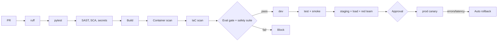

# 10 - CI/CD and MLOps / LLMOps

## Branching and promotion
Trunk-based; `feature/*` -> PR -> `main` auto-deploys to dev; tag `vX.Y.Z` promotes dev -> test -> staging -> prod (approval by Product Owner + Security; **EHS approval** if guardrail or safety files changed - enforced by CODEOWNERS on `fleetops/guardrails.py` and `eval/datasets/guardrails*`).

## Pipeline


## Eval gate (fails the build)
Guardrail precision/recall = 1.0 (safety cases: any miss blocks); intent accuracy >= 0.90; hit@10 >= 0.95; planted-pattern analytics 3/3; analytics vs independent calc equal; RAGAS context precision/recall >= 0.85/0.95. Nightly: faithfulness >= 0.85 (Bedrock judge).

## GitHub Actions - `.github/workflows/ci.yml`
```yaml
name: ci-fleetops
on:
  pull_request:
    paths: ["02-robotics-fleet-assistant/**"]
  push:
    branches: [main]
permissions: { contents: read, id-token: write }
jobs:
  test:
    runs-on: ubuntu-latest
    defaults: { run: { working-directory: 02-robotics-fleet-assistant } }
    steps:
      - uses: actions/checkout@v4
      - uses: actions/setup-python@v5
        with: { python-version: "3.12", cache: pip }
      - run: pip install -r requirements.txt ruff pytest pip-audit bandit
      - run: ruff check .
      - run: pytest -q                       # 25 tests, no model needed
      - run: bandit -r fleetops -ll
      - run: pip-audit -r requirements.txt
      - uses: gitleaks/gitleaks-action@v2
      - name: Eval gate (no LLM)
        run: python -m eval.run_eval --threshold-file eval/thresholds.json   # planned option (US-FLT-16)
      - uses: actions/upload-artifact@v4
        with: { name: eval, path: 02-robotics-fleet-assistant/eval/results }
  image:
    needs: test
    runs-on: ubuntu-latest
    steps:
      - uses: actions/checkout@v4
      - uses: aws-actions/configure-aws-credentials@v4
        with: { role-to-assume: "${{ secrets.AWS_CI_ROLE }}", aws-region: us-east-1 }
      - uses: aws-actions/amazon-ecr-login@v2
      - run: docker build -t $ECR/fleetops:${{ github.sha }} 02-robotics-fleet-assistant
      - uses: aquasecurity/trivy-action@0.24.0
        with: { image-ref: "${{ env.ECR }}/fleetops:${{ github.sha }}", exit-code: "1", severity: "CRITICAL,HIGH" }
      - run: docker push $ECR/fleetops:${{ github.sha }}
```
`--threshold-file`, `infra/` and smoke scripts are **to be created**; region/ECR values are placeholders.

## CD outline
Tag-triggered workflow: matrix dev -> test -> staging with `terraform apply -var image_tag=...` and a smoke script (health, one question per role, one zone-denied, one safety-blocked); prod job uses a protected environment and ECS canary 10% for 5 min with CloudWatch alarm rollback (5xx > 5%, p95 > 30 s).

## IaC layout
```
infra/ modules: network ecs_service opensearch rds redis iam waf monitoring vpn
      envs: dev test staging prod (S3 state + DynamoDB lock)
```

## Model, prompt, policy versioning
| Asset | Versioning |
|---|---|
| Prompts | Git; hash in trace; prompt registry (Phase 2) |
| Model ID | Config; change via PR + eval + ARB |
| **Policy thresholds** (battery, utilisation) | `policy.yaml` in Git (to be extracted from code); change needs Fleet Manager approval and re-run of planted-pattern tests |
| Embedding model / index | Fingerprint; snapshot per release |
| Eval datasets | Git, AI Lead review; safety set co-owned by EHS |
| Flags | AppConfig: per-role intents, rebalancing proposals, report scheduler |

## Open questions
Is GitHub the SCM? CODEOWNERS enforcement requires branch protection.
