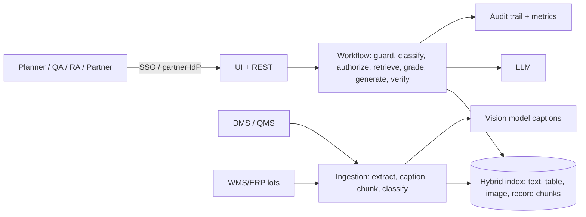

# 01 - Phase A: Architecture Vision

## Problem statement
Supply-chain, quality and regulatory teams need answers from controlled documents in many formats: SOPs (PDF),
deviation reports (Word), supplier status pages (HTML), policy (Markdown), lot data (CSV). Key facts sit in figures
(decision flowcharts, distribution maps, temperature charts) that keyword search cannot read, and confidential
documents must never reach external partners.

## Goals and KPIs
Pilot targets (not prototype results); baselines to be captured in the first month.
| ID | Goal | KPI | Baseline | Target |
|---|---|---|---|---|
| G1 | Faster answers in excursions and inspections | Median time to find an answer in controlled documents | TBD (A: 20 min) | -50% |
| G2 | One search across formats | Share of questions answered without opening >2 documents | TBD | >= 70% |
| G3 | No leakage to partners | Restricted chunks shown to `logistics_partner` | 0 | 0 |
| G4 | Trust | Answers with all citations verifiable | n/a | >= 95% (sampled) |
| G5 | Safe scope | Disposition/medical advice given | 0 | 0 |

AI quality metrics: retrieval hit@6 >= 0.95 (prototype 1.0 on 10 questions); hit rate by source type (text/table/image/record) >= 0.9 each (prototype 1.0); image chunk retrieved for figure questions >= 0.9 (prototype 100%); guardrail precision/recall 1.0 (11 cases); RAGAS context precision >= 0.85; context recall improved from 0.625 (strict reference) via k tuning on GPU/Bedrock; faithfulness >= 0.85 with a strong judge.

## Stakeholders and concerns
| Stakeholder | Concern | Influence |
|---|---|---|
| Quality assurance | Correct citations, controlled-document integrity, validation | High |
| Supply planners | Speed, lane/lot answers | Medium |
| Regulatory affairs | Inspection readiness, audit trail | High |
| Logistics partners (external) | Clear public guidance | Low |
| Security / compliance | Partner leakage, classification | High |
| Supply Chain Head (sponsor) | Excursion response, cost | High |
| IT / DMS owner | Integration, load | Medium |

## Scope
| In | Out |
|---|---|
| Q&A, summarisation, semantic search across PDF/Word/HTML/Markdown/CSV; figure captions; clearance | Quality decisions (release/reject), dosing/medical advice |
| Ingestion from DMS and lot data feeds | Writing to the DMS; creating deviations |
| Audit trail, metrics | Replacing the QMS |
Constraints: validated-state change control; classification enforced before retrieval; partners public only. Assumptions: DMS provides document metadata incl. classification and version.

## Solution concept

## Statement of Architecture Work
Deliver an ADM-aligned architecture and an 8-month plan including computer-system validation, to take the prototype to a validated, AWS-hosted service integrated with the DMS and SSO. Sponsor: Supply Chain Head. Architecture work: ESTIMATE 4 weeks (EA 1.0 FTE, AI lead 0.5, QA/CSV 0.25).

## Initial risk register
| ID | Risk | L | I | Mitigation |
|---|---|---|---|---|
| R-SCK-01 | Hallucinated or mis-cited procedure | M | H | ID/number grounding, citations with section, "not covered" fallback |
| R-SCK-02 | Wrong figure caption (vision model misreads a chart) | M | H | Caption labelled machine-generated, show source image, numeric facts verified against tables where available |
| R-SCK-03 | Confidential data reaches a partner | L | Critical | Clearance before retrieval, same check on `/documents` and `/images`, red-team |
| R-SCK-04 | Bias to well-formatted/long documents | M | M | Source-type hit-rate eval, chunk caps |
| R-SCK-05 | Drift: document versions change; stale index | H | H | Version metadata, effective-date filter, nightly sync, supersede handling |
| R-SCK-06 | Validation overhead delays release | M | M | Risk-based CSA approach, automated test evidence |
| R-SCK-07 | Vendor lock-in | M | M | `llm.py`, Ollama path |
| R-SCK-08 | Prompt injection from document content | M | H | Treat retrieved text as data; injection tests on poisoned docs |

## Open questions
Baseline lookup times; GxP classification outcome; partner identity provider.
