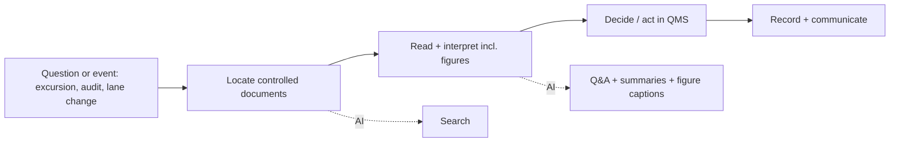
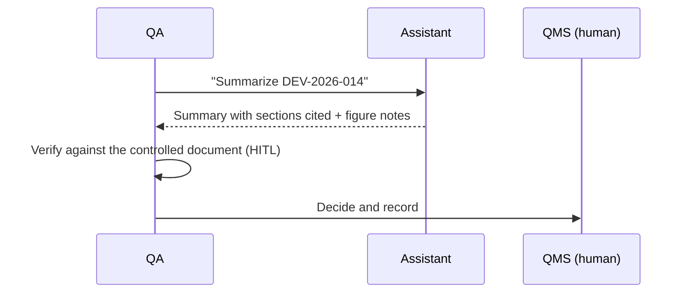

# 02 - Phase B: Business Architecture

## Capability map
| Capability | Current | Target | AI role |
|---|---|---|---|
| Document Q&A | Open files, read, search | Cited answers across formats | QA task |
| Document summarisation | Manual | On-demand structured summary | Summarize task |
| Cross-format search | Per-system search | Semantic + keyword, incl. figures | Search task |
| Figure comprehension | Visual inspection | Captioned, searchable | Vision captions |
| Access control by classification | Folder permissions | Enforced at retrieval | Clearance filter |
| Partner guidance | Email | Self-serve public policies | Partner role |
| Lot lookup | ERP screens | Exact `LOT-` lookup in answers | Record chunks |

## Value stream: "Respond to a supply-chain quality question"

D and E remain human, in the QMS.

## Process flows
As-is: QA opens SOP PDF, deviation Word file, supplier page; reads figures manually; asks colleagues.
To-be:

## Actors and organization impact
| Actor | Role key | Clearance | Tasks |
|---|---|---|---|
| Supply planner | `supply_planner` | internal | qa, search, summarize |
| Quality assurance specialist | `quality_assurance` | confidential | qa, search, summarize |
| Regulatory affairs specialist | `regulatory_affairs` | confidential | qa, search, summarize |
| Logistics partner | `logistics_partner` | public | qa, search |
No headcount change. New: content steward (0.5 FTE) who maintains classification metadata and ingestion exceptions.

## Use cases
| ID | Use case | Actor |
|---|---|---|
| UC-1 | Ask what a policy/SOP requires | Planner, RA |
| UC-2 | Summarise a deviation | QA |
| UC-3 | Ask what a figure shows (e.g. packaging configuration for lane L2) | Planner |
| UC-4 | Look up a lot | Planner, QA |
| UC-5 | Find supplier qualification status | RA |
| UC-6 | Partner transport rules (public) | Partner |

## Business rules
| ID | Rule |
|---|---|
| BR-1 | Role clearance: public < internal < confidential; retrieval returns only documents at or below clearance |
| BR-2 | Partners may use qa and search only |
| BR-3 | No release/reject/quarantine/recall decisions; no medical or dosing advice |
| BR-4 | Every ID (LOT-, SHP-, DEV-, SOP-, CAPA-, SUP-) and number in an answer must exist in retrieved context |
| BR-5 | If accessible documents do not cover the question, say so |
| BR-6 | Only effective document versions are used by default; superseded versions only on explicit request by QA/RA (target) |

## HITL and escalation
| Point | Human | Trigger |
|---|---|---|
| Any quality decision | QA | Always |
| Answer used in a deviation or inspection response | Author | Must verify citation in the DMS (UI reminder) |
| "Not covered" or low-confidence answer | Document owner | Feedback flagged "missing content" |
| Classification dispute | Security + RA | Partner or planner asks about a restricted document |

## Gap analysis
| Baseline | Target | Gap |
|---|---|---|
| Five sample files | DMS sync with versions and effective dates | Connector, supersede logic |
| Demo keys | Corporate SSO + partner federation | IdP integration |
| Folder permissions | Classification metadata from DMS | Label mapping |
| Local vision model | Hosted multimodal model | Provider swap + caption eval |
| No validation | CSV/CSA package | Validation plan, traceability, evidence |

## Open questions
How are partner users provisioned and de-provisioned? Do superseded SOP versions need to remain searchable for inspections?
