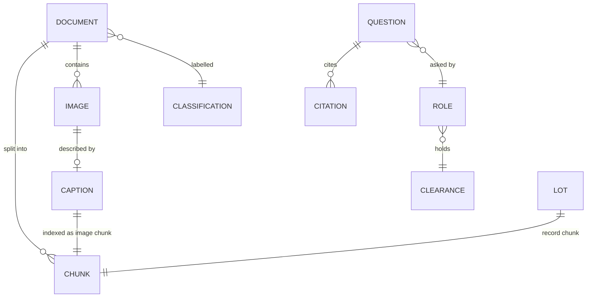
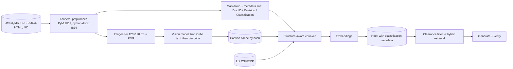
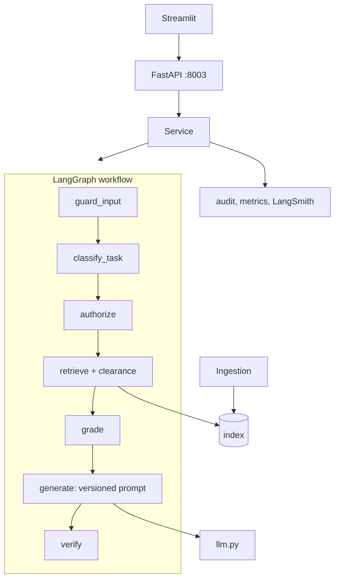
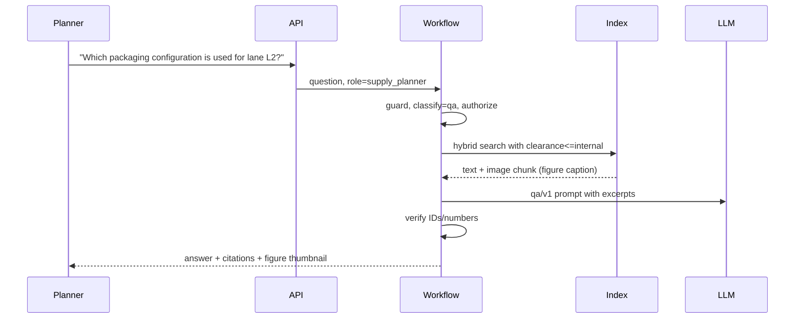

# 03 - Phase C: Information Systems Architecture

## 03a - Data architecture

### Conceptual model

### Logical / physical
| Entity | Attributes | Store |
|---|---|---|
| Document | doc_id, title, revision, classification, source file, effective date (target), status (effective/superseded, target) | Metadata in index + DMS (system of record) |
| Chunk | content_type (text, table, mixed, image, record), section, contextual header, text | Chroma -> OpenSearch |
| Image | image_id, source doc/page, SHA-256, PNG path, `image_path` | S3 (KMS), served by `/images/{id}` after clearance check |
| Caption | image hash, transcription, description, model id | `captions.json` -> DynamoDB/S3 cache keyed by hash |
| Lot record | lot id, product, site, status, storage, etc. (`inventory_lots.csv`, 30 rows in prototype) | `record` chunks |
| Audit event | ts, role, task, query (redacted), docs retrieved, classification levels, citations, flags | JSONL -> S3 (object lock) |

Prototype corpus: 50 chunks = 14 text, 2 table, 1 mixed, 3 image, 30 record.

### Lineage and flow

### Data for AI
| Item | Design |
|---|---|
| Fine-tuning | None |
| RAG corpus | 5 documents + 30 lots in prototype; target ~2,000 controlled documents + 50,000 lot records (ESTIMATE) |
| Chunking | Never cross a section; tables whole up to 2,500 chars (larger split by rows with header repeated); 800-char target, 100 overlap only for long paragraphs; header `Title (doc_id) > Section`; one `record` chunk per CSV row; one `image` chunk per figure under its section |
| Embeddings | `nomic-embed-text` with prefixes (local) / Titan v2 (AWS) |
| Metadata | doc_id, title, section, content_type, classification, revision, source, image path / lot ID |
| Retrieval | Clearance filter before ranking; hybrid vector + BM25 RRF, k=6 (k=10 recommended by RAGAS sweep, +0.018 F1, to apply on GPU/Bedrock); exact `LOT-` lookup |
| Refresh | Event-driven on DMS publish/supersede + nightly reconciliation; captions cached by image hash so unchanged figures are not re-captioned |

### Quality, governance, privacy, security
| Topic | Rule |
|---|---|
| Quality | Document must carry doc_id, revision and classification, otherwise **quarantined from the index** and reported; table extraction verified by row/column count; image minimum size; caption must include a transcription part |
| Classification | public / internal / confidential, from DMS; unknown = confidential (fail closed) |
| PII | Emails/phones redacted in outputs; user questions redacted in audit |
| Retention | Index follows document lifecycle; superseded versions retained per QMS policy (A: 10 years); audit 10 years (A: GxP); traces 90 days |
| Encryption | TLS 1.2+; KMS at rest for S3, OpenSearch; images served via signed, clearance-checked API only |
| Access | Clearance in code on `/ask`, `/search`, `/summarize`, `/documents`, `/images/{id}` |

## 03b - Application architecture

### Components

### AI architecture
| Topic | Decision |
|---|---|
| Models | Answers: Claude on Bedrock (target) / `llama3.2` local. Vision: hosted multimodal model (target) / `gemma3:4b` local. Embeddings: Titan v2 / nomic |
| Prompts | `qa/v1`, `summarize/v1` with `brief`, `detailed`, `executive`; version in every audit line; prompt changes = controlled change |
| RAG | Clearance-first hybrid retrieval; grade step drops weak chunks |
| Agent | Single deterministic workflow; search needs no LLM; QA and summaries use one call |
| Guardrails | Input: injection, forced-restricted-document attempts, medical/dosing, disposition commands. Output: ID/number grounding, PII redaction, "not covered" statement |
| Fallback | Search results only if LLM fails; extractive passage with citation |
| Caching | Caption cache by hash; embedding cache; answer cache keyed by (query, role clearance, index version) |

### API catalog
| Endpoint | Method | Auth | Purpose |
|---|---|---|---|
| `/ask` | POST | `X-API-Key` -> SSO | Cited answer |
| `/summarize` | POST | same | Document summary: brief/detailed/executive |
| `/search` | POST | same | Semantic search, no LLM |
| `/documents` | GET | same | Documents visible to the caller |
| `/images/{id}` | GET | same | Figure, clearance-checked |
| `/feedback` | POST | same | Rating |
| `/roles`, `/health`, `/metrics`, `/metrics/summary` | GET | admin/network | Ops |

### Integration patterns
DMS event + batch reconcile (REST or file drop); ERP lot feed (daily); OIDC for staff, federated partner IdP (SAML/OIDC) with a restricted group; Prometheus/OTel.

### Top-5 journeys

Others: **J2 QA summary** (`/summarize` DEV-2026-014, confidential); **J3 Partner** (cold-chain transport rules, public only; restricted chunk count 0); **J4 Disposition refused** ("release lot LOT-xxx" blocked pre-LLM); **J5 Lot lookup** (exact LOT- match in record chunk, cited).

### Gap analysis
SSO/partner federation; DMS sync with version/effective handling; hosted vision model; managed index; validation package; answer-cache invalidation on supersede; `/images` signed URLs.

## Open questions
Does the DMS expose effective dates and supersede events? Should image captions be reviewed by a human before indexing for GxP-relevant figures?
