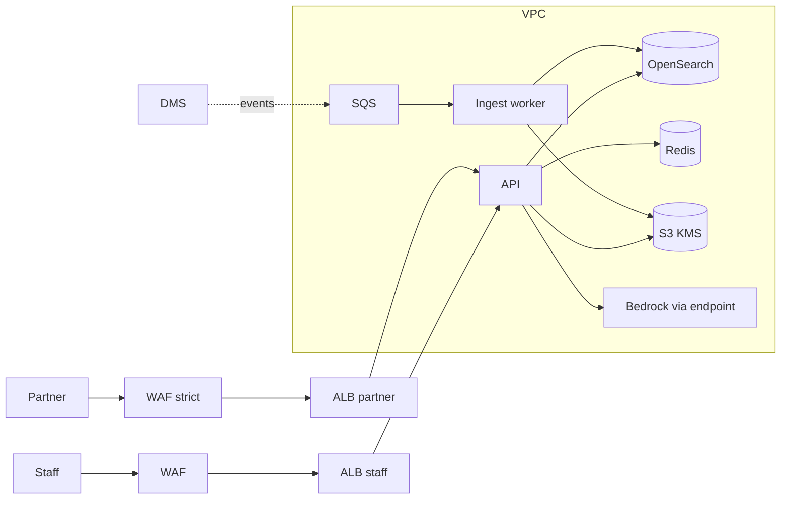
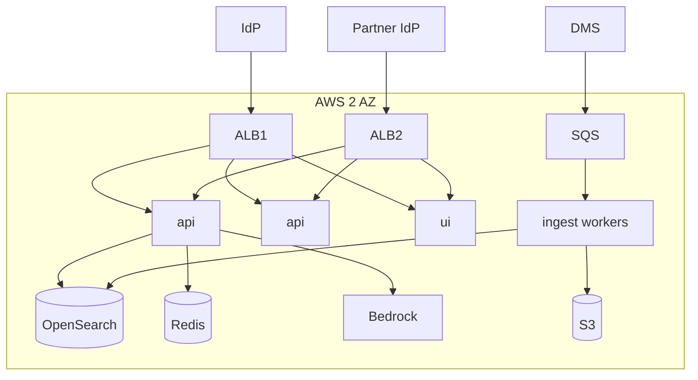

# 04 - Phase D: Technology Architecture

AWS target (A-03). All sizing is **ESTIMATE**.

## Infrastructure
| Layer | Choice |
|---|---|
| Compute | ECS Fargate: `api` (2 vCPU/4 GB, 2-4 tasks), `ui` (1 vCPU/2 GB x2), `ingest-worker` (SQS-driven, 4 vCPU/8 GB, 0-3 tasks, extraction is CPU heavy) |
| GPU | None; captions and answers via Bedrock multimodal/text models |
| Search | OpenSearch 2 x `m6g.large` (hybrid) with document-level security via metadata filter in code |
| Storage | S3: raw documents (versioned), extracted images (KMS), audit (object lock, compliance mode) |
| Cache | ElastiCache Redis (answers, embeddings) |
| Queue | SQS for ingest events, DLQ for failed documents |
| Network | VPC 2 AZ; private subnets; VPC endpoints; ALB + WAF; partner traffic enters via a separate ALB listener/host with stricter WAF rules and rate limits |
| Identity | Corporate IdP (OIDC); partner IdP federation (SAML) mapped to `logistics_partner` |

## Environments
| | Dev | Test | Staging (validation) | Prod |
|---|---|---|---|---|
| Data | Synthetic five documents | Synthetic + generated | Masked/real-like, qualified env | Real |
| Model | Ollama / small Bedrock | Bedrock small | Prod models pinned | Prod models pinned |
| Change control | None | PR | **Validated config baseline**, evidence retained | Validated, CAB |
| Partner access | Mock | Mock | Test partner tenant | Real |

## Security architecture

IAM least privilege; Secrets Manager; KMS CMKs per data class; zones public edge / app / data. Partner role cannot reach `/documents` beyond public docs and cannot call `/summarize`. Audit bucket write-once.

## Observability
| Signal | Tool | Items |
|---|---|---|
| Logs/audit | CloudWatch -> S3 object lock | every request with role, clearance, docs returned |
| Metrics | `/metrics` -> Grafana | `supplykb_*` requests by task/role/outcome, latency, blocks, restricted-chunk count (must be 0 for partner), fallbacks |
| Traces | LangSmith | per-node latency, tokens, retrieved doc IDs |
| LLM monitoring | LangSmith + CloudWatch | tokens, cost, groundedness flags, "not covered" rate, caption failures, index freshness (age of newest document sync) |

## HA / DR
Availability 99.5% business hours + best effort off-hours (A-05). RTO 4 h / RPO 24 h; index rebuildable from S3 (documents + caption cache) in ~2 h (ESTIMATE; re-captioning avoided by cache). Multi-AZ; cold DR region. S3 versioning + cross-region replication for documents and audit.

## Capacity (ESTIMATE)
| Input | Value | Basis |
|---|---|---|
| Users / questions | 150 / 400 per day | ~2.7 questions per user |
| Peak concurrency | 15 | excursion event spike |
| Tokens/request | 5,000 in / 500 out | ~6 chunks x 700 tokens + prompt |
| Corpus | 2,000 docs x ~25 chunks = 50,000 chunks + 50,000 lot records; 100k x 1,024 x 4 B = ~410 MB vectors | OpenSearch fits easily |
| Images | 2,000 docs x 3 figures = 6,000 captions (one-time) | at ~1,500 input tokens (image) + 400 output each |
| Ingest | 5 docs/min per worker | pdf extraction CPU; re-index 2,000 docs in ~7 h on one worker (ESTIMATE) |

Note: the prototype captioned 3 figures in 8.5 minutes on 2 CPU threads (~170 s each); a hosted multimodal model is required for bulk ingestion.

## Deployment diagram

## Standards and alternatives
| Area | Choice | Rejected |
|---|---|---|
| Orchestration | LangGraph single workflow | Multi-agent (adds calls without capability) |
| Document extraction | pdfplumber + PyMuPDF + python-docx | Textract/Document AI (cost, tables ok but figures need separate path); keep as fallback for scanned PDFs |
| Vision | Hosted multimodal via Bedrock | Local gemma3:4b in prod (slow, weaker descriptions) |
| Search | OpenSearch | Chroma server, pgvector, Kendra (less control over classification-first filtering) |
| Hosting | ECS Fargate | EKS, Lambda (PDF extraction time and memory) |
| IaC | Terraform | CDK |

## Open questions
Is a separate AWS account for partner-facing endpoints required? Is OCR for scanned legacy SOPs in scope (Textract)?
