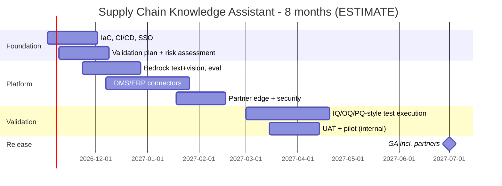

# 06 - Phase F: Migration / Delivery Planning

All figures **ESTIMATE**; rates are placeholders (A-04).

## Team (FTE by phase)
| Role | Build (m1-5) | Validate + harden (m6-8) | Run (m9+) |
|---|---|---|---|
| Product owner | 0.5 | 0.5 | 0.2 |
| Architect | 0.5 | 0.25 | 0.1 |
| AI/ML engineers | 2 | 1.5 | 0.5 |
| Backend | 1 | 0.5 | 0.25 |
| Frontend | 0.5 | 0.25 | 0.1 |
| Data engineer (ingestion, DMS) | 1.5 | 0.75 | 0.25 |
| DevOps/MLOps | 1 | 0.5 | 0.5 |
| QA / test automation | 1 | 1 | 0.25 |
| CSV/validation lead | 0.5 | 1 | 0.1 |
| Security | 0.25 | 0.25 | 0.1 |
| UX | 0.25 | 0.1 | 0 |
| Content steward | 0.25 | 0.5 | 0.5 |
| **Total** | **9.25** | **7.1** | **2.85** |

Skill gaps: document-extraction QA (medium), CSV/CSA for AI (high), vision-model evaluation (medium), partner identity federation (medium).

## Cost (USD, ESTIMATE)
**People:** build 9.25 x 5 = 46.25 FM; validate 7.1 x 3 = 21.3 FM; total 67.55 FM x 12,000 = **USD 810.6k** one-time. Run: 2.85 x 12,000 = 34.2k/month.

**Infrastructure monthly (prod):**
| Item | Sizing | USD |
|---|---|---|
| ECS Fargate (api, ui) | ~5 task-equivalents | 250 |
| Ingest workers | avg 0.5 task-equivalent (4 vCPU) | 150 |
| OpenSearch | 2 x m6g.large + 200 GB | 450 |
| Redis | t4g.small | 30 |
| S3 (documents, images, audit), CloudWatch, KMS, 2 ALB, WAF | | 450 |
| LangSmith | | 100 |
| **Prod** | | **1,430** |
| Non-prod incl. qualified staging (0.7x) | | 1,000 |
| **Total** | | **~2,430** |

**LLM usage:** requests/month = 400 x 22 = 8,800; input 5,000 -> 44M tokens; output 500 -> 4.4M. At ASSUMED USD 3 / 15 per 1M: 44 x 3 + 4.4 x 15 = 132 + 66 = **~USD 198/month**. One-time captioning: 6,000 images x (1,500 in + 400 out) = 9M in + 2.4M out = 27 + 36 = **~USD 63** (re-run on new figures only: ~USD 5/month). Embeddings of 100k chunks x ~300 tokens = 30M tokens at ASSUMED 0.02/1M = USD 0.6. CI judge ~USD 50/month.

| TCO | 12 months | 3 years |
|---|---|---|
| Build + validate people | 810,600 | 810,600 |
| Run people (m9-12: 4 x 34.2k; 3 yr: 4 + 24 months) | 136,800 | 957,600 |
| Infra (2,430 x 12 / x 36) | 29,160 | 87,480 |
| LLM, captions, eval (255 x 12 / x 36 + 63) | 3,123 | 9,243 |
| Tools, pen test, validation tooling | 45,000 | 63,000 |
| Subtotal | 1,024,683 | 1,927,923 |
| Contingency 20% (higher: validation risk) | 204,937 | 385,585 |
| **TCO** | **~1,229.6k** | **~2,313.5k** |

(The package index's "~USD 0.97M build" = build/validate people 810.6k x 1.20 contingency.)

One-time: build/validate people, captioning, pen test, validation tooling. Recurring: run people, infra, LLM.
Optimisation: answer cache (-25% calls); Haiku-class model for search/grade/summaries brief mode; caption cache; single-node non-prod; Savings Plans for Fargate.

## Roadmap

Milestones: M1 env (wk 4), M2 MVP staging (wk 16), M3 security + validation plan approved (wk 18), M4 internal pilot (wk 24), M5 validation report (wk 32), M6 GA (wk 34). 17 two-week sprints.
**Critical path:** DMS metadata/API access -> connectors -> classification verification -> validation execution -> GA.

## Open questions
Rate card and contingency policy; does validation require an independent party; internal-only pilot before partners?
