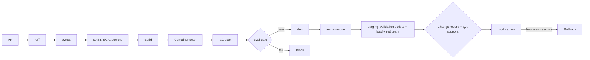

# 10 - CI/CD and MLOps / LLMOps

## Branching and promotion
Trunk-based with release branches for validated baselines. `main` -> dev automatically; tag `vX.Y.Z` -> test -> staging (qualified) -> prod. Prod promotion requires: green eval gate, **linked change record**, validation evidence attached, approval by Product Owner + QA + Security. Prompt, model and classification-logic files are protected by CODEOWNERS (AI Lead + QA).

## Pipeline


## Eval gate (fails the build)
Restricted chunks for partner = 0; guardrail precision/recall = 1.0; hit@6 >= 0.95; source-type hit rates >= 0.9; image-chunk retrieval >= 0.9; extraction tests (table whole/split, image markers) pass. Nightly: faithfulness / groundedness >= 0.85 (Bedrock judge), caption eval >= 95%.

## GitHub Actions - `.github/workflows/ci.yml`
```yaml
name: ci-supplykb
on:
  pull_request:
    paths: ["03-supply-chain-knowledge-assistant/**"]
  push:
    branches: [main]
permissions: { contents: read, id-token: write }
jobs:
  test:
    runs-on: ubuntu-latest
    defaults: { run: { working-directory: 03-supply-chain-knowledge-assistant } }
    steps:
      - uses: actions/checkout@v4
      - uses: actions/setup-python@v5
        with: { python-version: "3.12", cache: pip }
      - run: pip install -r requirements.txt ruff pytest pip-audit bandit
      - run: ruff check .
      - run: pytest -q                      # 18 tests, no model needed
      - run: bandit -r supplykb -ll
      - run: pip-audit -r requirements.txt
      - uses: gitleaks/gitleaks-action@v2
      - name: Eval gate (no LLM)
        run: python -m eval.run_eval --threshold-file eval/thresholds.json   # planned option (US-SCK-12)
      - uses: actions/upload-artifact@v4
        with: { name: eval-and-evidence, path: 03-supply-chain-knowledge-assistant/eval/results }
  image:
    needs: test
    runs-on: ubuntu-latest
    steps:
      - uses: actions/checkout@v4
      - uses: aws-actions/configure-aws-credentials@v4
        with: { role-to-assume: "${{ secrets.AWS_CI_ROLE }}", aws-region: us-east-1 }
      - uses: aws-actions/amazon-ecr-login@v2
      - run: docker build -t $ECR/supplykb:${{ github.sha }} 03-supply-chain-knowledge-assistant
      - uses: aquasecurity/trivy-action@0.24.0
        with: { image-ref: "${{ env.ECR }}/supplykb:${{ github.sha }}", exit-code: "1", severity: "CRITICAL,HIGH" }
      - run: docker push $ECR/supplykb:${{ github.sha }}
```
Threshold file, `infra/`, smoke and validation-evidence scripts are **to be created**; region/ECR values are placeholders.

## CD outline
Tag workflow with matrix dev -> test -> staging running `terraform apply` and `scripts/smoke.py` (one question per role, partner leakage probe, image 403 probe). Prod: protected environment; the job checks that a change-record ID is supplied and the validation evidence artifact exists; ECS canary 10% for 10 minutes, auto-rollback on 5xx > 5%, p95 > 40 s, or `restricted_chunks_partner_total > 0`.

## IaC layout
```
infra/ modules: network ecs_service opensearch redis s3_audit_lock iam waf_staff waf_partner monitoring
      envs: dev test staging prod
```

## Versioning of models, prompts, data
| Asset | Versioning |
|---|---|
| Prompts | `qa/v1`, `summarize/v1` ... in Git; version recorded in each audit line; new version = change record + eval |
| LLM / vision model IDs | Pinned in config; swap = RFC + eval incl. caption eval |
| Embedding model / chunk settings | Index fingerprint; change triggers rebuild; captions reused by hash |
| Index | Versioned alias; blue/green rebuild then alias switch |
| Eval datasets | Git; QA co-owns figure and unanswerable sets |
| Flags | AppConfig: summarize for partners (off), image display, answer cache |

## Open questions
Does QA require a separate validated pipeline tool, or is Git + CI evidence sufficient?
