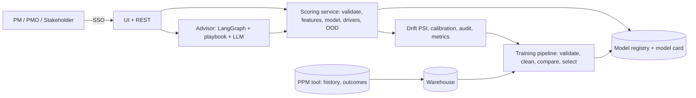

# 01 - Phase A: Architecture Vision

## Problem statement
A PMO receives project proposals and decides which to fund. Decisions depend on the reviewer, so they vary, and
risky projects (low technology readiness, thin resourcing, many dependencies) are approved and then slip. Years of
historical project outcomes exist but are not used.

## Goals and KPIs
Pilot targets, not prototype results.
| ID | Goal | KPI | Baseline | Target |
|---|---|---|---|---|
| G1 | Consistent intake | Agreement between two independent reviewers on go/no-go | TBD | +15 pts |
| G2 | Fewer slipped projects | Share of funded projects delivered on time/within tolerance | TBD | +10 pts after 12 months |
| G3 | Mitigation before kickoff | Funded high-risk projects with an approved mitigation plan | TBD | >= 90% |
| G4 | Faster intake review | Review time per proposal | TBD (A: 2 h) | -40% |
| G5 | Trustworthy model | Calibration error and drift incidents handled | n/a | ECE <= 0.05; no unhandled significant drift |

AI quality metrics (prototype hold-out, synthetic): ROC-AUC 0.874, PR-AUC 0.837, F1 0.739, Brier 0.144; 5-fold CV AUC 0.841. Production gates: ROC-AUC >= 0.80 on a time-based hold-out of real data (ESTIMATE; to be set by Model Risk), Brier <= 0.18, calibration slope 0.9-1.1, no subgroup AUC more than 0.05 below overall. Advisor: numeric grounding violations shown = 0; injection block = 100% on test set.

## Stakeholders and concerns
| Stakeholder | Concern | Influence |
|---|---|---|
| Portfolio director / PMO | Defensible, consistent decisions; threshold control | High |
| Project managers | Fairness, ability to see why; not being gamed | High |
| Data scientists (model owners) | Reproducibility, retraining, monitoring | High |
| Model risk / compliance | Validation, documentation, monitoring | High |
| Executives / stakeholders | Simple score, trust | Medium |
| IT security | Access to financials | Medium |

## Scope
| In | Out |
|---|---|
| Score proposals, drivers, OOD flags, batch intake scoring, drift, retrain with approval, optional advisor | Funding decisions; resource allocation optimisation; replacing PPM tool |
| Model registry and monitoring; outcome feedback | Using personal or protected attributes |
Constraints: interpretable primary model; human decision; no personal data in features. Assumptions: A-01; at least 800 labelled historical projects exist (prototype 1,212 synthetic).

## Solution concept

## Statement of Architecture Work
Deliver the architecture and a 5-month plan to move from a single-machine prototype to a governed ML service: warehouse-fed training pipeline, model registry with approval, monitored serving, outcome feedback and an advisor for mitigation. Sponsor: Portfolio Director. Architecture work: ESTIMATE 2 weeks (EA 1.0 FTE, DS 0.5).

## Initial risk register
| ID | Risk | L | I | Mitigation |
|---|---|---|---|---|
| R-FEA-01 | Advisor hallucination (invented numbers/mitigations) | M | M | Numeric grounding; playbook-only retrieval; labelled as advice |
| R-FEA-02 | Model bias: proxies such as region or type disadvantage some groups | M | H | No protected attributes; subgroup AUC and approval-rate review; threshold review |
| R-FEA-03 | Selection bias: only funded projects have outcomes | H | H | Document; use time-based validation; track rejected-then-self-funded cases; shadow mode first |
| R-FEA-04 | Data leakage/confidentiality of budgets to LLM | L | M | Advisor receives only scores and driver names, not raw proposal text (A) |
| R-FEA-05 | Model drift (portfolio mix changes) | H | M | PSI weekly; calibration on matured outcomes; retrain triggers |
| R-FEA-06 | Gaming: PMs tune inputs to pass | M | M | Audit of changes between predictions; OOD flags; board sees input history |
| R-FEA-07 | Vendor lock-in | L | L | Standard sklearn + joblib/ONNX; LLM abstraction |
| R-FEA-08 | Overreliance on score | M | H | Decision-support framing; mandatory board rationale |

## Open questions
Label definition; baseline reviewer agreement; whether rejected proposals have outcome data.
