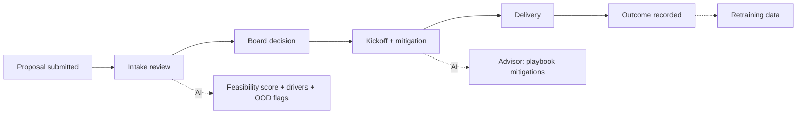
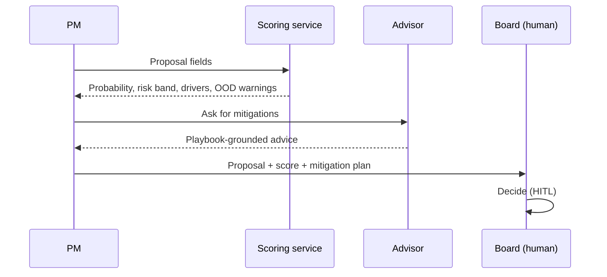

# 02 - Phase B: Business Architecture

## Capability map
| Capability | Current | Target | AI role |
|---|---|---|---|
| Intake screening | Reviewer judgement | Scored with drivers | Classifier |
| Risk mitigation planning | Ad hoc | Playbook-based advice at intake | Advisor |
| Portfolio view | Spreadsheets | Batch scoring of intake pipeline | Batch endpoint |
| Model governance | None | Model card, validation, drift monitoring | MLOps |
| Outcome learning | Not done | Outcomes feed retraining | Pipeline |

## Value stream: "Fund the right projects"

C remains a human board decision.

## Process flows
As-is: reviewers read proposals, score informally, board discusses. To-be:

## Actors and roles
| Actor | Role key | Capabilities |
|---|---|---|
| Project manager | `project_manager` | predict, advise |
| Portfolio director | `portfolio_director` | predict, advise, batch |
| Data scientist | `data_scientist` | predict, batch, model card, drift, retrain |
| Stakeholder viewer | `stakeholder_viewer` | score only |
Organization impact: board reviews gain a standard evidence page; new Model Owner role (0.5 FTE); PMs must submit complete inputs.

## Use cases
| ID | Use case | Actor |
|---|---|---|
| UC-1 | Score a proposal | PM |
| UC-2 | Get mitigation advice | PM |
| UC-3 | Score the intake batch | Director |
| UC-4 | Check model health and drift | Data scientist |
| UC-5 | Retrain and promote a model | Data scientist + Model Risk |
| UC-6 | View a score | Stakeholder |

## Business rules
| ID | Rule |
|---|---|
| BR-1 | Output is a probability plus risk band; never "approved" or "rejected" |
| BR-2 | Decision threshold set by the Portfolio Director (default 0.5; 0.45 maximises F1, 0.65 is the conservative option) |
| BR-3 | Inputs outside training range raise an OOD warning shown with the score |
| BR-4 | Stakeholder viewers see score only (no drivers, advice, model internals) |
| BR-5 | A retrained model is promoted only after Model Risk approval |
| BR-6 | Only structured proposal fields are used; no personal or protected attributes |
| BR-7 | Every prediction is audit-logged with model version and input hash |

## HITL and escalation
| Point | Human | Trigger |
|---|---|---|
| Funding decision | Board | Always |
| OOD or low data quality | PMO analyst | OOD warning present: manual review required |
| Borderline score (within 0.1 of threshold) | Board with extra review | Flagged "borderline" |
| Drift significant (PSI >= 0.25) | Model owner | Alert; decide retrain |
| Model promotion | Model Risk | Every new version |

## Gap analysis
| Baseline | Target | Gap |
|---|---|---|
| CSV + local training | Warehouse feed + scheduled pipeline | ETL, data contracts |
| Model file in repo | Registry with approval and rollback | Registry, process |
| Manual `/retrain` | Gated retraining | Pipeline + approvals |
| No outcome loop | Matured outcomes feed calibration | Outcome capture in PPM |
| Demo keys | SSO | IdP integration |

## Open questions
Outcome maturity period (e.g. 12 months after completion?) determines retraining cadence.
