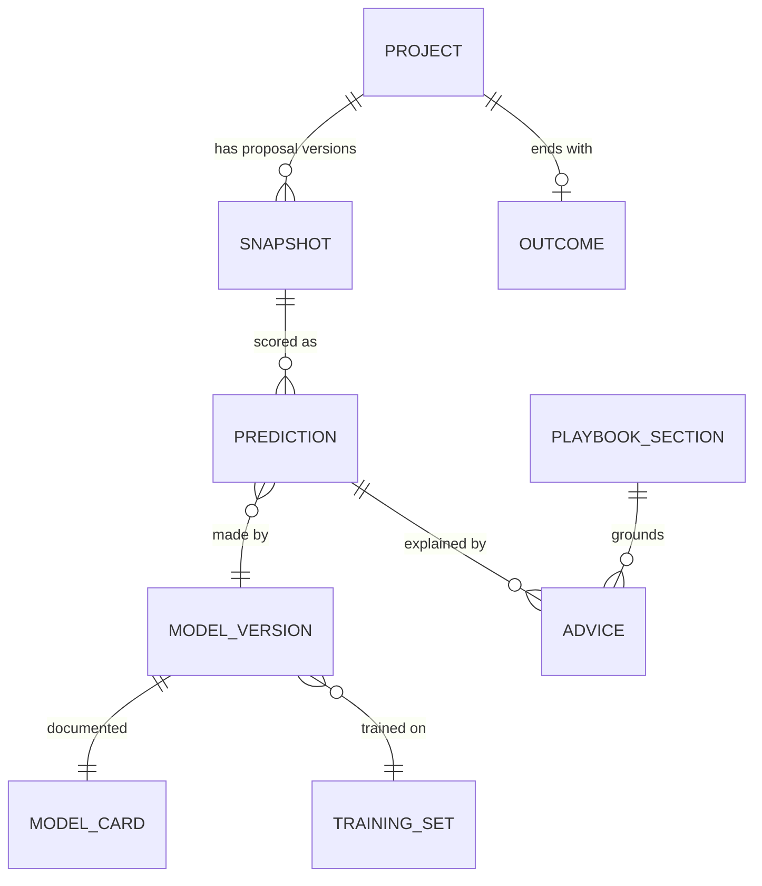
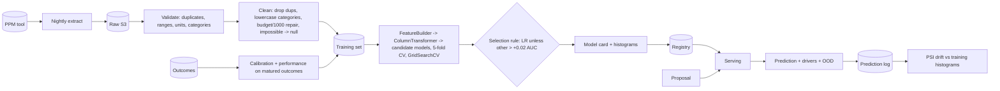
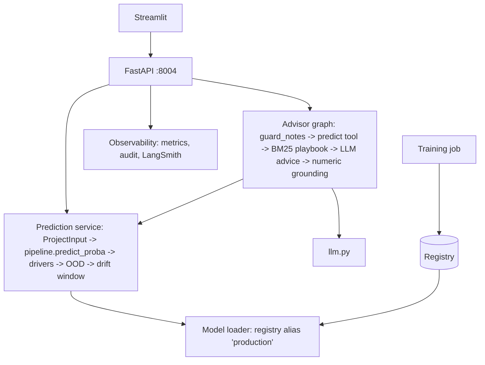

# 03 - Phase C: Information Systems Architecture

## 03a - Data architecture

### Conceptual model


### Logical / physical
| Entity | Attributes | Store |
|---|---|---|
| Project record (`projects.csv`) | project_id, project_type {application, infrastructure, data_platform, ai_ml, integration}, region {americas, emea, apj}, complexity 1-10, budget_usd 10k-20M, timeline_weeks 2-260, tech_readiness (TRL 1-9), resource_availability 0-1, dependency_count 0-50, team_experience_years 0-40, stakeholder_count 1-200, **label** (delivered successfully) | Warehouse table (Redshift/Athena over S3 Parquet) |
| Engineered features | log_budget_per_week, complexity_x_dependencies, staffing_pressure = complexity/(resources+0.1), experience_per_complexity | Computed in pipeline, not stored |
| Model artifact | `feasibility_model.joblib` (Pipeline), `model_card.json` (metrics, coefficients, training histograms, validation report, threshold) | S3 + registry record |
| Prediction log | ts, user, role, model version, input hash, probability, band, OOD flags, drivers | JSONL -> S3; Athena |
| Drift window | rolling recent inputs | In memory + hourly snapshot to S3 |
| Playbook | 7-section delivery playbook (Markdown) | Git/S3, versioned |
| Outcome | project_id, final status, delivered on time/budget, date | Warehouse (from PPM) |

### Lineage and flow


### Data for AI
| Item | Design |
|---|---|
| Training data | Historical projects with outcomes; stratified split; time-based hold-out in production (most recent 20%) in addition to random CV |
| Cleaning issues planted in prototype | duplicates 12, missing values ~4%, budgets entered x1000 (7-8 rows), TRL code 0 (6), inconsistent category spelling - all detected by validation report |
| Features | 10 raw + 4 engineered; `readiness_gap` removed (collinear with TRL) |
| LLM data | Advisor sees model output (probability, drivers) and optional free-text notes (<= 1,000 chars) after injection screening; not raw budgets (A) |
| RAG corpus | 7-section playbook; BM25 only (no vector store needed); refresh on playbook change |
| Refresh cadence | Data nightly; training monthly or on trigger; playbook on change |

### Quality, governance, privacy, security
| Topic | Rule |
|---|---|
| Quality | Schema + range checks (422 on serve; report on train); minimum 800 labelled rows; label rate between 20-80%; duplicate and unit-error checks must pass or the run fails |
| Classification | Project financials: Confidential; model artifacts: Internal; playbook: Internal |
| Privacy | No personal attributes; audit stores user ID (GDPR, 13-month retention) separate from prediction content |
| Retention | Training snapshots with model version 7 years (model risk, A); prediction logs 3 years; advisor traces 90 days |
| Encryption | TLS 1.2+; KMS at rest (S3, warehouse) |
| Access | Role capabilities in API; warehouse access by service role; model registry write only by pipeline role |

## 03b - Application architecture

### Components


### AI architecture
| Topic | Decision |
|---|---|
| Primary model | Tuned logistic regression (L2, C=0.1) in a scikit-learn Pipeline; explainable by coefficient x standardised value; comparison to RF, GB, SVM on every retrain; rule: LR unless another model is > 0.02 AUC better |
| Advisor model | Claude on Bedrock (target) / `llama3.2` local; optional feature flag |
| Prompts | Advisor prompt versioned in Git; instructs to use only the provided drivers and playbook excerpts |
| RAG | BM25 over playbook sections keyed by drivers; no embeddings |
| Guardrails | Pydantic ranges (422); OOD warning; injection check on notes; numeric grounding of advice; never says "approved" |
| Fallback | If LLM fails: return score + drivers + top playbook sections verbatim |
| Caching | Predictions are deterministic; cache by input hash + model version (1 h) |

### API catalog
| Endpoint | Method | Auth | Purpose |
|---|---|---|---|
| `/predict` | POST | role: predict | ProjectInput -> probability, band, drivers, OOD warnings, model version |
| `/predict/batch` | POST | batch | Score many projects (CSV/JSON) |
| `/advise` | POST | advise | Score + mitigation advice (+ optional `notes`) |
| `/model` | GET | model | Model card summary |
| `/drift` | GET | drift | PSI per feature, status |
| `/retrain` | POST | retrain | Starts pipeline; promotion needs approval (target) |
| `/feedback` | POST | any | Score a run_id |
| `/roles`, `/health`, `/metrics`, `/metrics/summary` | GET | admin/network | Ops |

### Integration patterns
Nightly pull from PPM into the warehouse; SSO via OIDC; optional webhook to PPM to attach score to intake record; BI reads prediction log.

### Top-5 journeys
```mermaid
sequenceDiagram
  participant PM
  participant API
  participant M as Model
  participant D as Drift window
  PM->>API: POST /predict (ProjectInput)
  API->>API: Validate ranges (422 on failure)
  API->>M: predict_proba (FeatureBuilder + pipeline)
  M-->>API: p=0.38
  API->>API: drivers = coef x standardised value; OOD check
  API->>D: add to window
  API-->>PM: probability, high-risk band, top drivers, warnings, model version
```
Others: **J2 Advice** (`/advise`: guard notes -> predict -> retrieve playbook -> LLM -> grounding); **J3 Batch** (director scores 8 intake projects ranked by probability); **J4 Drift check** (data scientist reads PSI: stable < 0.1, moderate < 0.25, significant >= 0.25); **J5 Retrain** (pipeline -> candidate -> compare with production on hold-out -> Model Risk approval -> alias switch).

### Gap analysis
Registry and approval workflow; warehouse feed; SSO; outcome capture; calibration monitor on matured outcomes; async batch for large imports; `/retrain` as a gated job rather than inline call.

## Open questions
Is ONNX export needed for a non-Python serving platform? Should free-text `notes` be dropped from the advisor to reduce injection surface?
