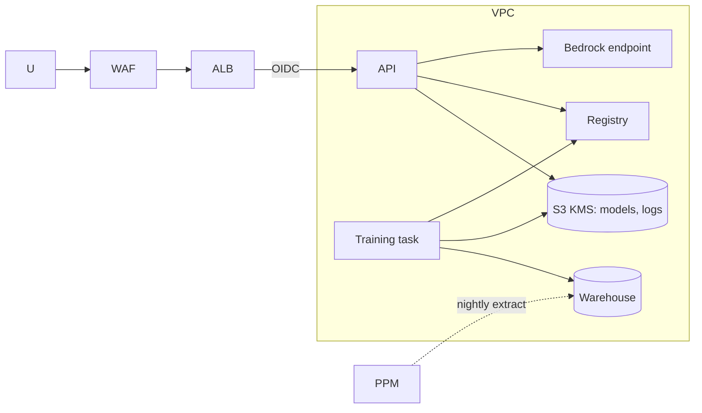
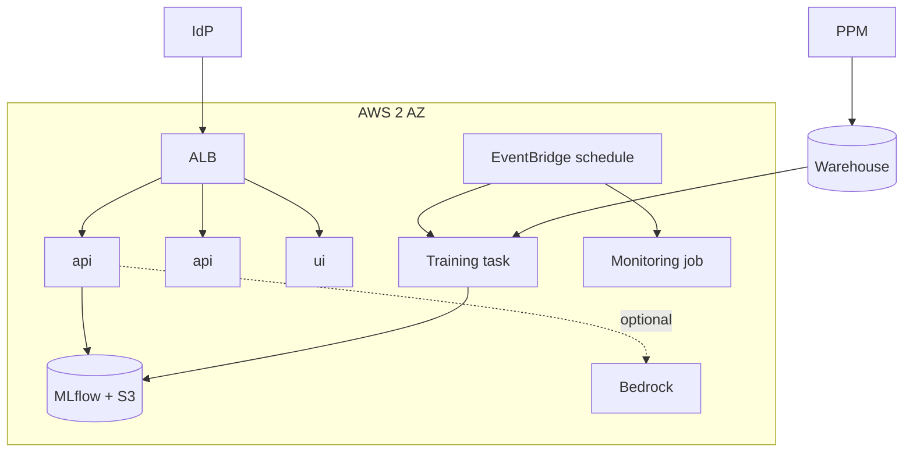

# 04 - Phase D: Technology Architecture

AWS target (A-03). All sizing is **ESTIMATE**.

## Infrastructure
| Layer | Choice |
|---|---|
| Serving | ECS Fargate `api` (1 vCPU/2 GB, 2 tasks), `ui` (0.5 vCPU/1 GB, 2 tasks). The model is a small sklearn pipeline (CPU, milliseconds) |
| Training | ECS scheduled/triggered task (4 vCPU/8 GB, minutes) or SageMaker Processing job; no GPU (ADR-FEA-02) |
| Data | S3 (raw, curated, models, logs); Athena for ad hoc; Redshift Serverless optional if the warehouse is not already available |
| Registry | MLflow on ECS with S3 artifact store and RDS backend (alias `production`, `staging`), or SageMaker Model Registry |
| Advisor | Bedrock Claude (optional, behind flag) |
| Network | VPC 2 AZ, private subnets, VPC endpoints, ALB + WAF |
| Identity | Corporate IdP (OIDC) |

## Environments
| | Dev | Test | Staging | Prod |
|---|---|---|---|---|
| Data | Synthetic 1,212 | Synthetic | Masked history | Real |
| Registry stage | none | `candidate` | `staging` | `production` |
| Advisor | Ollama | Bedrock small | Prod model | Prod model |
| Scale | 1 task | 1 task | 2 tasks | 2 tasks |

## Security architecture

IAM least privilege: serving role read-only on `models/production`; training role write to `models/candidate` only; promotion by a separate approver role. Secrets in Secrets Manager. KMS keys for S3 and warehouse. Budgets are confidential: warehouse access limited to training role and analysts.

## Observability
| Signal | Tool | Items |
|---|---|---|
| Logs/audit | CloudWatch -> S3 | prediction log with model version and input hash |
| Metrics | `/metrics` -> Grafana | requests by endpoint and role, predictions by risk band, OOD inputs, latency, drift PSI per feature |
| ML monitoring | Scheduled job | PSI weekly, **calibration and AUC on matured outcomes** monthly, subgroup metrics, approval-rate by band/type/region |
| LLM monitoring (advisor) | LangSmith | latency, tokens, grounding violations, injection blocks, feedback |

## HA / DR
Availability 99.5% business hours. RTO 4 h / RPO 24 h (models and data in S3 with versioning and cross-region replication; registry DB snapshot daily). Serving stateless; drift window rebuilt from prediction log.

## Capacity (ESTIMATE)
| Input | Value | Basis |
|---|---|---|
| Predictions | 300/month + batches of up to 100 | A-01 |
| Peak concurrency | 5 | board prep day |
| Latency | < 200 ms model; advisor 5-15 s | sklearn LR; one LLM call |
| Training | 1,212 rows now; 20k rows later; minutes on 4 vCPU | tabular |
| Advisor tokens | 2,500 in / 400 out per call; ~100 advice calls/month | playbook excerpts + drivers |
| Storage | < 5 GB/yr | tiny |

## Deployment diagram

## Standards and alternatives
| Area | Choice | Rejected |
|---|---|---|
| Model | Logistic regression pipeline | Gradient boosting (-0.021 AUC on prototype CV and less interpretable), neural nets, LLM-as-classifier (not reproducible) |
| Registry | MLflow | SageMaker Model Registry (equally valid if the org already uses SageMaker), files in Git (no approval/rollback) |
| Training | ECS task | Full SageMaker pipelines (overkill for minutes-long jobs) |
| Retrieval | BM25 | Vector DB for 7 playbook sections |
| Serving | FastAPI in container | SageMaker endpoint (cost for a tiny model), Lambda |
| IaC | Terraform | CDK |

## Open questions
Does the enterprise already run MLflow/SageMaker? Is a warehouse available or should S3 + Athena suffice?
