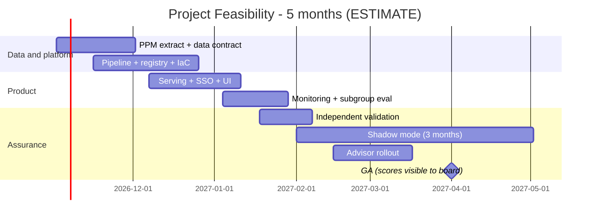

# 06 - Phase F: Migration / Delivery Planning

All figures **ESTIMATE**; rates are placeholders (A-04).

## Team (FTE by phase)
| Role | Build (m1-3) | Shadow + harden (m4-5) | Run (m6+) |
|---|---|---|---|
| Product owner (PMO) | 0.4 | 0.4 | 0.2 |
| Architect | 0.3 | 0.15 | 0.05 |
| Data scientists / ML engineers | 1.5 | 1.0 | 0.4 |
| Backend | 0.75 | 0.4 | 0.15 |
| Frontend | 0.4 | 0.2 | 0.05 |
| Data engineer | 1.0 | 0.5 | 0.2 |
| DevOps/MLOps | 0.75 | 0.4 | 0.25 |
| QA | 0.75 | 0.75 | 0.15 |
| Security | 0.15 | 0.15 | 0.05 |
| UX | 0.2 | 0.1 | 0 |
| Model risk validator | 0.2 | 0.4 | 0.1 |
| **Total** | **6.4** | **4.45** | **1.6** |

Skill gaps: MLflow/registry operations (low-medium), calibration and fairness analysis (medium), PPM data model (domain, via PMO).

## Cost (USD, ESTIMATE)
**People:** build 6.4 x 3 = 19.2 FM; shadow/harden 4.45 x 2 = 8.9 FM; total 28.1 FM x 12,000 = **USD 337.2k** one-time. Run: 1.6 x 12,000 = 19.2k/month.

**Infrastructure monthly (prod):**
| Item | Sizing | USD |
|---|---|---|
| ECS Fargate (api x2, ui x2) | ~1.5 vCPU-equivalent total | 90 |
| MLflow (ECS 1 task + RDS t4g.small) | | 80 |
| Training task | 4 vCPU x ~2 h/month | 5 |
| S3, Athena, CloudWatch, KMS, ALB, WAF | | 150 |
| Redshift Serverless (optional, if no warehouse) | light use | 100 |
| LangSmith (advisor) | | 40 |
| **Prod** | | **~465** |
| Non-prod (0.5x) | | 230 |
| **Total** | | **~695** |

**LLM usage (advisor):** 100 advice calls/month x (2,500 in + 400 out) = 0.25M in + 0.04M out. At ASSUMED USD 3 / 15 per 1M: 0.75 + 0.60 = **~USD 1.4/month**. CI/eval judge ~USD 10/month. LLM cost is negligible; the model itself has no per-call cost.

| TCO | 12 months | 3 years |
|---|---|---|
| Build people | 337,200 | 337,200 |
| Run people (m6-12 = 7 x 19.2k; 3 yr: 7 + 24 months) | 134,400 | 595,200 |
| Infra (695 x 12 / x 36) | 8,340 | 25,020 |
| LLM + eval (12 x 11.4 / x 36) | 137 | 410 |
| Tools, independent validation, pen test | 20,000 | 32,000 |
| Subtotal | 500,077 | 989,830 |
| Contingency 15% | 75,012 | 148,475 |
| **TCO** | **~575.1k** | **~1,138.3k** |

(The package index's "~USD 0.39M build" = build people 337.2k x 1.15 contingency = ~388k.)

One-time: build people, validation, pen test. Recurring: run people, infra, LLM.
Optimisation: skip Redshift if S3 + Athena suffices (-100/month); run MLflow on the existing platform; Fargate Spot for training; disable advisor if low adoption.

## Roadmap

Milestones: M1 pipeline + registry (wk 8), M2 serving in staging (wk 12), M3 validation passed (wk 16), M4 shadow mode start (wk 17), M5 GA after shadow review (wk 22). 11 two-week sprints (shadow mode runs in parallel with Phase 2 work).
**Critical path:** PPM data + labels -> pipeline -> validation -> shadow review -> GA.

## Open questions
Rate card; who funds independent validation; can GA wait for 3 months of shadow data?
