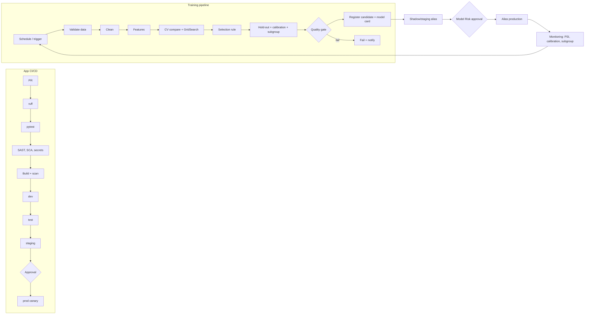

# 10 - CI/CD and MLOps

## Branching and promotion
Trunk-based. `main` deploys serving to dev. Model changes follow a separate promotion path inside the registry: `candidate` -> `staging` -> `production`, each with gates. App promotion: tag `vX.Y.Z` dev -> test -> staging -> prod with approval. **Model promotion is not a code deploy**: it moves a registry alias after Model Risk approval; the serving tasks reload within 5 minutes.

## Pipelines


## Quality gates
Training/CI gate: hold-out ROC-AUC >= 0.80, PR-AUC >= 0.75, Brier <= 0.18, calibration within 0.07, coefficient signs correct, subgroup AUC gap <= 0.05, seed stability, candidate not worse than production by > 0.01 AUC. App gate: pytest, scans, API contract. Advisor nightly: grounding violations 0, injection 100% blocked, judge relevance >= 4/5.

## GitHub Actions - `.github/workflows/ci.yml`
```yaml
name: ci-feasibility
on:
  pull_request:
    paths: ["04-project-feasibility-ml/**"]
  push:
    branches: [main]
permissions: { contents: read, id-token: write }
jobs:
  test:
    runs-on: ubuntu-latest
    defaults: { run: { working-directory: 04-project-feasibility-ml } }
    steps:
      - uses: actions/checkout@v4
      - uses: actions/setup-python@v5
        with: { python-version: "3.12", cache: pip }
      - run: pip install -r requirements.txt ruff pytest pip-audit bandit
      - run: ruff check .
      - run: pytest -q                                   # 11 tests
      - run: bandit -r feasibility -ll
      - run: pip-audit -r requirements.txt
      - uses: gitleaks/gitleaks-action@v2
      - name: Retrain on synthetic data and gate
        run: |
          python data/generate_data.py
          python -m feasibility.train
          python -m eval.run_eval --threshold-file eval/thresholds.json   # planned option (US-FEA-14)
      - uses: actions/upload-artifact@v4
        with: { name: model-card-and-eval, path: |
            04-project-feasibility-ml/models/model_card.json
            04-project-feasibility-ml/eval/results }
  image:
    needs: test
    runs-on: ubuntu-latest
    steps:
      - uses: actions/checkout@v4
      - uses: aws-actions/configure-aws-credentials@v4
        with: { role-to-assume: "${{ secrets.AWS_CI_ROLE }}", aws-region: us-east-1 }
      - uses: aws-actions/amazon-ecr-login@v2
      - run: docker build -t $ECR/feasibility:${{ github.sha }} 04-project-feasibility-ml
      - uses: aquasecurity/trivy-action@0.24.0
        with: { image-ref: "${{ env.ECR }}/feasibility:${{ github.sha }}", exit-code: "1", severity: "CRITICAL,HIGH" }
      - run: docker push $ECR/feasibility:${{ github.sha }}
```
The training workflow in production runs as a scheduled EventBridge -> ECS task using the same entry points (`feasibility.train`), reading from the warehouse rather than `data/generate_data.py`. The `--threshold-file` option, `infra/` and registry integration are **to be created**; region/ECR values are placeholders.

## Model, prompt and data versioning
| Asset | Versioning |
|---|---|
| Model | Registry version (immutable artifact + model card JSON); aliases staging/production; input hash + model version in each prediction log |
| Training data | Snapshot in S3 with content hash recorded in the model card |
| Code | Git SHA recorded in the model card |
| Features | `FeatureBuilder` versioned with the model (inside the pipeline artifact) |
| Threshold | Config in Git/AppConfig with audit; changes by Portfolio Director |
| Advisor prompt and playbook | Git; hash in traces; playbook edited by PMO via PR |
| Feature flags | AppConfig: advisor on/off, batch size limit, viewer band display |

## IaC layout
```
infra/ modules: network ecs_service mlflow rds s3_data iam waf monitoring eventbridge_jobs
      envs: dev test staging prod
```

## Open questions
Is MLflow already available in the enterprise? Which orchestrator is standard (EventBridge, Airflow, Step Functions)?
