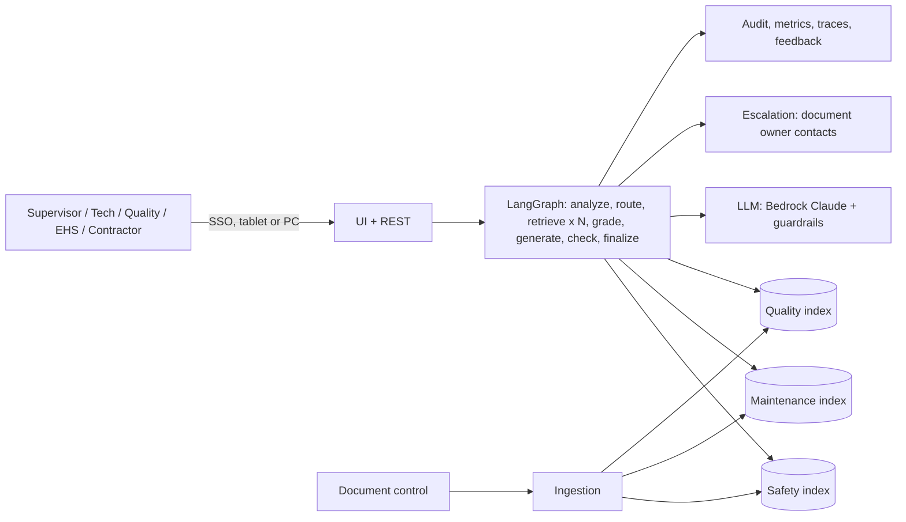

# 01 - Phase A: Architecture Vision

## Problem statement
Plant answers live in three document sets (EHS safety procedures, maintenance manuals, quality control
standards) owned by three teams. Supervisors know the question, not which binder holds the answer. A maintenance
answer that omits lockout/tagout is a safety risk.

## Goals and KPIs
Pilot targets, not prototype results.
| ID | Goal | KPI | Baseline | Target |
|---|---|---|---|---|
| G1 | Faster right procedure | Time to the correct procedure | TBD (A: 8 min) | < 1 min |
| G2 | Fully traceable | Answers with valid citations | n/a | 100% |
| G3 | Fewer routine calls to engineers | Calls per shift to maintenance/quality/EHS for lookup questions | TBD | -30% |
| G4 | Safety prerequisites never omitted | Hands-on answers containing LOTO/PPE | n/a | 100% |
| G5 | No unsafe assistance | Unsafe advice shown | 0 | 0 |
| G6 | Honest scope | Out-of-scope questions declined | n/a | >= 95% |

AI quality metrics (prototype, synthetic): retrieval hit@5 100% (26/26), MRR 0.974, guardrail precision/recall 1.0/1.0 on 16 cases, keyword-fallback routing 82% (23/28), live LLM routing 4/4. Production gates: hit@5 >= 0.95, MRR >= 0.90, LLM routing >= 90%, guardrail 1.0/1.0, numeric grounding violations shown = 0, fact recall >= 0.85 and RAGAS faithfulness >= 0.85 with a strong judge.

## Stakeholders and concerns
| Stakeholder | Concern | Influence |
|---|---|---|
| Floor supervisors | Fast, usable on a tablet with gloves/noise | High |
| EHS manager | No unsafe advice, correct emergency handling | High (veto) |
| Maintenance / Quality managers | Their documents cited accurately; revision control | High |
| Maintenance technicians, quality engineers | Precise numbers (torques, limits) | Medium |
| Contractors | Safety info only | Low |
| Plant manager (sponsor) | Productivity, risk | High |
| IT security | Device and network exposure | Medium |
| Works council / HR (A) | Monitoring of staff use | Medium |

## Scope
| In | Out |
|---|---|
| Routed Q&A over safety, maintenance, quality documents with citations, escalation, emergency banner | Authoring or approving documents; work-order creation; control of equipment |
| Roles and source access; guardrails; audit | Multi-turn chat (Phase 2); OCR of scanned documents; diagrams (Phase 2) |
| Tablet/PC UI; API | Replacement of the permit-to-work system |
Constraints: safety-first policy; document control; answers only from controlled documents. Assumptions: documents available as Markdown, Word or text PDFs with front matter (ID, revision, owner).

## Solution concept

## Statement of Architecture Work
Deliver the architecture and a 6-month plan to move from a single-user prototype to an SSO-integrated, AWS-hosted service for one plant, with document-control sync, safety-governed change management, a CI evaluation gate, and operations on 3 shifts. Sponsor: Plant Manager. Architecture work: ESTIMATE 3 weeks (EA 1.0 FTE, AI lead 0.5, EHS reviewer 0.2).

## Initial risk register
| ID | Risk | L | I | Mitigation |
|---|---|---|---|---|
| R-PLA-01 | Hallucinated number (wrong torque/limit) | M | Critical | Numeric grounding, regenerate, caveat, LLM verifier, source citation |
| R-PLA-02 | Wrong routing misses a safety document | M | H | Safety-first policy; low confidence fans out to all sources |
| R-PLA-03 | Unsafe advice or bypass help | L | Critical | Input and output unsafe filters, Bedrock Guardrails, EHS red-team |
| R-PLA-04 | Stale document revision | H | H | Revision metadata, sync on publish, show revision in citation |
| R-PLA-05 | Bias toward longer or better-structured documents | M | M | Per-source hit rates in eval |
| R-PLA-06 | Prompt injection via document text | L | H | Data/instruction separation, injection tests |
| R-PLA-07 | Data leakage (contractor sees maintenance/quality content) | L | M | Source filter in code on every retrieval |
| R-PLA-08 | Model drift (provider update changes behaviour) | M | M | Pinned model IDs, regression set |
| R-PLA-09 | Vendor lock-in | M | M | Provider switch by configuration |
| R-PLA-10 | Overreliance by supervisors | M | H | "Verify against the document" prompt, citation links, training |

## Open questions
Baseline lookup times; EHS stance on verbatim-only safety answers; tablet device management policy.
