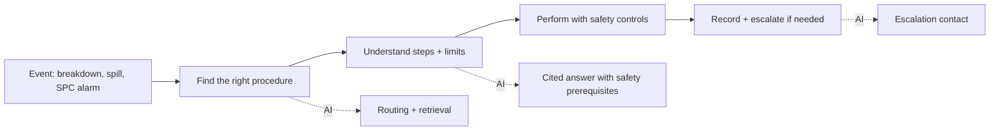
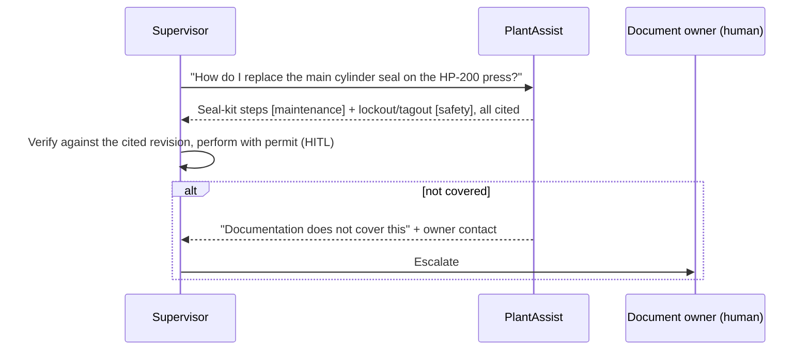

# 02 - Phase B: Business Architecture

## Capability map
| Capability | Current | Target | AI role |
|---|---|---|---|
| Procedure lookup | Binders, intranet folders, phone calls | One question, right document | Router + retrieval |
| Safety prerequisites | Memory/training | Automatically attached (LOTO, PPE) | Safety-first policy |
| Emergency response guidance | Posted sheets | Fixed banner + response procedure | Emergency detection |
| Quality reaction plans | Quality engineer on call | Standard reaction plan cited (e.g. SPC rules) | Quality index |
| Escalation | Phone tree | Document-owner contact when not covered | `no_answer` node |
| Document control | Owners per team | Same owners; sync + audit of what was cited | Ingestion + audit |

## Value stream: "Resolve a floor question safely"

D and E stay with people and plant systems.

## Process flow (to-be)

As-is: supervisor searches binders or calls engineering. Emergencies: posted sheets; the fixed banner (ext. 5555 / 911) is shown before any AI text.

## Actors and organization impact
| Actor | Role key | Sources |
|---|---|---|
| Floor supervisor | `floor_supervisor` | safety, maintenance, quality |
| Maintenance technician | `maintenance_technician` | safety, maintenance |
| Quality engineer | `quality_engineer` | safety, quality |
| EHS manager | `ehs_manager` | all |
| Contractor | `contractor` | safety only |
Safety is always searchable. Impact: document owners become content stewards; new AI lead / prompt owner 0.5 FTE; training for supervisors on verifying citations.

## Use cases
| ID | Use case | Actor |
|---|---|---|
| UC-1 | Repair guidance with safety prerequisites | Supervisor, technician |
| UC-2 | Emergency response (spill, fire, injury) | Anyone |
| UC-3 | SPC/quality reaction plan | Quality engineer |
| UC-4 | Contractor PPE and site rules | Contractor |
| UC-5 | Look up a specification (torque, interval) from tables | Technician |
| UC-6 | Out-of-scope question declined | Anyone |

## Business rules
| ID | Rule |
|---|---|
| BR-1 | Safety documentation is searchable by every role |
| BR-2 | Hands-on maintenance questions always include lockout/tagout and PPE from the safety source |
| BR-3 | Emergency language triggers the fixed banner first, then the response procedure |
| BR-4 | Requests to defeat protections (bypass, jumper, disable, skip LOTO/PPE/permit) are refused; **reports** of a past violation are answered |
| BR-5 | Routing confidence < 0.6 searches every source the role may access |
| BR-6 | Chunks with cosine < 0.55 are not used; nothing relevant after one rewrite -> escalate |
| BR-7 | Every number in an answer must appear in the excerpts or the question |
| BR-8 | Contractors never receive maintenance or quality content |

## Human-in-the-loop and escalation
| Point | Human | Trigger |
|---|---|---|
| Doing the work | Supervisor/technician | Always; permit-to-work remains |
| Not covered | Document owner (per source) | `no_answer` outcome with contact |
| Unverified or caveated answer | Supervisor -> engineer | Caveat shown |
| Emergency | Emergency services / EHS | Banner always; AI does not call |
| Repeated blocked unsafe requests by one user | EHS | >= 3 per week |
| Negative feedback on safety answers | EHS + AI Lead | Any thumbs-down on safety source reviewed within 1 business day |

## Gap analysis
| Baseline | Target | Gap |
|---|---|---|
| 13 sample documents loaded by script | Controlled-document sync with revisions | Connector, supersede handling |
| Demo keys | SSO with plant roles | IdP mapping |
| Single-turn | Follow-up questions | Checkpointer (Phase 2) |
| Text only | Diagrams and scanned PDFs | OCR / vision (Phase 2) |
| One plant | Multiple plants/languages | Plant dimension in metadata |

## Open questions
Who maintains escalation contacts? Is a verbatim-only mode needed for the safety source?
