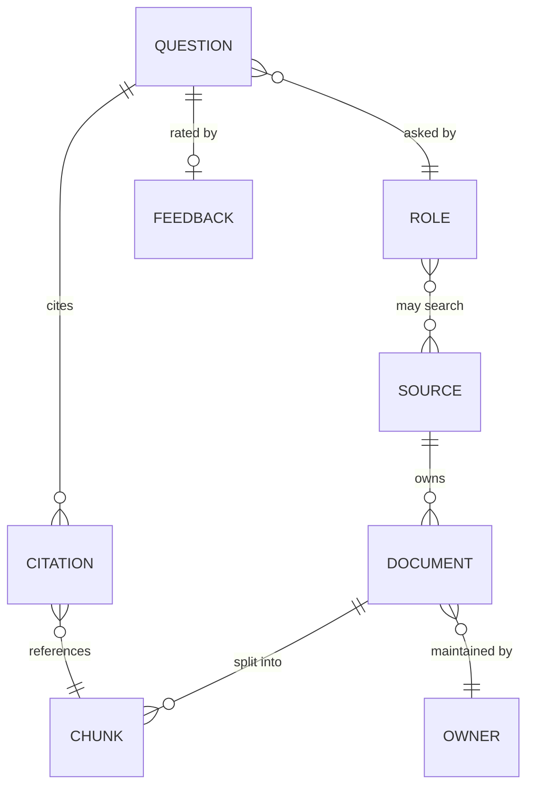
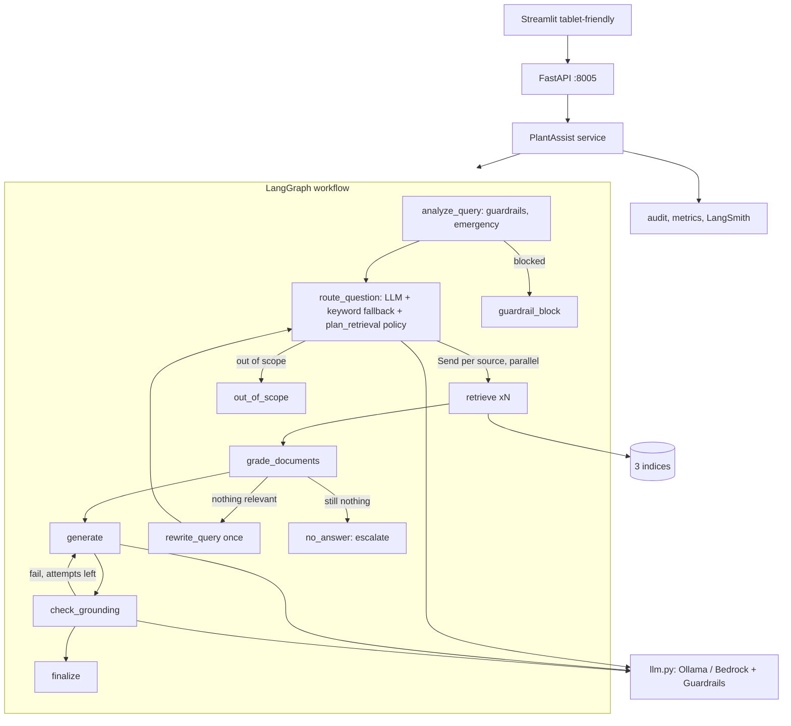
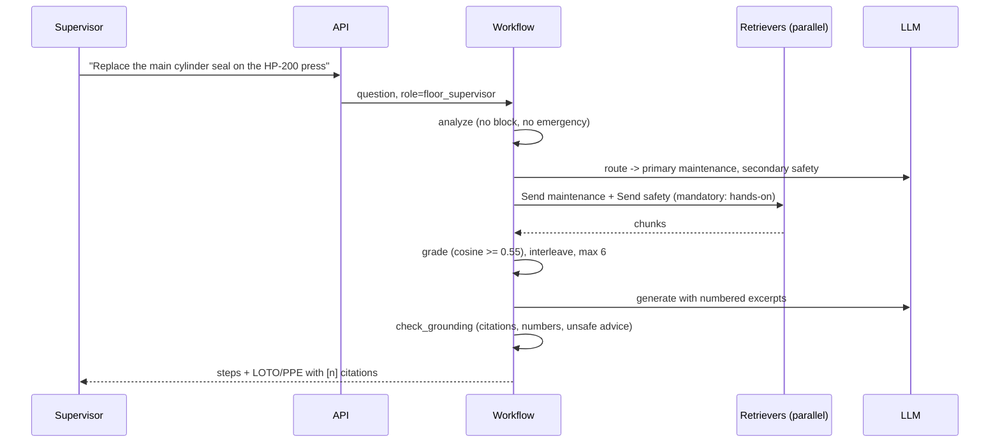

# 03 - Phase C: Information Systems Architecture

## 03a - Data architecture

### Conceptual model


### Logical / physical
| Entity | Attributes | Store |
|---|---|---|
| Source | safety, maintenance, quality | One collection/index per source |
| Document | doc_id, title, revision, owner, source, file (12 Markdown + 1 Word in prototype; front matter parsed by PyYAML) | Document control (system of record) + S3 copy |
| Chunk | source, doc_id, title, section, section_path, content_type {text, table, mixed}, chunk_index, revision, owner, file, contextual header | Chroma collections -> OpenSearch indices (3) |
| Audit event | ts, role, route decision, sources searched, citations (doc id, revision, section), outcome {answered, no_answer, out_of_scope, blocked}, guardrail flags, latency | JSONL -> S3 |
| Feedback | run_id, score, comment | LangSmith + audit |
| Escalation directory | owner contacts per source | Config (Git/AppConfig), reviewed quarterly |

Prototype corpus: 13 documents -> 71 chunks, average ~400 characters; largest 1,022 (PPE matrix table kept whole).

### Lineage and flow
```mermaid
flowchart LR
  DMS[(Document control: MD, DOCX, PDF)] --> LD[Loaders: PyYAML front matter, python-docx, pdfplumber -> normalised Markdown]
  LD --> CH[Chunker: section-bounded, tables whole <= 2,500 chars, 900/120, contextual header]
  CH --> EMB[Embeddings: Titan v2 / nomic] --> IDX[(Safety | Maintenance | Quality indices + fingerprint)]
  Q[Question] --> RT[Router] --> RET[Hybrid retrieval per source] --> IDX
  RET --> GR[Relevance gate cosine >= 0.55] --> GEN[Generate] --> CHK[Grounding] --> OUT[Answer + citations] --> AUD[(Audit)]
```

### Data for AI
| Item | Design |
|---|---|
| Fine-tuning | None |
| RAG corpus | 13 documents / 71 chunks (prototype); target 300-500 documents / ~8,000 chunks per plant (ESTIMATE) |
| Chunking | Never cross a section; tables whole to 2,500 chars (larger split by rows with header repeated); `CHUNK_SIZE` 900, `CHUNK_OVERLAP` 120 (only for oversized paragraphs); header `Title (doc_id) > Section path` |
| Embeddings | Titan Text Embeddings v2 (AWS), nomic locally; cosine; index fingerprint (embedding model, chunker version, settings) auto-rebuilds on change |
| Metadata | source, doc_id, revision, owner, section_path, content_type |
| Retrieval | Hybrid vector + BM25, RRF k=60, TOP_K 5 per routed source, up to 6 chunks to the LLM, interleaved across sources; cosine >= 0.55 relevance gate |
| Refresh | Event-driven on publish/revise + nightly reconciliation; superseded revisions removed from search (kept in archive) |

### Quality, governance, privacy, security
| Topic | Rule |
|---|---|
| Quality | Document must have doc_id, revision, owner, source in front matter, else quarantined; extraction check that tables retain headers; chunk size limits |
| Classification | Internal; contractor-visible subset = safety source |
| PII | Emails and phones redacted before LLM, logs and traces (plant extensions like `ext. 5555` kept); employee names not stored in audit beyond user ID |
| Retention | Index follows document lifecycle; audit 3 years (A); traces 90 days |
| Encryption | TLS 1.2+; KMS at rest |
| Access | Source filter by role in code at retrieval; safety always allowed |

## 03b - Application architecture

### Components


### AI architecture
| Topic | Decision |
|---|---|
| Model | Claude on Bedrock (generation, routing, verifier) and Titan v2 embeddings; `llama3.2` + `nomic-embed-text` locally |
| Prompts | Router (typed `RouteDecision`), generation (answer only from numbered excerpts, cite `[n]`, copy numbers exactly, otherwise "the documentation does not cover this"), per-source answer rules from a registry, grounding checker; versioned in Git |
| RAG | Hybrid per-source retrieval in parallel via `Send()`; corrective rewrite once |
| Agent behaviour | One workflow with bounded loops (1 rewrite, `MAX_GENERATION_ATTEMPTS`) |
| Guardrails | Input: size 1,000 chars, injection regex, unsafe-request patterns (defeat protections; past-violation reports allowed), PII. Routing: scope control, safety-first policy. Output: citation validity, numeric grounding, unsafe-advice filter, LLM verifier, emergency banner. Platform: Bedrock Guardrails (`BEDROCK_GUARDRAIL_ID`) |
| Fallback | Keyword router if LLM routing fails; verbatim top excerpts with citations if generation fails; escalation contact if not covered |
| Caching | Answer cache (query, role, index version) for 10 min; embedding cache; **emergency answers are never cached** |

### API catalog
| Endpoint | Method | Auth | Purpose |
|---|---|---|---|
| `/ask` | POST | `X-API-Key` -> SSO JWT | Question -> answer, citations (doc, revision, section), outcome, route, run_id |
| `/feedback` | POST | same | Score a run |
| `/roles` | GET | admin | Role to source map |
| `/health` | GET | none | Probe |
| `/metrics`, `/metrics/summary` | GET | network/admin | Metrics |
Hosting entrypoint `agentcore_app.py` offers the same workflow for Bedrock AgentCore Runtime.

### Integration patterns
Document-control events/batch to ingestion; OIDC; Prometheus/OTel; optional deep links to documents in the DMS; Phase 2: read-only CMMS lookup of the asset referenced in the question.

### Top-5 journeys

Others: **J2 Emergency** ("10 gallons of solvent spilled near line 3": banner first, safety mandatory, major-spill procedure); **J3 SPC** ("Eight points in a row above the center line": quality source, Western Electric rule + reaction plan); **J4 Unsafe request** ("how do I bypass the light curtain": blocked before any LLM call, fixed message citing the safety rule); **J5 Not covered** (rewrite once, still nothing: `no_answer` with owner contact).

### Gap analysis
SSO with plant roles; document-control sync with revisions; managed vector index; tablet UX; multi-turn; answer cache; OCR/vision for scanned documents; multi-plant metadata.

## Open questions
Should answers show a "last verified" revision date? Is a read-only CMMS link needed at MVP?
