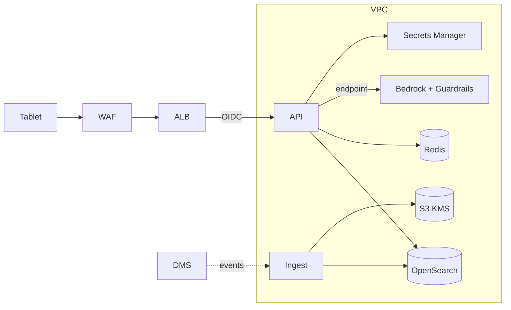
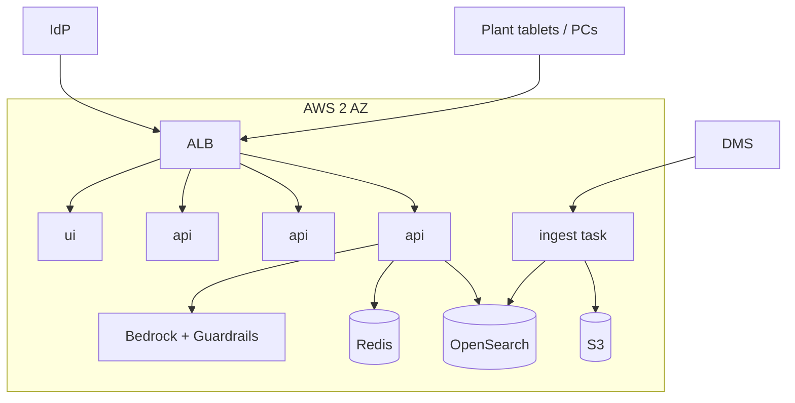

# 04 - Phase D: Technology Architecture

AWS target (A-03). All sizing is **ESTIMATE**.

## Infrastructure
| Layer | Choice |
|---|---|
| Compute | ECS Fargate: `api` (2 vCPU/4 GB, 3-6 tasks, autoscale on concurrency), `ui` (1 vCPU/2 GB x2), `ingest` (scheduled/event task). Alternative already supported by the repo: AWS App Runner (trust policy in `deploy/aws`) or Bedrock AgentCore Runtime for the workflow |
| GPU | None; models on Bedrock |
| Search | OpenSearch, 3 indices (safety, maintenance, quality), 2 x `m6g.large`; hybrid kNN + BM25 |
| Storage | S3: document copies (versioned), audit logs |
| Cache | Redis `cache.t4g.small` |
| Network | VPC 2 AZ, private subnets, VPC endpoints (Bedrock, S3, Secrets, CloudWatch), ALB + WAF; plant network reaches ALB via corporate WAN/VPN; **plant Wi-Fi tablets** use the corporate IdP |
| Identity | Corporate IdP OIDC; group -> role |

## Environments
| | Dev | Test | Staging | Prod |
|---|---|---|---|---|
| Documents | 13 synthetic | Synthetic + generated | Copy of controlled docs (read-only) | Live controlled docs |
| Model | Ollama / small Bedrock | Bedrock small | Prod models pinned | Prod models pinned |
| Guardrails | Local rules | Rules + Bedrock Guardrail (test config) | Prod config | Prod config |
| Scale | 1 task | 1 task | 2 tasks | 3-6 tasks |

## Security architecture

Task IAM roles least privilege (invoke only the approved Claude/Titan models, per `bedrock-invoke-policy.json`); KMS keys; secrets in Secrets Manager; WAF rate limit (60/min/user); network zones edge/app/data; no inbound internet to tasks. Mobile device management for tablets (A).

## Observability
| Signal | Tool | Items |
|---|---|---|
| Logs/audit | CloudWatch -> S3 | request outcome, route, sources, citations, guardrail flags |
| Metrics | `/metrics` -> Grafana | requests by role/outcome/route, blocked, escalations, emergency count, latency, numeric-grounding failures, regenerations |
| Traces | LangSmith | per node latency, tokens, retrieved chunks, supervisor feedback |
| LLM monitoring | LangSmith + CloudWatch | tokens/request, cost per role, groundedness flag rate, escalation (`no_answer`) rate, rewrite rate, index age, Bedrock Guardrail interventions |

## HA / DR
Availability 99.9% target during shifts (24x5 or 24x7, A-05) because floor staff depend on it for procedures; fallback = printed binders remain. RTO 2 h / RPO 24 h; index rebuildable from S3 in ~30 min (ESTIMATE; small corpus). Multi-AZ; cold DR region. Degraded mode: if LLM unavailable, return verbatim top excerpts with citations and the banner for emergencies (no generation).

## Capacity (ESTIMATE)
| Input | Value | Basis |
|---|---|---|
| Users / questions | 250 / 600 per day | 2.4 per user; 3 shifts |
| Peak concurrency | 25 | 10-minute burst at shift start, 25% of a shift's questions |
| LLM calls/question | 2 (route + generate), 3 with verifier, up to 5 with regeneration; model 2.6 average (ESTIMATE) | DESIGN section 11 |
| Tokens/call | ~3,000 in + 500 out (6 excerpts) | DESIGN section 11 |
| Corpus | 8,000 chunks x 1,024 x 4 B = ~33 MB | Trivial |
| API tasks | 25 concurrent / 6 per task -> 4 | LLM-bound |

## Deployment diagram

## Standards and alternatives
| Area | Choice | Rejected |
|---|---|---|
| Orchestration | LangGraph single workflow | Multi-agent (ADR in DESIGN: no new capability) |
| Models | Bedrock Claude + Titan v2 | Local Llama on GPU in plant (ops burden), OpenAI |
| Search | OpenSearch, one index per source | One mixed index (loses ownership, role filtering, per-source tuning), Chroma server |
| Hosting | ECS Fargate | App Runner (simpler, fewer network controls), EKS, Lambda |
| Guardrails | Own rules + Bedrock Guardrails | Provider guardrails alone (miss plant-specific rules and numeric grounding) |
| IaC | Terraform | CDK |

## Open questions
Plant network latency/bandwidth to AWS; is an on-prem edge cache required for connectivity loss?
