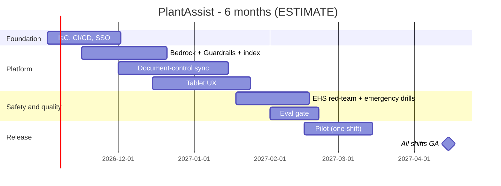

# 06 - Phase F: Migration / Delivery Planning

All figures **ESTIMATE**; rates are placeholders (A-04).

## Team (FTE by phase)
| Role | Build (m1-4) | Harden + pilot (m5-6) | Run (m7+) |
|---|---|---|---|
| Product owner | 0.5 | 0.5 | 0.2 |
| Architect | 0.5 | 0.25 | 0.1 |
| AI/ML engineers | 2 | 1.5 | 0.5 |
| Backend | 1 | 0.5 | 0.25 |
| Frontend / UX (tablet) | 1 | 0.5 | 0.2 |
| Data engineer | 1 | 0.5 | 0.25 |
| DevOps/MLOps | 1 | 0.5 | 0.5 |
| QA | 1 | 1 | 0.25 |
| Security | 0.25 | 0.25 | 0.1 |
| EHS reviewer | 0.2 | 0.3 | 0.1 |
| Document-owner stewards (3 x 0.1) | 0.3 | 0.3 | 0.3 |
| **Total** | **8.75** | **6.1** | **2.75** |

Skill gaps: Bedrock Guardrails configuration (medium), tablet/accessible UX in industrial settings (medium), adversarial safety testing (medium, via EHS).

## Cost (USD, ESTIMATE)
**People:** build 8.75 x 4 = 35 FM; pilot 6.1 x 2 = 12.2 FM; total 47.2 FM x 12,000 = **USD 566.4k** one-time. Run: 2.75 x 12,000 = 33k/month.

**Infrastructure monthly (prod):**
| Item | Sizing | USD |
|---|---|---|
| ECS Fargate | ~6 task-equivalents | 300 |
| OpenSearch | 2 x m6g.large + 50 GB | 400 |
| Redis | t4g.small | 30 |
| S3, CloudWatch, KMS, ALB, WAF, endpoints | | 300 |
| Bedrock Guardrails | ~18k requests/month x ~3 text units; ASSUMED 0.75 per 1k text units (verify pricing) | 40 |
| LangSmith | | 100 |
| **Prod** | | **1,170** |
| Non-prod (0.5x) | | 585 |
| **Total** | | **~1,755** |

**LLM usage:** requests/month = 600 x 30 = 18,000 (3 shifts, 7-day plant, A-05); LLM calls ~2.6 per request = 46,800 calls; tokens/call 3,000 in + 500 out -> 140.4M in + 23.4M out. At ASSUMED USD 3 / 15 per 1M: 140.4 x 3 + 23.4 x 15 = 421.2 + 351 = **~USD 772/month**. Embeddings (queries 18,000 x 30 tokens + re-ingest) < USD 1. CI judge ~USD 50/month.

| TCO | 12 months | 3 years |
|---|---|---|
| Build people | 566,400 | 566,400 |
| Run people (m7-12 = 6 x 33k; 3 yr: 6 + 24 months) | 198,000 | 990,000 |
| Infra (1,755 x 12 / x 36) | 21,060 | 63,180 |
| LLM + eval (822 x 12 / x 36; first 6 months at 50% adoption ramp ignored, conservative) | 9,864 | 29,592 |
| Tools, pen test, red-team support | 35,000 | 53,000 |
| Subtotal | 830,324 | 1,702,172 |
| Contingency 15% | 124,549 | 255,326 |
| **TCO** | **~954.9k** | **~1,957.5k** |

(The package index's "~USD 0.65M build" = build people 566.4k x 1.15 contingency.)

One-time: build people, pen test, red-team. Recurring: run people, infra, LLM.
Optimisation: answer cache (-20-30% LLM calls); Haiku-class model for routing (-35% of tokens per request); disable the LLM verifier outside safety source (rules remain); scale tasks by shift; reserved capacity for OpenSearch.

## Roadmap

Milestones: M1 env (wk 4), M2 MVP staging (wk 12), M3 EHS + security sign-off (wk 16), M4 pilot one shift (wk 20), M5 all shifts GA (wk 24). 12 two-week sprints.
**Critical path:** document metadata/sync -> staging with real documents -> EHS red-team and sign-off -> pilot.

## Open questions
Rate card; pilot plant and shift; budget owner for LLM spend (plant vs central IT).
