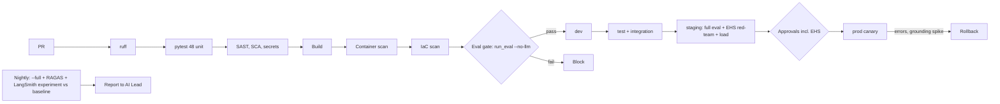

# 10 - CI/CD and MLOps / LLMOps

## Branching and promotion
Trunk-based. `main` -> dev; tag `vX.Y.Z` -> test -> staging -> prod. Prod requires green eval + safety suites and approval by Product Owner, Security and **EHS for any change to `guardrails.py`, router policy, emergency text or the safety eval set** (CODEOWNERS). Deploy outside shift handovers.

## Pipeline


## Eval gate (fails the build)
Guardrail precision/recall = 1.0; retrieval hit@5 >= 0.95 and MRR >= 0.90; keyword-router fallback accuracy >= 80%; chunking/extraction tests pass; safety set (EHS) 100% blocked/handled. Nightly/pre-release: LLM routing >= 90%, fact recall >= 0.85, faithfulness >= 0.85 (strong judge), no >2 pt drop vs LangSmith baseline.

## GitHub Actions - `.github/workflows/ci.yml`
```yaml
name: ci-plantassist
on:
  pull_request:
    paths: ["05-plant-assist/**"]
  push:
    branches: [main]
permissions: { contents: read, id-token: write }
jobs:
  test:
    runs-on: ubuntu-latest
    defaults: { run: { working-directory: 05-plant-assist } }
    steps:
      - uses: actions/checkout@v4
      - uses: actions/setup-python@v5
        with: { python-version: "3.12", cache: pip }
      - run: pip install -r requirements-app.txt ruff pytest pip-audit bandit
      - run: ruff check .
      - run: pytest -q                              # unit tests, no model needed
      - run: bandit -r plant_assist -ll
      - run: pip-audit -r requirements-app.txt
      - uses: gitleaks/gitleaks-action@v2
      - name: Eval gate (no LLM, ~20 s)
        run: python -m eval.run_eval --no-llm --threshold-file eval/thresholds.json   # threshold option planned (US-PLA-14)
      - uses: actions/upload-artifact@v4
        with: { name: eval, path: 05-plant-assist/eval/results }
  image:
    needs: test
    runs-on: ubuntu-latest
    steps:
      - uses: actions/checkout@v4
      - uses: aws-actions/configure-aws-credentials@v4
        with: { role-to-assume: "${{ secrets.AWS_CI_ROLE }}", aws-region: us-east-1 }
      - uses: aws-actions/amazon-ecr-login@v2
      - run: docker build -t $ECR/plantassist:${{ github.sha }} 05-plant-assist
      - uses: aquasecurity/trivy-action@0.24.0
        with: { image-ref: "${{ env.ECR }}/plantassist:${{ github.sha }}", exit-code: "1", severity: "CRITICAL,HIGH" }
      - run: docker push $ECR/plantassist:${{ github.sha }}
  nightly-eval:
    if: github.event_name == 'schedule'
    runs-on: ubuntu-latest
    steps:
      - run: python -m eval.run_eval --full && python -m eval.ragas_eval --llm 5 && python -m eval.langsmith_eval
```
Note: the `schedule:` trigger, `--threshold-file` option, `infra/` and smoke scripts are **to be created**; region/ECR values are placeholders.

## CD outline
Tag workflow: matrix dev -> test -> staging with `terraform apply -var image_tag=...` and `scripts/smoke.py` (one question per role; emergency banner check; unsafe request blocked; contractor scope; `/metrics`). Prod: protected environment (PO + Security + EHS if flagged); ECS canary 10% / 10 min; rollback alarms: 5xx > 5%, p95 > 30 s, numeric-grounding failure rate > 10%, any emergency answer lacking the banner (synthetic probe every minute).

## IaC layout
```
infra/ modules: network ecs_service opensearch redis iam waf monitoring bedrock_guardrail
      envs: dev test staging prod
deploy/aws/ (existing): apprunner-trust.json, bedrock-invoke-policy.json  -> basis for task roles
```

## Versioning of models, prompts, data
| Asset | Versioning |
|---|---|
| Prompts (router, generate, verifier, rewrite) | Git; hash in each trace; prompt registry in Phase 2 |
| Model IDs (Claude, Titan) | Pinned in config; swap = RFC + full eval + EHS sign-off |
| Bedrock Guardrail | Versioned guardrail ID/version in IaC |
| Index | Fingerprint (embedding model, chunker version, settings); blue/green alias; snapshot per release |
| Documents | Revision metadata; superseded versions archived |
| Eval sets | Git; routing and guardrail sets reviewed by AI Lead; safety set co-owned by EHS |
| Flags | AppConfig: LLM verifier on/off, answer cache, source enablement per role |

## Open questions
Can the nightly job reach Bedrock from CI (OIDC role)? Is LangSmith allowed to store plant question text, or should it be self-hosted/OTel?
