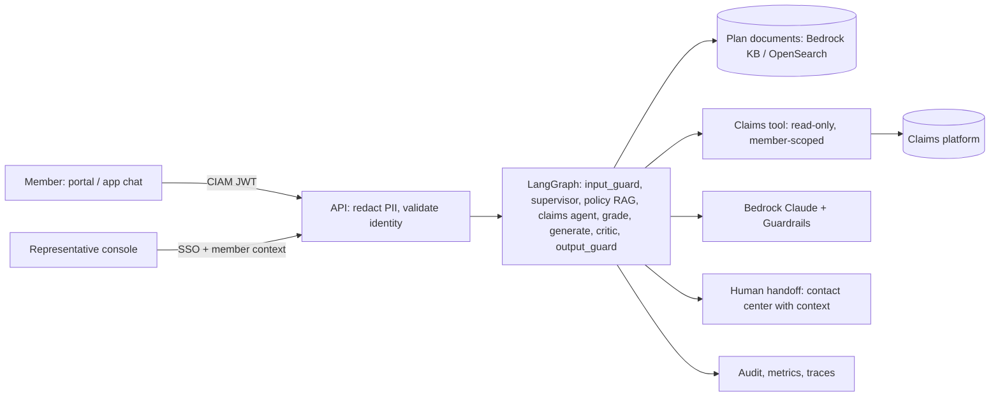

# 01 - Phase A: Architecture Vision

## Problem statement
Health-plan member services handle a high volume of repetitive questions ("what is my deductible?", "why was my
claim denied?") whose answers are split between benefit documents and the claims system. Answers must be accurate
and cited, members' health and claim data is protected (PHI), and a member must never see someone else's claim.

## Goals and KPIs
Pilot targets, not prototype results; baselines captured in the first month.
| ID | Goal | KPI | Baseline | Target |
|---|---|---|---|---|
| G1 | Higher self-service | Contained resolution rate for benefit/claim-status chats (no human transfer, no repeat contact in 7 days) | TBD | 45% |
| G2 | Shorter handle time | Representative average handle time on assisted calls | TBD (A: 9 min) | -20% |
| G3 | Consistency | Same question -> same cited answer across channels | n/a | >= 95% agreement on audit sample |
| G4 | No cross-member leakage | Cross-member disclosures | 0 | 0 |
| G5 | Member experience | CSAT on AI chats | TBD | >= 4.0/5 |
| G6 | Safe handoffs | Escalations delivered with context to a human | n/a | 100% |

AI quality metrics (prototype local run, 21 golden cases, llama3.2): intent accuracy 0.947 (gate 0.85), retrieval hit rate 0.929 (gate 0.85), guardrail accuracy 1.0 (gate 1.0), leakage-free rate 1.0 (gate 1.0), keyword recall 0.639 **(FAILED gate 0.75 on the 3B local model)**, red-team 27/27 must-pass cases with 5 documented known gaps (leetspeak, non-English, base64, role-play jailbreaks, names/addresses); local latency p50 26.7 s, p95 43.4 s. Production targets on Bedrock: intent >= 0.95, hit >= 0.90, keyword recall >= 0.80, faithfulness >= 4.0/5 (judge), leakage-free 1.0, guardrail accuracy 1.0, red-team including known-gap cases >= 95% with Bedrock Guardrails, p95 <= 12 s.

## Stakeholders and concerns
| Stakeholder | Concern | Influence |
|---|---|---|
| Members | Correct, understandable answers; privacy; reach a human | High |
| Member-services representatives | Not replaced; useful assist; fewer repeat contacts | High |
| Head of Member Services (sponsor) | Cost to serve, CSAT | High |
| Privacy Officer / Security | PHI minimisation, BAA, auditability | High (veto) |
| Compliance / Legal | Accuracy of denial explanations, appeal rights language | High (veto on wording) |
| Claims operations | Read-only access, load on claims API | Medium |
| IT / contact-center platform | Handoff integration | Medium |
| Regulators / auditors | Records of automated communications | Medium |

## Scope
| In | Out |
|---|---|
| Benefit Q&A with citations; claim status and denial explanations (own claims, read-only); follow-up memory; human handoff; chat UI + API + AgentCore endpoint | Claim adjudication or reprocessing; prior-authorization decisions; medical advice; payments; filing appeals on the member's behalf (Phase 2 may draft, human submits) |
| PII redaction, authorization, guardrails, evaluation, observability | Voice channel (Phase 2); multilingual (Phase 2) |
Constraints: HIPAA; identity from verified token; AWS HIPAA-eligible services; no PHI to non-BAA tools (LangSmith configured for hiding or self-hosted). Assumptions: claims API available read-only; plan documents current and versioned.

## Solution concept

## Statement of Architecture Work
Deliver the architecture and a 9-month plan to move from prototype to a HIPAA-compliant, AWS-hosted member-facing service on Bedrock AgentCore with CIAM identity, claims-API integration, contact-center handoff, quality gates and operations. Sponsor: Head of Member Services. Architecture work: ESTIMATE 4 weeks (EA 1.0 FTE, AI lead 0.5, Privacy 0.2, Compliance 0.2).

## Initial risk register
| ID | Risk | L | I | Mitigation |
|---|---|---|---|---|
| R-MSC-01 | Hallucinated benefit amount or denial reason | M | H | Citations, numeric groundedness check + judge fact-check, critic loop, claim fields quoted from record |
| R-MSC-02 | Cross-member data disclosure | L | Critical | Authorization in code, identity from JWT, no-enumeration replies, red-team |
| R-MSC-03 | PHI leakage to model provider or tracing | L | Critical | Redaction, BAA/zero-retention, LangSmith hide-inputs or self-host, hashed ids |
| R-MSC-04 | Bias: answers differ by plan, language or member group | M | H | Fairness evaluation across plans/demographic proxies, plain-language checks |
| R-MSC-05 | Prompt injection / jailbreak (known gaps: leetspeak, non-English, base64, role-play) | M | H | Bedrock Guardrails PROMPT_ATTACK, output guards, tool-level authz (injection cannot widen access) |
| R-MSC-06 | Policy/model drift (plan year changes, model updates) | H | M | Versioned documents by plan year, regression set, drift triggers |
| R-MSC-07 | Wrong or non-compliant denial explanation wording | M | H | Compliance-approved templates, mandatory appeal-rights text added by code |
| R-MSC-08 | Vendor lock-in (Bedrock/AgentCore) | M | M | Provider factory, KnowledgeBase interface, container is portable |
| R-MSC-09 | Latency (local p95 43 s) | H | M | Hosted model, smaller models for supervisor/critic, streaming |
| R-MSC-10 | Members cannot reach a human | M | H | Always-visible "talk to a person", handoff SLA |

## Open questions
Required disclosure language; handoff platform; whether claim detail may be sent to the LLM unredacted under the BAA.
