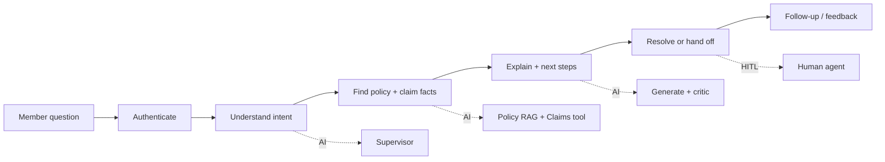
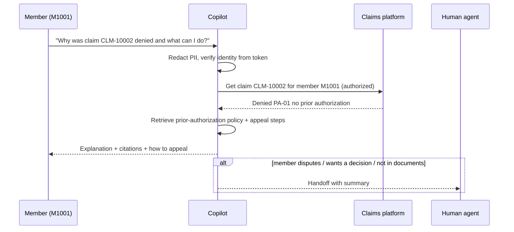

# 02 - Phase B: Business Architecture

## Capability map
| Capability | Current | Target | AI role |
|---|---|---|---|
| Benefit information | Call center, PDFs, website | Cited conversational answers | Policy RAG agent |
| Claim status and denial explanation | Representative looks up, explains | Member self-serve with next steps | Claims agent + policy agent |
| Follow-up conversations | Repeat calls | Session memory, standalone-question rewrite | Checkpointer |
| Identity and authorization | IVR/portal login | Token-bound member scope | Tool authz |
| Escalation | Phone transfer | Warm handoff with transcript summary | Direct response + handoff |
| Quality and compliance monitoring | Call QA sampling | Automated audit, gates, sampling | Eval + observability |
| Representative assist | Search tools | Same copilot on behalf of the member in context | Phase 2 |

## Value stream: "Member gets a clear answer about benefits or a claim"

## Process flows

As-is: member calls; representative opens claims screen and benefit PDFs; 8-10 minute call. To-be: chat resolves routine cases; representatives take the exceptions.

## Actors and organization impact
| Actor | Access | Impact |
|---|---|---|
| Plan member (Gold PPO, Silver HMO...) | Policy documents + own claims | Self-service |
| Member-services representative | Same, scoped to the member being helped (Phase 2) | Faster handling; focus on complex cases |
| Integrating system (portal backend, AgentCore caller) | `x-api-key` / token | Embeds the copilot |
| Compliance reviewer | Audit and sampled transcripts | Review workload shifts to sampling |
New roles: AI content owner (policy documents per plan year), conversation reviewer (QA sampling).

## Use cases
| ID | Use case | Actor |
|---|---|---|
| UC-1 | Ask a benefit question (deductible, copay, coverage) | Member |
| UC-2 | Check claim status | Member |
| UC-3 | Understand a denial and next steps | Member |
| UC-4 | Follow-up question in the same session | Member |
| UC-5 | Request something outside scope or not in documents (e.g. acupuncture coverage not documented) | Member |
| UC-6 | Ask about someone else's claim | Member (must be refused without disclosure) |
| UC-7 | Hand off to a human | Member / system |

## Business rules
| ID | Rule |
|---|---|
| BR-1 | Members can only retrieve their own claims; "not found" and "not yours" return identical replies |
| BR-2 | Benefit answers are drawn only from plan documents for the member's plan and plan year; every answer cites its source |
| BR-3 | Denial explanations quote the claim's denial code and reason from the record, then the relevant policy (e.g. PA-01 prior authorization, OON-05 out-of-network, TF-02 timely filing) and next steps (appeal) |
| BR-4 | No medical advice; no coverage determinations beyond what documents state; if not in documents, escalate |
| BR-5 | PII (names, SSNs, phone, email, DOB, member numbers) is redacted before any model call and in logs |
| BR-6 | Required disclosures: AI assistant identification and appeal-rights text on every denial explanation |
| BR-7 | The member can reach a human at any time |
| BR-8 | Prompt injection and out-of-scope requests are refused without revealing system details |

## Human-in-the-loop and escalation
| Point | Human | Trigger |
|---|---|---|
| Not in documents / low retrieval relevance | Member services representative | Critic or grader fails after bounded loops; answer says it will escalate |
| Disagreement with a decision, appeal filing, grievance | Appeals team | Intent `appeal` / member expresses dispute |
| Safety / distress language (self-harm, emergency) | Crisis protocol / emergency guidance | Keyword + classifier; show emergency instructions and live transfer |
| Cross-member probing, injection attempts | Security | Repeated attempts per session |
| Low-rated answers | AI content owner | 👎 or critic flagged |

## Gap analysis
| Baseline | Target | Gap |
|---|---|---|
| 3 demo members, `member_id` in request body | CIAM JWT, 150k members | Identity integration (AgentCore inbound auth / Cognito) |
| 8 policy docs, 8 claims (CSV/JSON) | All plans and plan years; live claims API | Connectors, plan-year versioning |
| In-memory/SQLite checkpointer | Durable, encrypted session store with TTL | DynamoDB/Postgres checkpointer or AgentCore Memory |
| Local rules only for known-gap attacks | Bedrock Guardrails ML filters on | Guardrail configuration and tuning |
| No handoff | Warm transfer to contact center | Integration |
| English only | Spanish and other languages | Phase 2 |

## Open questions
Is the representative console in scope at MVP? What are legal requirements for chatbot disclosure and transcript retention?
