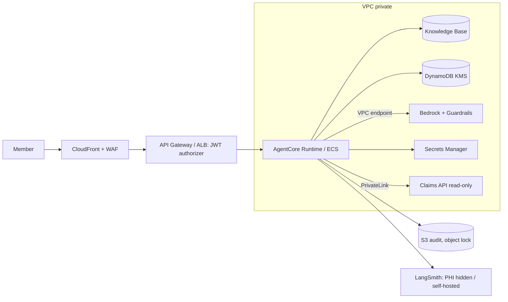
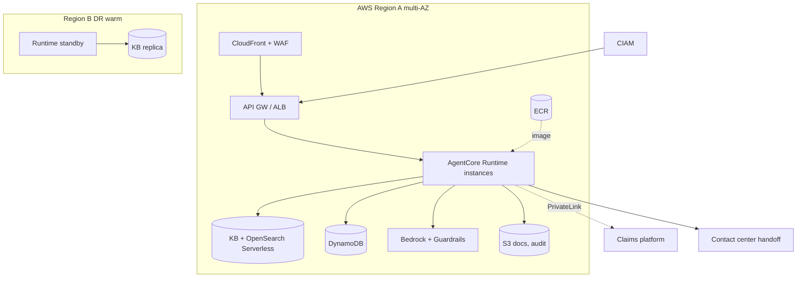

# 04 - Phase D: Technology Architecture

AWS (A-04: only HIPAA-eligible services under the BAA; verify each). All sizing is **ESTIMATE**.

## Infrastructure
| Layer | Choice |
|---|---|
| Agent runtime | **Bedrock AgentCore Runtime** (arm64 container from the repo's `Dockerfile`; `/ping`, `/invocations` on 8080; inbound auth via Cognito/JWT authorizer); alternative already documented: ECS Fargate or App Runner (ADR-MSC-02) |
| Models | Bedrock Claude (inference profile) + Titan Text Embeddings v2; Bedrock Guardrails (`create_guardrail.py`) |
| Retrieval | Bedrock Knowledge Bases (OpenSearch Serverless) or OpenSearch domain; S3 source bucket |
| State | DynamoDB (checkpointer, TTL 24 h) or AgentCore Memory |
| Edge | CloudFront + WAF -> API Gateway or ALB for member traffic; portal backend calls via private connectivity |
| Network | VPC with private subnets; VPC endpoints (Bedrock runtime, S3, DynamoDB, Secrets, ECR, CloudWatch); claims platform via PrivateLink/VPN |
| Identity | CIAM (Cognito or enterprise) with member JWT carrying `member_id`, plan; workforce IdP (OIDC) for representatives |
| Queue | SQS for handoff and feedback events |

## Environments
| | Dev | Test | Staging | Prod |
|---|---|---|---|---|
| Data | Synthetic (3 members) | Synthetic scaled | Synthetic only (**no PHI outside prod**) | Real |
| LLM | Ollama / Bedrock small | Bedrock | Prod model | Prod model + Guardrails |
| Claims API | Mock (`claims.json`) | Mock | Vendor sandbox | Prod read-only |
| Tracing | LangSmith (synthetic) | LangSmith | LangSmith | Self-hosted or hide inputs/outputs |
| Access | Developers | QA | QA + Compliance | Members via CIAM |

## Security architecture

IAM: runtime role limited to `bedrock:InvokeModel` on approved profiles, `ApplyGuardrail`, KB retrieve, DynamoDB table, specific S3 prefixes (see `iam-runtime-policy.json` / `iam-trust-policy.json` in `deploy/aws`). KMS CMKs per data class. WAF: managed rule groups, bot control, rate limit per member and IP. Network zones: edge, app, data, claims-link. Secrets in Secrets Manager. Pen test before GA. Bedrock model-invocation logging to encrypted S3 with restricted access.

## Observability
| Signal | Tool | Items |
|---|---|---|
| Logs | CloudWatch (structured JSON, no message bodies) | request id, hashed member, intent, outcome, flags |
| Audit | S3 object lock | pseudonymised audit events |
| Metrics | CloudWatch/Grafana | requests by intent/outcome, containment, handoff rate, `authz_denied`, guardrail blocks, grounded rate, latency, tokens, cost per conversation |
| Traces | LangSmith (threads per `session_id`; auto feedback `grounded`, `guardrail_blocked`, `authz_denied`, `intent:*`; user `user_score`) | per node latency/tokens; PHI hidden |
| LLM monitoring | LangSmith + eval jobs | groundedness flag rate, critic rejection rate, retrieval relevance, intent fallbacks, CSAT, sampled transcript scoring |

## HA / DR
Availability 99.9% (member-facing, 24x7). RTO 1 h / RPO 15 min for session state (non-critical: loss of memory degrades gracefully); knowledge base rebuildable from S3 in ~1 h; multi-AZ; DR region warm standby for the runtime and read replicas of documents (no PHI replicated except audit). Degraded mode: if Bedrock is unavailable, serve a static message with phone/handoff options and (policy-only) cached answers.

## Capacity and sizing (ESTIMATE)
| Input | Value | Basis |
|---|---|---|
| Members / chats | 150,000 / 3,000 per day | 2% daily chat rate |
| Turns | ~3 per chat = 9,000/day (~0.1 per second average) | assumption |
| Peak | 60 concurrent chats; 6 turns/s burst | 10x average at open enrollment |
| LLM calls per turn | ~3 (supervisor, generate, critic); +1 for regeneration (10%) -> 3.3 | graph |
| Tokens per call | 3,500 in / 350 out | 4 chunks x ~700 tokens + history + system |
| Corpus | 4,000 chunks x 1,024 x 4 B = ~16 MB | trivial |
| Runtime | each turn ~10 s of mostly waiting; 60 concurrent -> 6-8 container instances | autoscale |
| Quotas | peak 6 turns/s x 3.3 calls = ~20 calls/s -> request Bedrock quota increase early | critical path |

## Deployment diagram

## Standards and alternatives
| Area | Choice | Rejected |
|---|---|---|
| Agent hosting | AgentCore Runtime | Fargate (fine; chosen if AgentCore not HIPAA-eligible per A-04 or for portability), Lambda (long calls, cold starts) |
| Models | Bedrock Claude + Titan | OpenAI/Azure (extra BAA path), self-hosted open models (accuracy and ops) |
| Retrieval | Bedrock KB (managed) with Chroma only for local | Pinecone (data egress, BAA), pgvector |
| Guardrails | Local rules + Bedrock Guardrails | Local rules alone (5 documented known gaps), third-party gateways |
| Memory | DynamoDB/AgentCore Memory | In-memory/SQLite (not durable, single instance) |
| Observability | LangSmith (PHI hidden/self-hosted) | Sending PHI to SaaS without BAA |
| IaC | Terraform (plus existing `deploy/aws` scripts for bootstrap) | Console deployments |

## Open questions
Is AgentCore Runtime HIPAA-eligible for the intended region/date? Is self-hosting LangSmith acceptable or should Langfuse/OTel be used?
