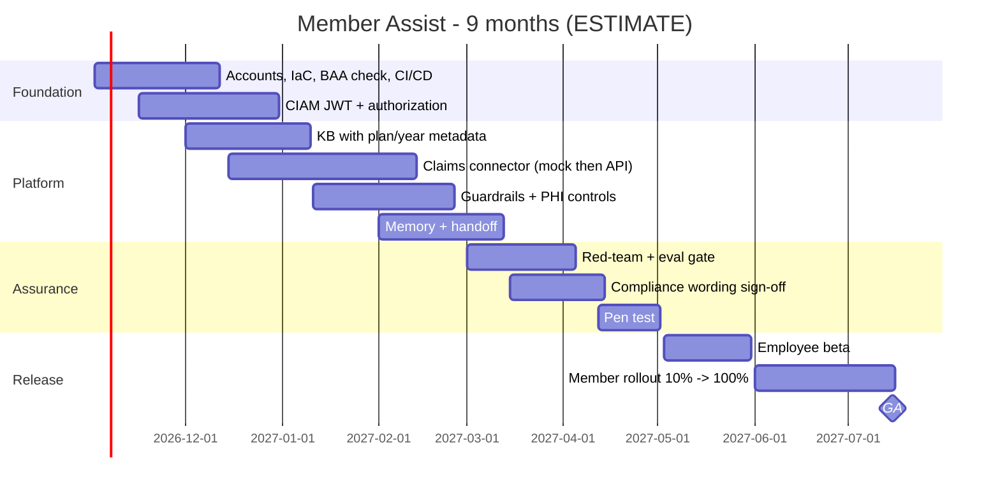

# 06 - Phase F: Migration / Delivery Planning

All figures **ESTIMATE**; rates are placeholders (A-05).

## Team (FTE by phase)
| Role | Build (m1-6) | Beta + GA (m7-9) | Run (m10+) |
|---|---|---|---|
| Product owner | 0.5 | 0.5 | 0.25 |
| Architect | 0.5 | 0.25 | 0.1 |
| AI/ML engineers | 2.5 | 1.5 | 0.75 |
| Backend / integration | 1.5 | 1 | 0.5 |
| Frontend / UX | 1 | 0.5 | 0.25 |
| Data engineer (documents, KB) | 1 | 0.5 | 0.25 |
| DevOps/MLOps | 1.5 | 1 | 0.75 |
| QA / test automation | 1.5 | 1.5 | 0.5 |
| Security engineer | 0.5 | 0.5 | 0.25 |
| Privacy / compliance analyst | 0.5 | 0.5 | 0.25 |
| Conversation designer / content owner | 0.5 | 0.5 | 0.5 |
| **Total** | **11.5** | **8.25** | **4.35** |

Skill gaps: HIPAA-aware AI engineering (high), Bedrock Guardrails/AgentCore (medium), claims-domain knowledge (via SMEs), conversation design (medium), red-teaming (medium).

## Cost (USD, ESTIMATE)
**People:** build 11.5 x 6 = 69 FM; beta/GA 8.25 x 3 = 24.75 FM; total 93.75 FM x 13,000 (higher blended rate for regulated work, A-05) = **USD 1,218.75k** one-time. Run: 4.35 x 13,000 = 56.55k/month.

**Infrastructure monthly (prod):**
| Item | Sizing | USD |
|---|---|---|
| AgentCore Runtime / ECS | ~8 instance-equivalents (2 vCPU) | 700 |
| OpenSearch Serverless / KB | 2 OCU search + 2 OCU indexing minimum | 700 |
| DynamoDB, S3, KMS, CloudWatch, SQS | | 400 |
| CloudFront, WAF (bot control), API GW/ALB, NAT/endpoints | | 600 |
| LangSmith self-hosted (small EKS/ECS) or hosted team plan | | 300 |
| Bedrock Guardrails | 9,000 turns/day x 30 x ~2 evaluations x ~2 text units = ~1.1M units; ASSUMED 0.75 per 1k units (verify) | 810 |
| **Prod** | | **~3,510** |
| Non-prod (0.6x; Guardrails and KB smaller) | | 1,500 |
| **Total** | | **~5,010** |

**LLM usage:** turns/month = 9,000 x 30 = 270,000; LLM calls = 3.3 per turn = 891,000; tokens per call 3,500 in + 350 out -> 3,118.5M in + 311.9M out. At ASSUMED USD 3 / 15 per 1M: 9,355.5 + 4,678 = **~USD 14,034/month**. Embeddings of queries 270,000 x 40 tokens ~ 10.8M tokens at ASSUMED 0.02 per 1M < USD 1. Eval and judge runs ~USD 300/month.
Cost per conversation (3 turns) = 14,034 / 90,000 chats = **~USD 0.16** (compare with a representative-handled contact: A-06 USD 5-8; the business case must use real figures).

**Optimisation (modelled):** route supervisor and critic to a smaller model (ASSUMED USD 0.8 / 4 per 1M) for 2 of 3 calls: large calls 1/3 x (9,355.5 + 4,678) = 4,678 + small 2/3 x 3,430 (= (3,118.5 x 0.8 + 311.9 x 4) x 2/3 = (2,494.8 + 1,247.6) x 2/3 = 2,494.9) = **~USD 7,173/month (-49%)**. Further: prompt caching of static prompts (-15% input), policy-answer cache, skip critic for high-confidence direct responses, limit history window.

| TCO (list-price basis, before optimisation) | 12 months | 3 years |
|---|---|---|
| Build people (m1-9) | 1,218,750 | 1,218,750 |
| Run people (m10-12 = 3 x 56.55k; 3 yr: 3 + 24 months) | 169,650 | 1,526,850 |
| Infra (5,010 x 12 / x 36; conservative, full size from month 1) | 60,120 | 180,360 |
| LLM + eval (14,334/month: year 1 = 3 live months at 50% average load = 21,501; 3 yr = 21,501 + 27 x 14,334) | 21,501 | 408,519 |
| Tools, pen test, red-team, compliance review | 120,000 | 168,000 |
| Subtotal | 1,590,021 | 3,502,479 |
| Contingency 20% | 318,004 | 700,496 |
| **TCO** | **~1,908.0k** | **~4,203.0k** |

(The package index's "~USD 1.5M build" = build people 1,218.75k x 1.20 contingency = ~1.46M.) With the 49% model-mix optimisation, LLM spend falls by about USD 6.9k/month at steady state (~USD 83k/year).

One-time: build people, pen test, red-team, compliance reviews. Recurring: run people, infra, LLM, Guardrails.

## Roadmap

Milestones: M1 environments + identity (wk 10), M2 MVP in staging (wk 22), M3 security/privacy/compliance sign-off (wk 28), M4 employee beta (wk 31), M5 10% members (wk 35), M6 GA (wk 38). 19 two-week sprints.
**Critical path:** claims API access + PHI approval -> authorization tests -> compliance wording sign-off -> pen test -> beta -> rollout. Bedrock quota increase runs in parallel and must be requested in month 1.

## Open questions
Rate card; real cost per assisted contact for the business case; staged release (representative-first) to reduce risk.
