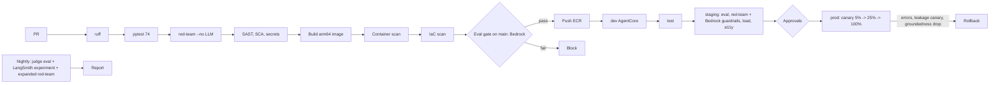

# 10 - CI/CD and MLOps / LLMOps

## Branching and promotion
Trunk-based. PRs run lint, tests and a red-team subset. `main` deploys to dev; tag `vX.Y.Z` promotes dev -> test -> staging -> prod. Prod requires: eval gate and red-team green, change record, approvals from Product Owner, Security and Privacy; **Compliance** approval when denial templates, disclosures or guardrail policies change (CODEOWNERS on `app/prompts.py`, `app/guardrails.py`, `app/tools.py`, `eval/guardrail_redteam.jsonl`, the template store).

## Pipeline


## Gates (fail the build)
`python -m eval.run_eval` already exits non-zero when a gate fails. Production thresholds (file 09): intent >= 0.95, hit rate >= 0.90, keyword recall >= 0.80, faithfulness >= 4.2, leakage-free = 1.0, guardrail accuracy = 1.0; red-team must-pass 100% and known-gap cases >= 95% when Bedrock Guardrails are on. Dependency lock (`requirements.lock`) is checked for drift.

## Existing workflow (in the project) and recommended additions
The project ships `.github/workflows/ci.yml` (jobs `test`, then `eval-gate` on `main` against Bedrock with OIDC role `AWS_CI_ROLE_ARN`, uploads `eval/reports/`). It is written for the project as its own repository; in the monorepo it must be copied to the root `.github/workflows/` with `working-directory: 06-health-member-services-copilot` (as the README states). Recommended version for production:
```yaml
name: ci-member-assist
on:
  pull_request:
    paths: ["06-health-member-services-copilot/**"]
  push:
    branches: [main]
permissions: { contents: read, id-token: write }
defaults: { run: { working-directory: 06-health-member-services-copilot } }
jobs:
  test:
    runs-on: ubuntu-latest
    steps:
      - uses: actions/checkout@v4
      - uses: actions/setup-python@v5
        with: { python-version: "3.12", cache: pip }
      - run: pip install -r requirements-dev.txt pip-audit bandit
      - run: ruff check app eval tests
      - run: pytest -q                        # fake LLM + fake KB, no Ollama/AWS
      - run: python -m eval.guardrail_check   # local-rule red-team, instant
      - run: bandit -r app -ll
      - run: pip-audit -r requirements.lock
      - uses: gitleaks/gitleaks-action@v2
  eval-gate:
    needs: test
    if: github.ref == 'refs/heads/main'
    runs-on: ubuntu-latest
    env:
      LLM_PROVIDER: bedrock
      AWS_REGION: us-east-1
      RELEVANCE_THRESHOLD: "0.35"
      EVAL_JUDGE_PROVIDER: bedrock
      BEDROCK_GUARDRAIL_ID: ${{ vars.BEDROCK_GUARDRAIL_ID }}
    steps:
      - uses: actions/checkout@v4
      - uses: actions/setup-python@v5
        with: { python-version: "3.12" }
      - uses: aws-actions/configure-aws-credentials@v4
        with: { role-to-assume: "${{ secrets.AWS_CI_ROLE_ARN }}", aws-region: us-east-1 }
      - run: pip install -r requirements.txt
      - run: python -m app.ingest --reset
      - run: python -m eval.run_eval
      - run: python -m eval.guardrail_check --bedrock
      - uses: actions/upload-artifact@v4
        if: always()
        with: { name: eval-report, path: 06-health-member-services-copilot/eval/reports/ }
  build-deploy-dev:
    needs: eval-gate
    runs-on: ubuntu-latest
    steps:
      - uses: actions/checkout@v4
      - uses: aws-actions/configure-aws-credentials@v4
        with: { role-to-assume: "${{ secrets.AWS_DEPLOY_ROLE_ARN }}", aws-region: us-east-1 }
      - run: bash deploy/aws/deploy.sh          # existing script: ECR build/push, AgentCore deploy (arm64) -- to be parameterised per environment
      - run: python deploy/aws/invoke_agentcore.py "What is the Gold PPO deductible?"   # smoke
```
Additions marked "recommended" (`pip-audit`, `bandit`, `gitleaks`, `--bedrock` guardrail check, container scan, per-environment deploy parameters, canary and rollback orchestration) are **not in the repo yet**. CI must never use real PHI; test and eval data are synthetic.

## CD outline
Terraform for network, KMS, DynamoDB, KB, WAF, Cognito; existing scripts (`create_guardrail.py`, `deploy_agentcore.py`, `iam-*.json`) become modules/steps. Prod rollout: AgentCore runtime versions with endpoint aliases (5% -> 25% -> 100%, 15 min each) guarded by CloudWatch alarms: 5xx > 2%, p95 > 20 s, `authz_denied` anomalies, groundedness < 90%, and a **synthetic leakage probe** (a canary member asks for another canary member's claim every minute; any disclosure triggers rollback and Sev1).

## IaC layout
```
infra/ modules: network kms dynamodb knowledge_base agentcore ecr waf cognito monitoring guardrail
      envs: dev test staging prod (S3 backend + lock)
deploy/aws/ (existing scripts reused for bootstrap)
```

## Model, prompt, guardrail, data versioning
| Asset | Versioning |
|---|---|
| Prompts and templates | Git (`app/prompts.py`, template store for denial/appeal text); version string in trace metadata |
| Models | `BEDROCK_CHAT_MODEL_ID` (inference profile) pinned per environment; judge model separate; swap = RFC + LangSmith experiment + red-team |
| Bedrock Guardrail | Guardrail ID + version managed by IaC/`create_guardrail.py`; version pinned per environment |
| Knowledge base | Per plan-year data sources; ingestion job IDs; index alias for blue/green |
| Eval datasets | `eval/golden_dataset.jsonl`, `eval/guardrail_redteam.jsonl` in Git, reviewed by AI Lead and Compliance |
| Dependencies | `requirements.lock` |
| Feature flags | AppConfig: critic mode, groundedness mode, streaming, handoff, intents enabled per channel |

## Open questions
Does the contact-center vendor need a separate pipeline? Is a dedicated AWS account per environment mandated?
