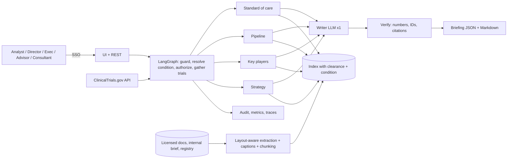

# 01 - Phase A: Architecture Vision

## Problem statement
Strategy teams spend days assembling the same picture for each condition: what the guideline recommends, what is
in the pipeline and who is behind it, from complex PDFs, internal briefs and registries. Facts hide in multi-page
tables and figures.

## Goals and KPIs
Pilot targets, not prototype results.
| ID | Goal | KPI | Baseline | Target |
|---|---|---|---|---|
| G1 | Briefing prep time | Hours from request to reviewed briefing | TBD (A: 24 h) | <= 3 h incl. review |
| G2 | Consistency | Briefings following the standard five-section format | n/a | 100% |
| G3 | Traceable | Statements with a valid source | n/a | >= 98% (rest labelled unattributed) |
| G4 | Correct counts | Counts and rankings matching the registry | n/a | 100% |
| G5 | Safe scope | Patient-specific advice given | 0 | 0 |
| G6 | Access control | Internal content shown to public-clearance roles | 0 | 0 |

AI quality metrics (prototype, synthetic): extraction checks 8/8; retrieval hit@6 1.0, MRR 0.917 across 12 questions / 11 source types; internal chunks to public role 0; guardrail precision/recall 1.0/1.0 (14 cases); registry analytics 6/6; RAGAS hybrid k=6 precision 0.958 / recall 0.892; 37 tests. Production gates: extraction >= 95% of checks on a 30-document real set; hit@6 >= 0.95; faithfulness >= 0.85 and response groundedness >= 0.85 (strong judge; 3B judge failed on faithfulness); numbers/IDs ungrounded in output = 0; section completeness 100%; clinical-advisor rating >= 4/5 on standard-of-care accuracy.

## Stakeholders and concerns
| Stakeholder | Concern | Influence |
|---|---|---|
| Strategy analysts | Time saved, defensible sources | High |
| Service-line directors / executives | Concise, accurate, comparable briefings | High |
| Physician advisors | Clinical accuracy, no overreach | High |
| Legal / licensing | Content rights, attribution | High (veto) |
| External consultants | Public-only view | Low |
| Security | Internal strategy confidentiality | Medium |
| IT | Document ingestion effort | Medium |

## Scope
| In | Out |
|---|---|
| Condition briefings (executive summary, standard of care, emerging treatments with late-stage table, key companies and institutions, strategic considerations); follow-up Q&A; live ClinicalTrials.gov mode; extraction view for QA | Patient-specific advice; clinical decision support; market-size forecasting; full competitive-intelligence platform |
| Complex-document extraction (columns, cross-page tables, figures) | OCR of scanned documents (Phase 2) |
| Roles/clearance, guardrails, audit | Publishing briefings externally |
Constraints: licence terms; disclaimer on every briefing; clearance before retrieval. Assumptions: A-01..A-03.

## Solution concept

## Statement of Architecture Work
Deliver the architecture and a 5-month plan to move from a synthetic-data prototype to an SSO-integrated, AWS-hosted service on licensed content, with a content-rights register, clinical review workflow, evaluation gate in CI and operations. Sponsor: CSO / Strategy Head. Architecture work: ESTIMATE 2 weeks (EA 1.0 FTE, AI lead 0.5, Legal 0.2).

## Initial risk register
| ID | Risk | L | I | Mitigation |
|---|---|---|---|---|
| R-CBR-01 | Hallucinated clinical or pipeline facts | M | H | Deterministic evidence gathering, grounding check, citations, clinical review |
| R-CBR-02 | Misread tables/figures (extraction or vision errors) | M | H | Extraction report, caption verification flag, side-by-side extraction tab, QA set |
| R-CBR-03 | Copyright/licence breach from ingesting or reproducing content | M | H | Rights register, quote limits, attribution, Legal gate |
| R-CBR-04 | Internal strategy leakage to consultants | L | H | Clearance before retrieval, tests |
| R-CBR-05 | Bias: briefings favour well-documented companies/institutions or large sponsors | M | M | Show data coverage, counts by sponsor type, caveat on registry completeness |
| R-CBR-06 | Stale content (guidelines updated, trials change status) | H | M | Refresh schedule, retrieval date and document version in briefing, cache expiry |
| R-CBR-07 | Drift: model/provider update changes briefing style | M | M | Pinned models, regression set |
| R-CBR-08 | Misuse as clinical advice | L | H | Refusal, disclaimer, role limits |
| R-CBR-09 | Vendor lock-in | M | L | Provider switch by config |
| R-CBR-10 | Latency: prototype briefing took ~492-600 s on CPU | H | M | Hosted model, one writer call, cache (< 1 s on repeat) |

## Open questions
Baseline prep time; licence terms of target sources; who is the clinical reviewer of record.
