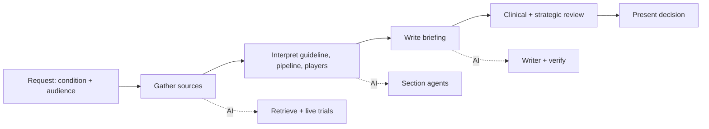
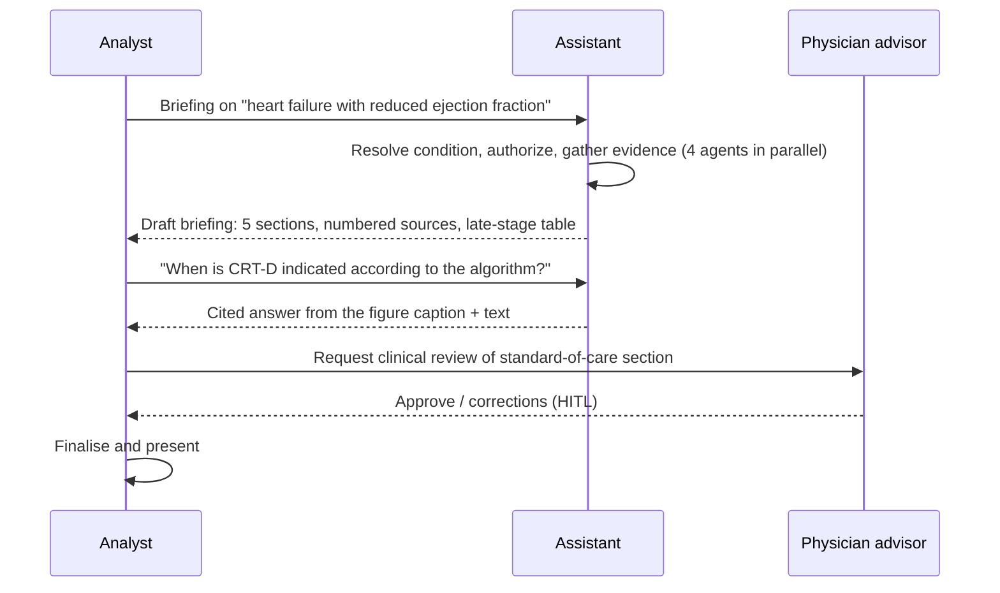

# 02 - Phase B: Business Architecture

## Capability map
| Capability | Current | Target | AI role |
|---|---|---|---|
| Condition landscape briefing | Days of manual research | Minutes + review | Briefing workflow |
| Guideline interpretation | Reading PDFs, tables, algorithms | Structured standard-of-care section | Extraction + retrieval + writer |
| Pipeline tracking | Spreadsheets, registry searches | Computed counts, late-stage table | Registry analytics, live trials |
| Competitor/partner mapping | Ad hoc | Ranked companies and institutions | Key-players agent |
| Internal strategy alignment | Slide decks | Strategic considerations tied to internal targets | Strategy agent (cleared roles only) |
| Follow-up analysis | Email analyst | Cited Q&A on same sources | RAG Q&A |
| Content governance | Informal | Rights register, refresh, review log | Platform |

## Value stream: "Brief the leadership on a condition"

E and F remain human.

## Process flow

As-is: analysts read PDFs and registries for days. To-be: draft in minutes, review in hours.

## Actors and organization impact
| Actor | Role key | Clearance | Live data | Style |
|---|---|---|---|---|
| Strategy analyst | `strategy_analyst` | internal | yes | analyst |
| Service-line director | `service_line_director` | internal | yes | analyst |
| Executive (CSO/COO) | `executive` | internal | no | executive (briefing only) |
| Physician advisor | `clinical_advisor` | internal | yes | clinical |
| External consultant | `external_consultant` | public | no | analyst |
Impact: analysts shift from collection to verification and synthesis; new content steward role (0.5 FTE) maintains the rights register and refresh calendar.

## Use cases
| ID | Use case | Actor |
|---|---|---|
| UC-1 | Generate a briefing for a catalogued condition | Analyst, Director |
| UC-2 | Generate a briefing for any condition with live trial data | Analyst, Advisor |
| UC-3 | Executive short briefing | Executive |
| UC-4 | Ask follow-up questions on the sources | Analyst, Advisor, Consultant |
| UC-5 | Inspect extraction quality for a document | QA / content steward |
| UC-6 | Public-sources-only briefing | Consultant |

## Business rules
| ID | Rule |
|---|---|
| BR-1 | Fixed sections: executive summary, standard of care, emerging treatments (with late-stage table), key companies and institutions, strategic considerations (cleared roles only) |
| BR-2 | Counts, phases and rankings come from registry analytics, never from the LLM |
| BR-3 | Every bullet carries a numbered source; if none matches, it is marked unattributed |
| BR-4 | No patient-specific advice; second-person treatment language is flagged |
| BR-5 | Roles see only documents at or below clearance; internal strategy documents never reach public roles |
| BR-6 | Live mode: show retrieval date, source URL/NCT IDs, and limit to recruiting/active Phase 2-3 (configurable) |
| BR-7 | Briefing disclaimer is always attached |
| BR-8 | Licensed content is quoted within licence limits and attributed |

## HITL and escalation
| Point | Human | Trigger |
|---|---|---|
| Clinical accuracy of standard-of-care | Physician advisor | Every briefing for external use; sampled otherwise |
| Strategic considerations | Service-line director | Before leadership circulation |
| Unattributed or caveated bullets | Analyst | Shown in the review panel |
| Extraction flags (caption verification) | Content steward | Drug names found nowhere else |
| Refused request | Requester -> clinical team | Patient-specific questions go to clinicians |

## Gap analysis
| Baseline | Target | Gap |
|---|---|---|
| 4 synthetic sources | Licensed guidelines + internal briefs + registries | Licensing, connectors |
| Static CSV registry | Scheduled refresh + live API | Jobs, caching rules |
| Demo keys | SSO | IdP mapping |
| Streamlit | Export to slide/Word, shareable link | Export feature (Phase 2) |
| Cache 24 h per role/clearance | Cache + invalidation on content refresh | Invalidation logic |

## Open questions
Which export formats are required? Is a human clinical sign-off required before executives see a briefing?
