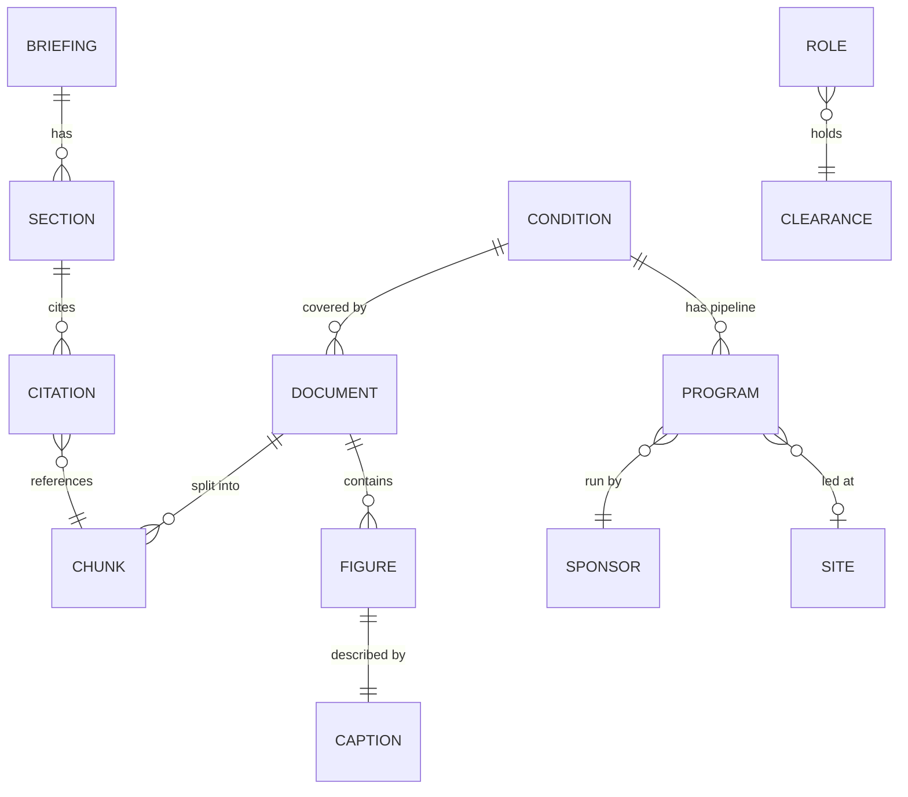
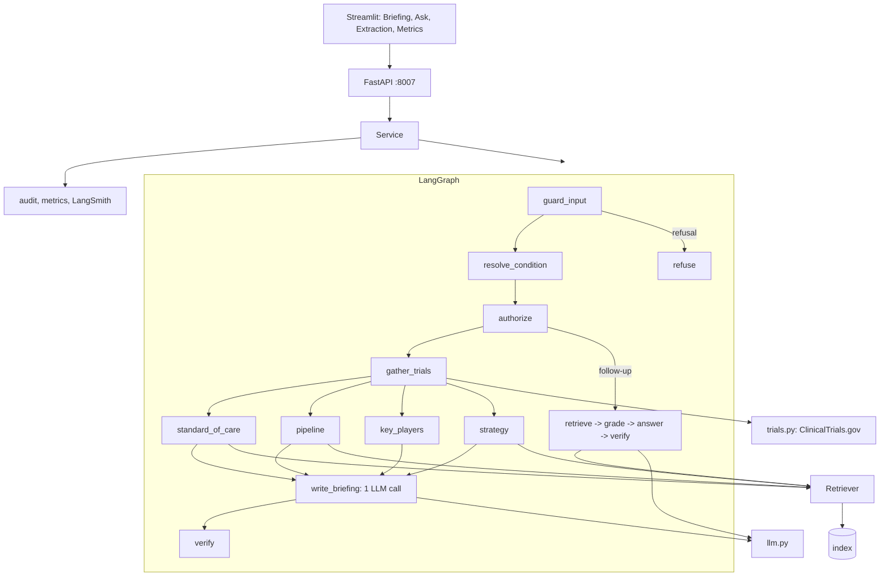
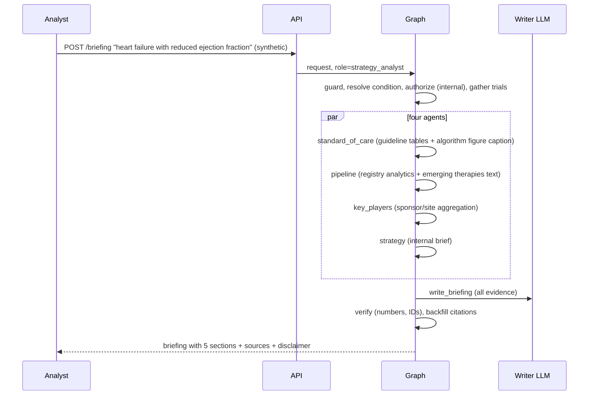

# 03 - Phase C: Information Systems Architecture

## 03a - Data architecture

### Conceptual model


### Logical / physical
| Entity | Attributes | Store |
|---|---|---|
| Document | doc_id, title, version/date, condition(s), classification {public, internal}, source type, licence/rights id | S3 + rights register |
| Chunk | content_type {text, table, image, record, footnote}, section, page, condition, classification, contextual header | Chroma -> OpenSearch |
| Figure + caption | image id, PNG, SHA-256, transcription, description, verification flag | S3 + `captions` cache |
| Program (trial registry) | program id / NCT id, condition, mechanism, modality, phase, status, sponsor, lead site (26 synthetic programs; live API for real) | Table (Parquet/Postgres), also record chunks |
| Briefing | request, role, clearance, style, sections JSON + Markdown, source list, evidence hash, model/prompt versions, created | S3/DynamoDB (cache keyed by condition + clearance + style + content version, 24 h) |
| Audit event | ts, role, task, condition, sources used, flags, latency | JSONL -> S3 |
| Rights register | source, licensor, permitted use (summarise, quote limits, redistribute), expiry, owner | Governed table in Git/DB |

Prototype index: 50 chunks (8 extraction checks pass; extraction report committed).

### Lineage and flow
```mermaid
flowchart LR
  PDF[Complex PDF] --> L1[Header/footer removal -> strips around tables/images -> column reading order -> ruled tables merged across pages -> headings by font size -> footnotes]
  DOCX[Word] --> L2[python-docx ordered walk]
  HTML[HTML] --> L3[BeautifulSoup]
  L1 --> IMG[Figures -> PNG -> vision caption -> verification flag]
  L1 & L2 & L3 & IMG --> CH[Chunker: text | table | image | record]
  CSV[Registry CSV] --> CH
  CH --> EMB[Embeddings] --> IDX[(Index with condition + classification)]
  CT[ClinicalTrials.gov API v2] -->|live mode, not indexed| TR[Trials gatherer]
  IDX --> AG[Section agents]
  TR --> AG
  RR[(Rights register)] -.gates ingestion.-> L1
```

### Data for AI
| Item | Design |
|---|---|
| Fine-tuning | None |
| RAG corpus | 4 documents / 50 chunks (prototype); target ~500 documents (guidelines, internal briefs, registry snapshots) / ~25,000 chunks (ESTIMATE) |
| Extraction | Lines in the top/bottom 8% repeated on most pages (digits masked) removed; reading order by strips with left column before right; tables to Markdown with cross-page merge when headers match; images >= 120 px extracted with position markers; headings by font size; footnotes by small type |
| Chunking | Section-bounded; whole tables (large tables split by rows with header repeated); figure caption = its own chunk under its section; one record chunk per registry row; contextual header |
| Embeddings | `nomic-embed-text` (local) / Titan v2 (AWS); cosine |
| Metadata | doc_id, section, condition, classification, content_type, page, version |
| Retrieval | Clearance and condition filters before ranking; hybrid vector + BM25 with RRF, k=6 (BM25 alone was within 0.006 F1 on 12 questions; vector alone clearly worse because questions hinge on drug names, trial IDs and table labels) |
| Refresh | Documents on publish/licence update; registry snapshot weekly; live trials fetched per request (cached 24 h) |

### Quality, governance, privacy, security
| Topic | Rule |
|---|---|
| Quality | Extraction checks per document (header/footer removed, columns in order, tables merged, all rows present, figures extracted, footnotes captured); documents failing checks are quarantined; caption verification flags unmatched drug names |
| Classification | public / internal; internal strategy brief confidential; clearance enforced in retrieval and in the `/documents`, `/extraction`, `/images` endpoints |
| Privacy | No patient data expected; PHI patterns (MRN, DOB, SSN, phone, email) redacted if typed |
| Licensing | Rights register gates ingestion; quote limits enforced in prompts and output checks; attribution footer |
| Retention | Documents per licence; briefings 2 years; audit 3 years; traces 90 days |
| Encryption | TLS 1.2+; KMS for S3/OpenSearch/DynamoDB |
| Access | SSO group -> role; extraction viewer limited to content stewards/analysts |

## 03b - Application architecture

### Components


### AI architecture
| Topic | Decision |
|---|---|
| Models | Writer and Q&A: Claude on Bedrock (target) / `llama3.2` local; vision: hosted multimodal / `gemma3:4b`; embeddings Titan v2 / nomic |
| Prompts | Versioned `ChatPromptTemplate`s for briefing styles (analyst, executive, clinical) and Q&A; token and bullet caps; citation instruction |
| RAG | Hybrid with clearance and condition filters; four section agents are deterministic (no LLM) |
| Agents | Parallel fan-out/join of four section agents; single writer call; conditional routes (briefing / follow-up / refusal) |
| Guardrails | Input: patient-specific advice, prompt injection, PHI redaction. Output: number and trial/document ID grounding, second-person treatment language flag, citation backfill or *unattributed* label, truncation handling, disclaimer. Clearance before retrieval |
| Fallback | If LLM fails: assemble a "facts-only" briefing from section agents' evidence without prose; keyword condition resolver |
| Caching | Briefing cache keyed by (condition, clearance, style, content version) 24 h (repeat request < 1 s in prototype); invalidated on content refresh |

### API catalog
| Endpoint | Method | Auth | Purpose |
|---|---|---|---|
| `/briefing` | POST | `X-API-Key` -> SSO | {condition, source: synthetic/live, style?} -> briefing JSON + Markdown, sources, flags |
| `/ask` | POST | same | Follow-up question with citations |
| `/conditions` | GET | same | Catalogued conditions |
| `/documents` | GET | same | Documents visible to the caller |
| `/extraction` | GET | same | Extraction report (internal docs hidden from public clearance) |
| `/images/{id}` | GET | same | Figure, clearance-checked |
| `/feedback` | POST | same | Rating |
| `/roles`, `/health`, `/metrics`, `/metrics/summary` | GET | admin/network | Ops |

### Integration patterns
Scheduled document sync from the content library; ClinicalTrials.gov REST (httpx, retries, cache); OIDC; Prometheus/OTel; optional export to slide/Word templates (Phase 2).

### Top-5 journeys

Others: **J2 Follow-up** ("When is CRT-D indicated according to the algorithm?": answer from the figure caption chunk + text); **J3 Live mode** (atrial fibrillation, outside catalogue: 40 recruiting/active Phase 2-3 studies fetched, ranked sponsors, no internal strategy section); **J4 Consultant** (public clearance: no internal chunks, no strategy section, `/extraction` hides internal docs); **J5 Refusal** ("should my father start an SGLT2 inhibitor?": blocked pre-LLM with explanation).

### Gap analysis
SSO; licensed-content ingestion with rights register; managed index; hosted vision model; export formats; scheduled refresh and cache invalidation; scanned-PDF OCR; reviewer sign-off workflow (record who clinically reviewed which briefing).

## Open questions
Does the licence permit sending guideline text to a hosted LLM? Should briefings be stored as versioned records with reviewer sign-off?
