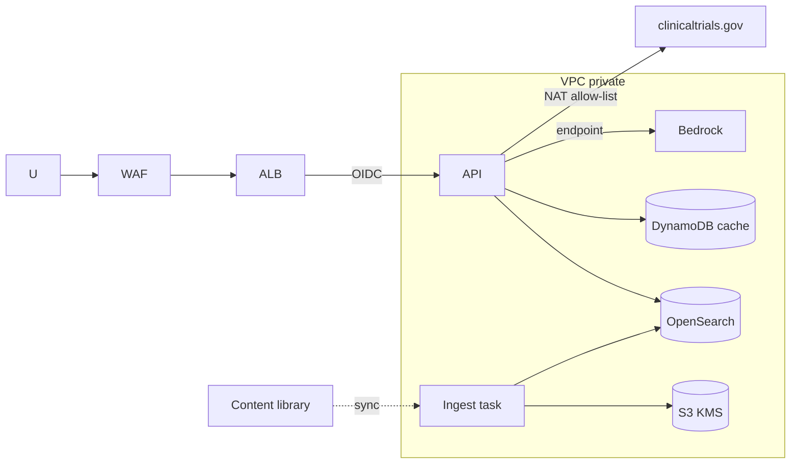
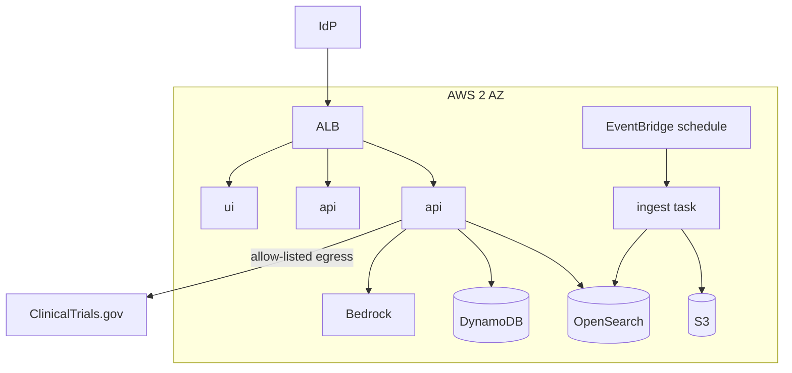

# 04 - Phase D: Technology Architecture

AWS target (A-04). All sizing is **ESTIMATE**.

## Infrastructure
| Layer | Choice |
|---|---|
| Compute | ECS Fargate: `api` (2 vCPU/4 GB, 2 tasks), `ui` (1 vCPU/2 GB, 2 tasks), `ingest` batch task (4 vCPU/8 GB; PDF extraction is CPU heavy), scheduled registry refresh |
| GPU | None; Bedrock for text and vision |
| Search | OpenSearch 2 x `m6g.large` (hybrid kNN + BM25), three indices by classification are not needed: filter by field |
| Storage | S3: raw documents (versioned, SSE-KMS), extracted Markdown/images, briefings archive, audit |
| Cache | DynamoDB table for briefing cache (TTL 24 h) |
| Network | VPC 2 AZ, private subnets, VPC endpoints; egress to ClinicalTrials.gov through a NAT with allow-listed domain (`clinicaltrials.gov`); ALB + WAF |
| Identity | Corporate IdP OIDC; consultant accounts as external guests mapped to `external_consultant` |

## Environments
| | Dev | Test | Staging | Prod |
|---|---|---|---|---|
| Content | Synthetic (4 files) | Synthetic + generated | Licensed sample (rights cleared) | Licensed + internal |
| Live trials | Mock | Live (read-only) | Live | Live |
| Models | Ollama / small Bedrock | Bedrock small | Prod model | Prod model |
| Scale | 1 task | 1 task | 2 tasks | 2-4 tasks |

## Security architecture

IAM least privilege per task role; Secrets Manager; KMS CMKs; zones edge/app/data; outbound allow-list (only the registry API and Bedrock endpoint); WAF rate limits. Internal strategy documents carry `classification=internal` and are inaccessible to consultant role at query level and via direct S3 (no presigned URLs for internal files).

## Observability
| Signal | Tool | Items |
|---|---|---|
| Logs/audit | CloudWatch -> S3 | request, role, condition, outcome, flags |
| Metrics | `/metrics` -> Grafana | briefings by role/source/outcome, cache hit rate, follow-ups, refusals, grounding failures, truncations, live-API errors, latency |
| Traces | LangSmith | per-node latency, tokens, retrieved chunks; feedback |
| LLM monitoring | LangSmith + CloudWatch | writer tokens/briefing, cost per briefing, unattributed-bullet rate, number-grounding failure rate, caption verification flags, content freshness (age of newest document per condition) |

## HA / DR
Availability 99.5% business hours; RTO 4 h / RPO 24 h; index rebuildable from S3 (extracted Markdown + caption cache) in ~1 h (ESTIMATE); multi-AZ; cold DR region; degraded mode: cached briefings and facts-only briefings if the LLM is down.

## Capacity (ESTIMATE)
| Input | Value | Basis |
|---|---|---|
| Users / usage | 40 / 150 briefings + 600 follow-ups per month | A-01 |
| Peak concurrency | 8 | Monday planning meeting |
| Briefing | 1 writer call 6,000 in + 1,500 out; resolve step 1,000 in + 100 out | 4 chunks per section + registry table |
| Follow-up | 1 answer call 4,000 in + 500 out; grade step 2,000 in + 100 out | 6 chunks |
| Corpus | 25,000 chunks x 1,024 x 4 B = ~100 MB | small |
| Ingest | ~2 documents/min/worker (PDF with 3 figures, vision calls) -> 500 documents in ~4 h on one worker | ESTIMATE |

## Deployment diagram

## Standards and alternatives
| Area | Choice | Rejected |
|---|---|---|
| Orchestration | LangGraph with fixed parallel plan | ReAct multi-turn agent loop (plan is the same for every condition; slower, less testable) |
| PDF extraction | pdfplumber + PyMuPDF with custom layout logic | Textract/Document AI as the only path (cost, figures still need separate handling); keep as a fallback for scanned PDFs |
| Search | OpenSearch hybrid | Chroma server, pgvector (BM25 matters here: drug names, trial IDs, table labels) |
| LLM | Bedrock Claude | Self-hosted on GPU, OpenAI |
| Hosting | ECS Fargate | Lambda (long extraction jobs), EKS |
| IaC | Terraform | CDK |

## Open questions
Is outbound access to ClinicalTrials.gov allowed from the production VPC? Is Bedrock acceptable under the licensed-content terms?
