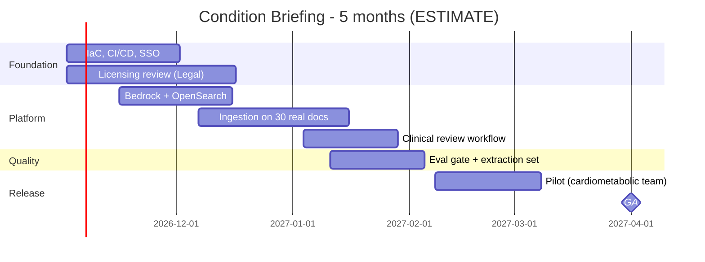

# 06 - Phase F: Migration / Delivery Planning

All figures **ESTIMATE**; rates are placeholders (A-05).

## Team (FTE by phase)
| Role | Build (m1-3) | Pilot + harden (m4-5) | Run (m6+) |
|---|---|---|---|
| Product owner | 0.4 | 0.4 | 0.2 |
| Architect | 0.3 | 0.15 | 0.05 |
| AI/ML engineers | 1.5 | 1.0 | 0.4 |
| Backend | 0.75 | 0.4 | 0.15 |
| Frontend / UX | 0.5 | 0.25 | 0.1 |
| Data engineer (ingestion) | 1.0 | 0.5 | 0.25 |
| DevOps/MLOps | 0.75 | 0.4 | 0.25 |
| QA | 0.75 | 0.75 | 0.15 |
| Security | 0.15 | 0.15 | 0.05 |
| Clinical advisor (reviewer) | 0.2 | 0.3 | 0.1 |
| Legal / licensing | 0.1 | 0.1 | 0.05 |
| Content steward | 0.25 | 0.25 | 0.25 |
| **Total** | **6.65** | **4.65** | **2.0** |

Skill gaps: complex-PDF extraction QA (medium), vision-model evaluation (medium), content licensing (Legal), clinical review (advisor).

## Cost (USD, ESTIMATE)
**People:** build 6.65 x 3 = 19.95 FM; pilot 4.65 x 2 = 9.3 FM; total 29.25 FM x 12,000 = **USD 351.0k** one-time. Run: 2.0 x 12,000 = 24k/month.

**Infrastructure monthly (prod):**
| Item | Sizing | USD |
|---|---|---|
| ECS Fargate | ~4 task-equivalents + ingest bursts | 120 |
| OpenSearch | 2 x m6g.large + 50 GB | 400 |
| S3, DynamoDB, CloudWatch, KMS, ALB, WAF, NAT | | 200 |
| LangSmith | | 100 |
| **Prod** | | **820** |
| Non-prod (0.5x) | | 410 |
| **Total** | | **~1,230** |

**LLM usage:** briefings 150/month x (7,000 in + 1,600 out) = 1.05M in + 0.24M out; follow-ups 600/month x (6,000 in + 600 out) = 3.6M in + 0.36M out. Total 4.65M in + 0.6M out. At ASSUMED USD 3 / 15 per 1M: 13.95 + 9.0 = **~USD 23/month**. CI judge and nightly evals ~USD 30/month. One-time vision captioning of ~500 documents x 3 figures x (1,500 in + 400 out): 2.25M in + 0.6M out = 6.75 + 9.0 = **~USD 16**. LLM is a negligible share of cost; people and content licences dominate (licence fees **not included**, A-06).

| TCO | 12 months | 3 years |
|---|---|---|
| Build people | 351,000 | 351,000 |
| Run people (m6-12 = 7 x 24k; 3 yr: 7 + 24 months) | 168,000 | 744,000 |
| Infra (1,230 x 12 / x 36) | 14,760 | 44,280 |
| LLM + eval (53 x 12 / x 36) | 636 | 1,908 |
| Tools, pen test, captioning (one-time) | 25,000 | 40,000 |
| Subtotal | 559,396 | 1,181,188 |
| Contingency 15% | 83,909 | 177,178 |
| **TCO** | **~643.3k** | **~1,358.4k** |

(The package index's "~USD 0.40M build" = build people 351k x 1.15 contingency = ~404k.)

One-time: build people, pen test, captioning. Recurring: run people, infra, LLM, licences (excluded).
Optimisation: briefing cache (repeat requests ~free); Haiku-class model for resolve/grade steps; single-node non-prod; S3 lifecycle for archives; share OpenSearch with other portfolio services.

## Roadmap

Milestones: M1 env + SSO (wk 4), M2 licensing decisions (wk 7), M3 MVP in staging (wk 12), M4 pilot (wk 16), M5 GA (wk 22). 11 two-week sprints.
**Critical path:** Legal licence decisions -> ingestion of real documents -> extraction acceptance -> clinical review workflow -> pilot.

## Open questions
Licence fees and who pays; rate card; is a pilot with 10 users sufficient to measure prep-time KPI?
