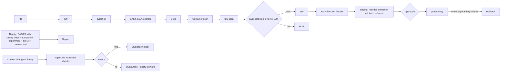

# 10 - CI/CD and MLOps / LLMOps

## Branching and promotion
Trunk-based. `main` -> dev; tag `vX.Y.Z` -> test -> staging -> prod. Prod requires green eval, change record, and approval by Product Owner and Security; **Legal** approval when a new content source or live-data feature is added; **Clinical Advisor** approval when the standard-of-care template or extraction rules change (CODEOWNERS on `medbrief/prompts.py`, `medbrief/loaders.py`, `medbrief/guardrails.py`, the rights register).

## Pipeline


## Eval gate (fails the build)
Extraction contract checks 8/8 on contract documents; retrieval hit@6 >= 0.95 and every source type >= 0.9; internal chunks to public = 0; guardrail precision/recall 1.0; registry analytics 100%; unit tests. Nightly: RAGAS precision >= 0.90 / recall >= 0.85; faithfulness/groundedness >= 0.85 (Bedrock judge); live-API contract test (schema unchanged).

## GitHub Actions - `.github/workflows/ci.yml`
```yaml
name: ci-condition-briefing
on:
  pull_request:
    paths: ["07-healthcare-condition-briefing/**"]
  push:
    branches: [main]
permissions: { contents: read, id-token: write }
jobs:
  test:
    runs-on: ubuntu-latest
    defaults: { run: { working-directory: 07-healthcare-condition-briefing } }
    steps:
      - uses: actions/checkout@v4
      - uses: actions/setup-python@v5
        with: { python-version: "3.12", cache: pip }
      - run: pip install -r requirements.txt ruff pytest pip-audit bandit
      - run: ruff check .
      - run: pytest -q                              # 37 tests, no model needed
      - run: bandit -r medbrief -ll
      - run: pip-audit -r requirements.txt
      - uses: gitleaks/gitleaks-action@v2
      - name: Eval gate (extraction, retrieval, access, guardrails, analytics)
        run: python -m eval.run_eval --threshold-file eval/thresholds.json   # threshold option planned (US-CBR-13)
      - uses: actions/upload-artifact@v4
        with: { name: eval, path: 07-healthcare-condition-briefing/eval/results }
  image:
    needs: test
    runs-on: ubuntu-latest
    steps:
      - uses: actions/checkout@v4
      - uses: aws-actions/configure-aws-credentials@v4
        with: { role-to-assume: "${{ secrets.AWS_CI_ROLE }}", aws-region: us-east-1 }
      - uses: aws-actions/amazon-ecr-login@v2
      - run: docker build -t $ECR/medbrief:${{ github.sha }} 07-healthcare-condition-briefing
      - uses: aquasecurity/trivy-action@0.24.0
        with: { image-ref: "${{ env.ECR }}/medbrief:${{ github.sha }}", exit-code: "1", severity: "CRITICAL,HIGH" }
      - run: docker push $ECR/medbrief:${{ github.sha }}
```
Nightly and ingestion workflows (`schedule:`, `python -m eval.ragas_eval --llm 5`, `python -m medbrief.ingest` as an ECS task) are described in the pipeline diagram and are **to be created**; the threshold file, `infra/` and smoke scripts too. Region/ECR values are placeholders.

## CD outline
Tag workflow: matrix dev -> test -> staging with `terraform apply -var image_tag=...` and `scripts/smoke.py` (briefing from cache, one briefing synthetic, one live mock, follow-up, consultant clearance probe, patient-advice refusal). Prod: protected environment; ECS canary 10% / 10 min; rollback alarms: 5xx > 5%, p95 > 120 s, grounding failure rate > 10%, internal-chunk-to-public probe > 0.

## IaC layout
```
infra/ modules: network ecs_service opensearch dynamodb s3 iam waf monitoring eventbridge_jobs
      envs: dev test staging prod
```

## Versioning of models, prompts, data
| Asset | Versioning |
|---|---|
| Prompts (briefing styles, Q&A, caption) | Git `ChatPromptTemplate` versions; id logged on each briefing; prompt registry Phase 2 |
| Models (writer, vision, embeddings) | Pinned config; swap = RFC + full eval + clinical sample review |
| Index | Fingerprint (embedding model, chunk settings, extraction version); blue/green alias; snapshot per release |
| Extraction code version | Stored in each document's extraction report; change triggers re-extraction of all documents and the contract tests |
| Documents | Version/date metadata; superseded kept in archive |
| Captions | Cache by image hash + vision model id |
| Eval sets | Git; real-document set controlled access (licensed) |
| Flags | AppConfig: live mode, briefing cache, export, strategy section |

## Open questions
Can the 30-document licensed test set be stored in CI artifacts, or must evaluation run in a controlled account?
