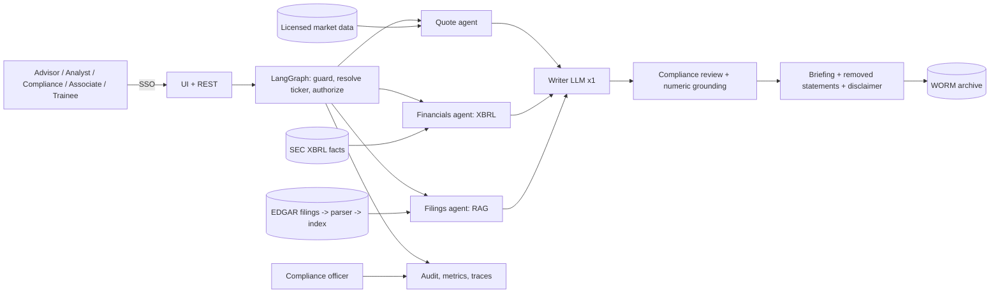

# 01 - Phase A: Architecture Vision

## Problem statement
Before a client call an advisor needs the quote, the financial trend and the main risks, which means a quote
screen plus skimming a 100-page 10-K, the latest 10-Q and recent 8-Ks. Few advisors have time, and anything they
say must not sound like an unsanctioned recommendation.

## Goals and KPIs
Pilot targets, not prototype results.
| ID | Goal | KPI | Baseline | Target |
|---|---|---|---|---|
| G1 | Faster preparation | Minutes per stock before a call | TBD (README assumption: 30-60) | <= 5 plus review |
| G2 | Consistent coverage | Briefings covering business, performance, risks, events, what to watch | n/a | 100% |
| G3 | Traceable | Figures traceable to a filing or feed | n/a | 100% |
| G4 | Compliant | Recommendation language reaching an advisor un-flagged | 0 | 0 |
| G5 | Supervisable | Briefings retrievable by Compliance with sources and timestamps | n/a | 100% |
| G6 | Adoption | Active advisors using it weekly | 0 | >= 60% of pilot group |

AI quality metrics (prototype, synthetic): filing extraction 6/6; retrieval hit@6 1.0, MRR 1.0, 0 cross-company chunks; guardrail precision/recall 1.0/1.0 (14 cases); computed metrics 5/5; compliance filter: 5/5 advice removed, 4/4 facts kept; RAGAS precision 0.972 / recall 1.0 (BM25 weight 2); 31 tests; the real 8.5 MB 10-K parsed in 5.2 s with 28 item headings. Production gates: extraction >= 98% of sections on 50 real filings; hit@6 >= 0.95; compliance filter recall (advice removed) >= 99% on 300 adversarial outputs with factual-keep >= 95%; numeric grounding failures shown 0; faithfulness >= 0.85 and groundedness >= 0.85 with a strong judge (3B judge failed); quote/financial values match source 100%.

## Stakeholders and concerns
| Stakeholder | Concern | Influence |
|---|---|---|
| Financial advisors | Speed, usable before calls, no embarrassment | High |
| Research analysts | Depth, precision | Medium |
| Compliance / CCO | No recommendations, supervision, records, regulatory exam readiness | High (veto) |
| Client-service associates | Quote look-ups only | Low |
| Head of Advisory (sponsor) | Productivity, risk | High |
| Legal / vendor management | Market-data and EDGAR terms | High |
| Security / Records | Archive, access | Medium |
| Regulators (indirect) | Supervision, communications | High |

## Scope
| In | Out |
|---|---|
| Briefing per ticker (snapshot, key financials, filings summary), quote mode, follow-up Q&A on filings, audit view, role scoping | Recommendations, ratings, price targets, portfolio construction, MNPI, trade execution |
| Live US-listed tickers (EDGAR + licensed quotes); synthetic mode for training | Non-US filings (Phase 2); earnings call transcripts (Phase 2); client-facing distribution |
Constraints: licensed market data; EDGAR fair access; WORM archive; compliance filter always on. Assumptions: A-01, A-02.

## Solution concept

## Statement of Architecture Work
Deliver the architecture and a 5-month plan to move from a prototype using an unlicensed quote feed and local models to a supervised, SSO-integrated, AWS-hosted service with licensed market data, WORM archive, compliance-approved lexicon and a CI evaluation gate. Sponsor: Head of Advisory. Architecture work: ESTIMATE 2 weeks (EA 1.0 FTE, AI lead 0.5, Compliance 0.3).

## Initial risk register
| ID | Risk | L | I | Mitigation |
|---|---|---|---|---|
| R-STB-01 | Hallucinated figure or event | M | H | Computed data, numeric grounding, citations, unattributed label |
| R-STB-02 | Recommendation language slips through | M | H | Input refusals + output filter + Compliance-owned lexicon + red-team + supervision |
| R-STB-03 | Unlicensed or unreliable market data | H | H | Replace Yahoo with licensed vendor; timestamps; delayed labels |
| R-STB-04 | MNPI or client-confidential data entering prompts | L | H | MNPI refusal, PII redaction, no client data in MVP |
| R-STB-05 | Bias: coverage depth differs by company size (large caps have richer filings), or the assistant frames positives vs negatives unevenly | M | M | Balanced prompt requirements (risks section mandatory), tone checks, coverage statistics |
| R-STB-06 | Stale data presented as current | H | M | Timestamps, cache TTL 30 min, filing dates, "latest filing" check |
| R-STB-07 | Drift: model update changes tone/format; filing formats change | M | M | Pinned models, regression set, parser tests on new real filings |
| R-STB-08 | EDGAR fair-access violation (rate limits, User-Agent) | L | M | Rate limiter, shared cache, proper UA |
| R-STB-09 | Books-and-records failure (briefings not archived) | L | H | WORM archive, archive-before-display |
| R-STB-10 | Vendor lock-in | M | L | Provider switch by config; data adapters |

## Open questions
Whether advisors may share briefings with clients; baseline prep times; which vendor supplies licensed quotes.
