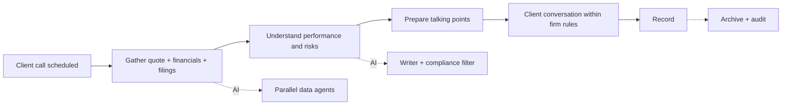
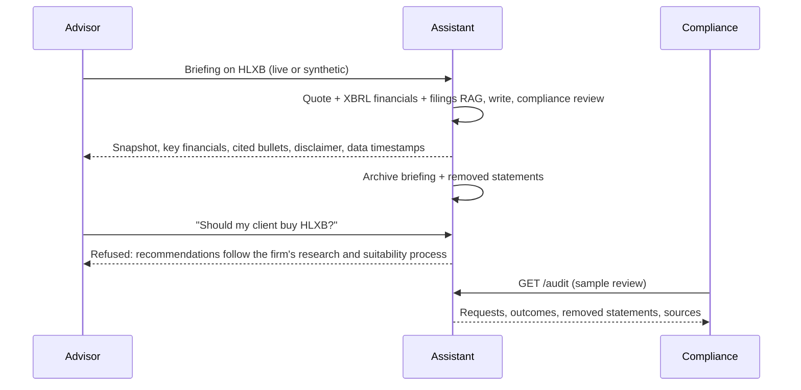

# 02 - Phase B: Business Architecture

## Capability map
| Capability | Current | Target | AI role |
|---|---|---|---|
| Pre-call stock preparation | Quote screen + skimming filings | One briefing in minutes | Briefing workflow |
| Market snapshot | Terminal / quote screen | Snapshot in briefing: price, change, 52-week range, 1-year change, market cap, P/E | Quote agent (no LLM) |
| Financial trend | Manual from filings | Key financials from XBRL with growth and margins | Financials agent |
| Filing comprehension | Reading 10-K/10-Q/8-K | Cited bullets: business, performance, risks, events, what to watch | Filings agent + writer |
| Follow-up research | Search in PDFs | Q&A on the same filings | RAG Q&A |
| Communications supervision | Sampling | Auditable briefings with removed-statement log | Compliance review + `/audit` |
| Training | Shadowing | Practice briefings on fictional companies | Trainee role |

## Value stream: "Prepare for a client conversation about a stock"

D (judgement) and E (conversation, suitability) remain with the advisor.

## Process flow (to-be)

## Actors and organization impact
| Actor | Role key | Tasks | Live data | Style |
|---|---|---|---|---|
| Financial advisor | `financial_advisor` | briefing, qa, quote | yes | advisor (plain language) |
| Research analyst | `research_analyst` | briefing, qa, quote | yes | analyst (precise) |
| Compliance officer | `compliance_officer` | briefing, qa, quote, audit | yes | analyst |
| Client-service associate | `client_service_associate` | quote | no | - |
| Advisor trainee | `advisor_trainee` | briefing (synthetic only) | no | advisor |
Impact: advisors spend time verifying instead of reading; Compliance gains structured evidence; new role: lexicon owner (Compliance, 0.2 FTE).

## Use cases
| ID | Use case | Actor |
|---|---|---|
| UC-1 | Briefing before a client call | Advisor |
| UC-2 | Deeper filing Q&A | Analyst |
| UC-3 | Quote look-up on the phone | Associate |
| UC-4 | Review audit trail and removed statements | Compliance |
| UC-5 | Practice briefing | Trainee |
| UC-6 | Refusal of advice request | Any |

## Business rules
| ID | Rule |
|---|---|
| BR-1 | No buy/sell/hold, price targets, "will it go up", allocation, valuation judgement |
| BR-2 | MNPI-related requests are refused with a pointer to Compliance |
| BR-3 | Output bullets with recommendation language are removed and logged, not shown |
| BR-4 | Every number must exist in filings or computed data; computations are done in code |
| BR-5 | Briefings carry quote time/source ("may be delayed") and filing dates, plus the firm disclaimer |
| BR-6 | Max 5 bullets per section; uncited bullets are backfilled or marked unattributed |
| BR-7 | All briefings, Q&A and removed statements are retained per firm retention policy (A: 6 years, WORM) |
| BR-8 | Associates cannot request briefings; trainees cannot use live data |
| BR-9 | Retrieval is scoped to the requested ticker only |

## HITL and escalation
| Point | Human | Trigger |
|---|---|---|
| Use of talking points with a client | Advisor | Always; the advisor is accountable |
| Removed statements | Compliance | Daily digest and sampling |
| Advice or MNPI request | Compliance | Refusal logged; repeated attempts by a user flagged |
| Unattributed bullet | Advisor | Marked for verification |
| Data feed outage / stale quote | Advisor | Warning with timestamp; no silent fallback |

## Gap analysis
| Baseline | Target | Gap |
|---|---|---|
| Yahoo chart API | Licensed market-data vendor | Contract, adapter, entitlements |
| Demo keys | SSO groups | IdP mapping |
| `logs/audit.jsonl` | WORM archive + surveillance integration | Archive service |
| 2 synthetic companies + live EDGAR via cache | Governed ingestion for any US ticker, rate-limited | Shared cache, rate limiter |
| English/US only | Non-US filings | Phase 2 |

## Open questions
Do firm policies require pre-approval of the briefing template as a communication? Should associates' quote lookups be archived?
