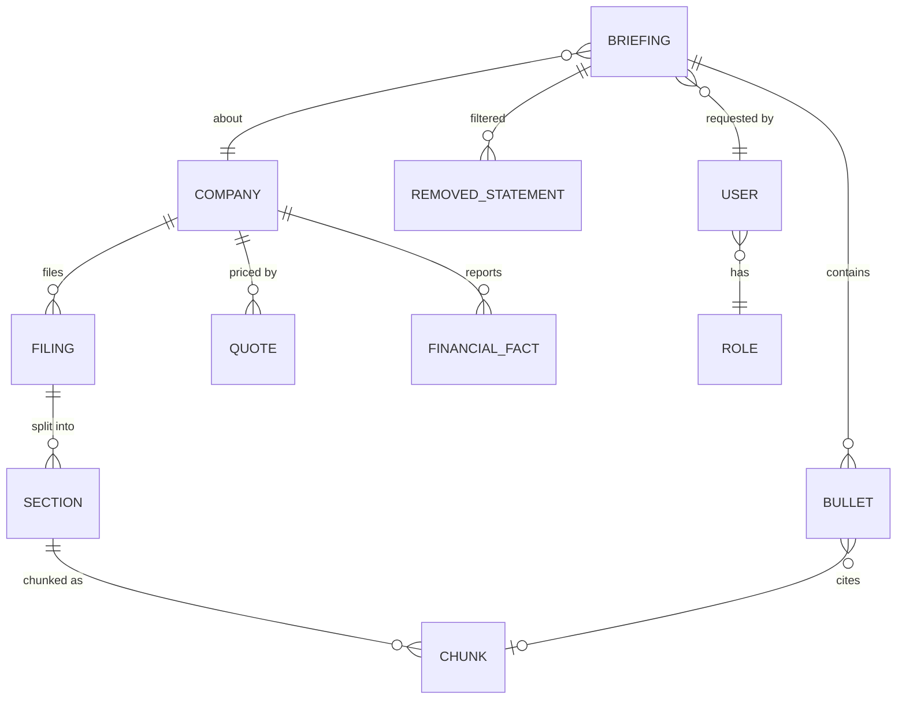
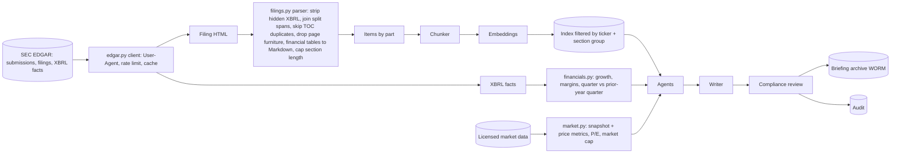
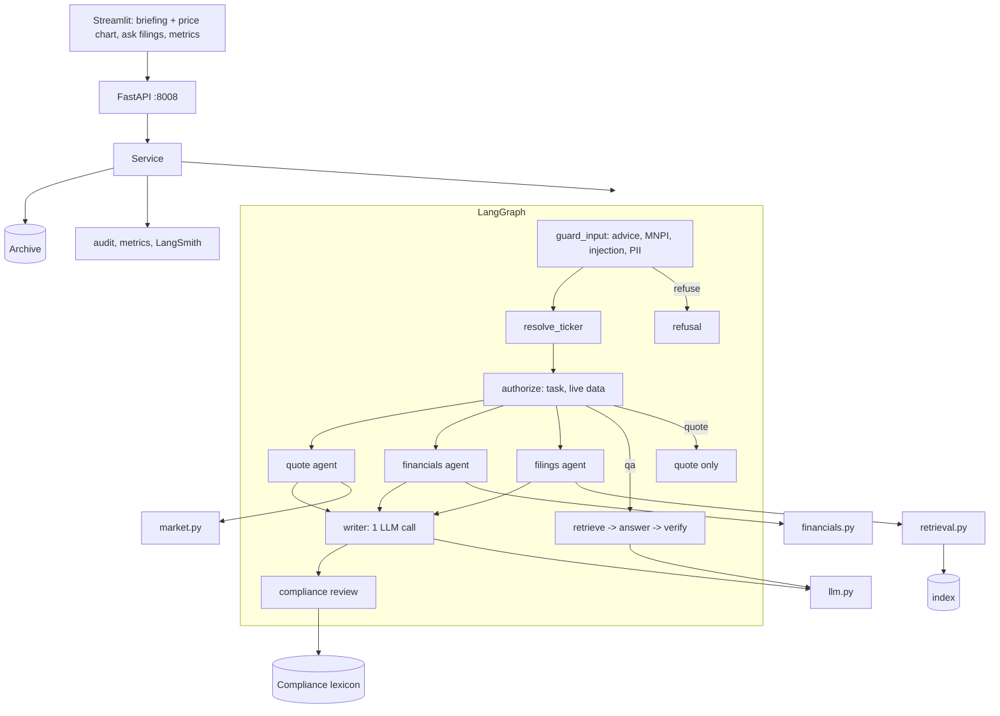
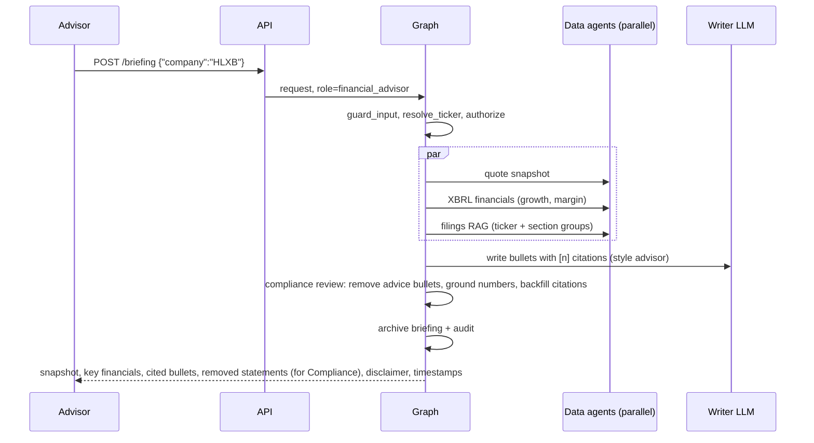

# 03 - Phase C: Information Systems Architecture

## 03a - Data architecture

### Conceptual model

### Logical / physical
| Entity | Attributes | Store |
|---|---|---|
| Company | ticker, CIK, name, exchange, synthetic flag (NWRB, HLXB fictional) | Table / reference data |
| Quote | ticker, price, change, 52-week high/low, 52 weekly closes, market cap inputs, as-of timestamp, source | Licensed vendor via cache (Redis 60 s - 15 min per entitlement); never persisted beyond licence rules except in archived briefings |
| Financial fact | tag, period, duration, value, unit, accession (annual = 10-K ~1-year duration; latest quarter = most recent 10-Q ~3-month duration vs same quarter a year earlier) | S3 Parquet cache of SEC company facts |
| Filing | accession, form (10-K, 10-Q, 8-K), filed date, URL, ticker | S3 (raw HTML), index of parsed Items |
| Section | item key (`1`, `1A`, `7`; 10-Q: `I-2`, `II-1A`), group, text | S3 Markdown |
| Chunk | ticker, form, filed date, section key and group, source, URL, text (800-char target, tables whole) | Chroma -> OpenSearch |
| Briefing | request, role, style, sections, bullets with citations, computed snapshot, removed statements, disclaimer, data timestamps, model/prompt versions | S3 Object Lock (WORM) + DynamoDB index; 30-minute cache copy in Redis |
| Audit event | ts, user, role, task, ticker, outcome (answered, refused, blocked, denied), guardrail flags, latency | JSONL -> S3 Object Lock; queryable via `GET /audit` |

Prototype index: 14 chunks (synthetic filings); live MSFT run indexed 135 chunks from the latest 10-K, 10-Q and two 8-Ks.

### Lineage and flow

### Data for AI
| Item | Design |
|---|---|
| Fine-tuning | None |
| RAG corpus | Per ticker on demand: latest 10-K, 10-Q and two 8-Ks (about 135 chunks for a large company); target working set ~1,500 tickers cached, ~200,000 chunks (ESTIMATE) |
| Parsing | Hidden XBRL headers/scripts/`display:none` removed; text joined across styled spans; for each item the occurrence followed by the longest section wins (TOC duplicates skipped); running page headers, back-links and page numbers dropped; "$" cells dropped and ")" / "%" glued; spacer cells removed; single-column layout tables read as text; sections capped at 15,000 chars for live (bounds embedding cost) |
| Chunking | Shared structure-aware chunker: 800 chars, tables whole, contextual header; metadata ticker/form/filed/section/group/source/URL |
| Embeddings | Titan v2 (AWS) / `nomic-embed-text` (local); cosine |
| Retrieval | Ticker filter always; section-group filter for briefing sections; hybrid vector + BM25 with weighted RRF, **BM25 weight 2** (RAGAS: F1 0.934 -> 0.986), k=6 |
| Refresh | New filings detected by EDGAR submissions poll (every 30 min in market hours, A); quotes per request via cache; XBRL facts daily |

### Quality, governance, privacy, security
| Topic | Rule |
|---|---|
| Quality | Parser acceptance per filing: required items found (10-K: 1, 1A, 7; 10-Q: I-2, II-1A), page furniture removed, no hidden XBRL text; failures flagged and ticker served with a warning; financial values cross-checked against XBRL tags |
| Classification | Source data public; briefings and audit **Confidential - firm record**; quotes subject to vendor display rules |
| Privacy | Account numbers, SSN, email, phone redacted on input and output; no client data in prompts in MVP |
| Licensing | Market data per vendor entitlement (display, caching, redistribution limits); EDGAR fair-access (declared User-Agent, <= 10 requests/s, shared cache) |
| Retention | Briefings, Q&A and audit 6 years (A, books and records) in WORM; caches ephemeral; traces 90 days with questions redacted |
| Encryption | TLS 1.2+; KMS at rest; Object Lock compliance mode on archive |
| Access | SSO group -> role; compliance role read-only on archive |

## 03b - Application architecture

### Components

### AI architecture
| Topic | Decision |
|---|---|
| Models | Writer and Q&A: Claude on Bedrock (target) / `llama3.2` local; embeddings Titan v2 / nomic. Two stateless prompts only |
| Prompts | `briefing/v1` (sections: Business overview, Recent performance, Key risks, Recent events, What to watch; cite `[n]`; copy numbers; never compute; no advice/targets/valuation judgements; style advisor vs analyst), `qa/v1`; versioned in Git; version stored in the archive |
| RAG | Ticker-scoped hybrid retrieval per section group |
| Agents | Quote, financials, filings agents run in parallel and are deterministic (no LLM); one writer call; compliance review step |
| Guardrails | Input: investment advice (buy/sell/hold, targets, "will it go up", allocations), MNPI, injection, PII. Output: recommendation-language filter (bullets removed and listed), numeric grounding, citation backfill/unattributed, bullet cap, disclaimer and timestamps |
| Fallback | LLM down -> data-only briefing (snapshot, key financials, section excerpts with citations); data feed down -> explicit warning, no stale price; keyword ticker resolution |
| Caching | Briefing cache keyed (ticker, role style, data version) for 30 minutes (quotes move; < 1 s on hit); EDGAR/XBRL caches longer |

### API catalog
| Endpoint | Method | Auth | Purpose |
|---|---|---|---|
| `/briefing` | POST | `X-API-Key` -> SSO | {company or ticker, live?} -> briefing JSON + Markdown, flags, removed statements |
| `/quote/{ticker}` | GET | same | Quote snapshot (no LLM) |
| `/ask` | POST | same | Follow-up on filings, with citations |
| `/filings/{ticker}` | GET | same | Filings index and parsed items |
| `/audit` | GET | compliance role | Audit entries (filters: user, ticker, outcome, date) |
| `/feedback` | POST | same | Rating |
| `/roles`, `/health`, `/metrics`, `/metrics/summary` | GET | admin/network | Ops |

### Integration patterns
Licensed market-data API (REST/streaming snapshot); SEC EDGAR REST with rate limit; OIDC; archive API (S3 Object Lock) and export to the compliance surveillance platform (nightly batch); Prometheus/OTel.

### Top-5 journeys

Others: **J2 Quote** (associate; no LLM); **J3 Follow-up** ("What were the HLX-INS7 Phase 3 topline results?": answer from the 8-K with citation); **J4 Advice refused** ("Should my client buy HLXB?": refused pre-LLM, audit outcome `refused`); **J5 Compliance review** (`GET /audit?outcome=refused&limit=...` and removed statements).

### Gap analysis
Licensed data adapter; SSO; WORM archive and surveillance export; shared rate limiter for EDGAR; managed index; hosted model; pre-market capacity; lexicon governance; CRM context (Phase 2).

## Open questions
Does Compliance want to pre-screen the lexicon with the firm's existing surveillance vendor? How long may licensed quotes be cached?
