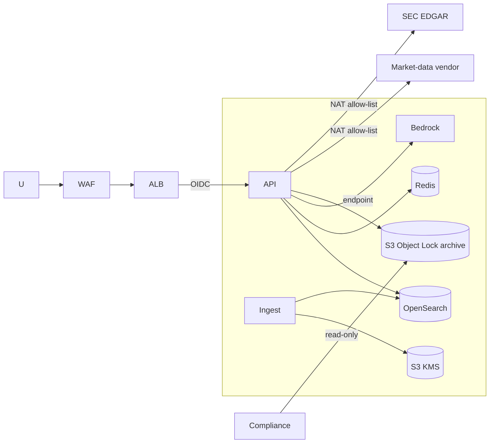
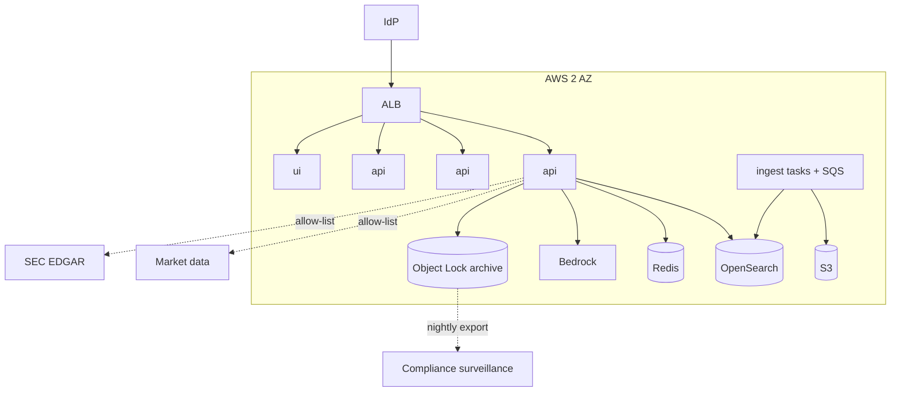

# 04 - Phase D: Technology Architecture

AWS target (A-03). All sizing is **ESTIMATE**.

## Infrastructure
| Layer | Choice |
|---|---|
| Compute | ECS Fargate: `api` (2 vCPU/4 GB, 3-6 tasks, autoscale for pre-market bursts), `ui` (1 vCPU/2 GB x2), `ingest` (event/scheduled; EDGAR fetch + parse) |
| GPU | None; Bedrock |
| Search | OpenSearch 2 x `m6g.large` (hybrid; ticker + section filters) |
| Cache | ElastiCache Redis: quotes (short TTL), briefing cache (30 min), EDGAR rate-limit tokens (shared across tasks) |
| Storage | S3: raw filings, parsed items, XBRL facts; **S3 Object Lock (compliance mode)** for briefings and audit |
| Queue | SQS for ingest and archive-export |
| Network | VPC 2 AZ; private subnets; VPC endpoints; egress via NAT with allow-list (`data.sec.gov`, `www.sec.gov`, market-data vendor, Bedrock endpoint); ALB + WAF |
| Identity | Corporate IdP OIDC; groups -> roles |

## Environments
| | Dev | Test | Staging | Prod |
|---|---|---|---|---|
| Data | Synthetic NWRB/HLXB | Synthetic + recorded EDGAR/vendor fixtures | Live EDGAR; vendor delayed/sandbox feed | Live EDGAR + licensed feed |
| Models | Ollama / small Bedrock | Bedrock small | Prod model | Prod model |
| Archive | Standard S3 | Standard S3 | Object Lock (governance mode) | Object Lock (compliance mode) |
| Users | Developers | QA | QA + Compliance | Advisors |

## Security architecture

IAM least privilege; task role cannot delete or overwrite the archive (Object Lock + bucket policy); separate read-only role for Compliance; Secrets Manager (vendor API keys; SEC contact UA string); KMS CMKs; zones edge/app/data; WAF rate limits (120/min/user). Market-data keys scoped per environment.

## Observability
| Signal | Tool | Items |
|---|---|---|
| Logs/audit | CloudWatch -> S3 Object Lock | all requests, outcomes, flags |
| Metrics | `/metrics` -> Grafana | `stockbrief_requests_total{intent,role,outcome}`, latency, guardrail blocks, output flags, removed statements, cache hit rate, data-feed latency/errors, EDGAR 429/403 |
| Traces | LangSmith | per-node latency, tokens, retrieved chunks, feedback |
| LLM monitoring | LangSmith + CloudWatch | tokens/briefing, cost, removed-statement rate, unattributed-bullet rate, numeric-grounding failures, refusal rate by user, stale-data warnings, filing freshness |

## HA / DR
Availability 99.9% from 07:00 to 18:00 local trading days (pre-market surge); 99.5% otherwise. RTO 2 h / RPO 24 h (archive is immutable and replicated cross-region; index rebuildable from S3 in ~2 h ESTIMATE). Multi-AZ. Degraded modes: quote-only if LLM down; "data unavailable" banners if a feed is down (never show stale price as current).

## Capacity (ESTIMATE)
| Input | Value | Basis |
|---|---|---|
| Users | 450 | A-01 |
| Briefing requests | 1,500/month, 40% cache hits -> 900 LLM briefings | assumption |
| Follow-ups | 4,000/month | assumption |
| Quote lookups | 30,000/month (no LLM) | assumption |
| Peak | 30 concurrent between 08:00-09:30 | pre-market prep |
| Tokens | Briefing: 7,500 in + 1,200 out; follow-up 5,000 in + 500 out | 6 chunks per section + data tables |
| Corpus | ~200,000 chunks x 1,024 x 4 B = ~0.8 GB | fits 2 data nodes |
| Ingest | First briefing for a new ticker: fetch + parse + embed ~135 chunks ~30-60 s on Bedrock embeddings (prototype CPU: minutes); EDGAR budget 10 req/s shared | pre-warm top 500 tickers nightly |

## Deployment diagram

## Standards and alternatives
| Area | Choice | Rejected |
|---|---|---|
| Orchestration | LangGraph fixed plan | Autonomous agent with tool freedom (unpredictable compliance behaviour) |
| Market data | Licensed vendor API | Yahoo chart API in production (terms and reliability, ADR-STB-03), scraping |
| Filing text | Own EDGAR HTML parser + XBRL facts for numbers | Third-party summarisation APIs; LLM reading raw HTML |
| Search | OpenSearch, BM25 weight 2 | Vector only (F1 0.930 vs 0.986) |
| Archive | S3 Object Lock | Database table (mutable), email archive |
| LLM | Bedrock Claude | Self-hosted on GPU, OpenAI |
| Hosting | ECS Fargate | Lambda (parsing multi-MB filings), EKS |
| IaC | Terraform | CDK |

## Open questions
Does the firm already have an approved archive platform (replace S3 Object Lock)? Is outbound EDGAR access approved from the VPC?
