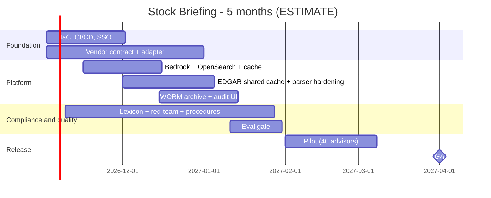

# 06 - Phase F: Migration / Delivery Planning

All figures **ESTIMATE**; rates are placeholders (A-04).

## Team (FTE by phase)
| Role | Build (m1-3) | Pilot + harden (m4-5) | Run (m6+) |
|---|---|---|---|
| Product owner | 0.4 | 0.4 | 0.2 |
| Architect | 0.3 | 0.15 | 0.05 |
| AI/ML engineers | 1.5 | 1.0 | 0.4 |
| Backend | 1.0 | 0.5 | 0.2 |
| Frontend / UX | 0.75 | 0.4 | 0.15 |
| Data engineer (market/EDGAR feeds) | 1.0 | 0.5 | 0.25 |
| DevOps/MLOps | 0.75 | 0.4 | 0.25 |
| QA | 0.75 | 0.75 | 0.15 |
| Security | 0.25 | 0.25 | 0.1 |
| Compliance analyst | 0.3 | 0.4 | 0.2 |
| Legal / vendor management | 0.1 | 0.1 | 0.05 |
| **Total** | **7.1** | **4.85** | **2.0** |

Skill gaps: SEC/XBRL data handling (medium), financial-communications compliance (Compliance), WORM archive operations (low-medium), market-data vendor APIs (low).

## Cost (USD, ESTIMATE)
**People:** build 7.1 x 3 = 21.3 FM; pilot 4.85 x 2 = 9.7 FM; total 31.0 FM x 12,500 = **USD 387.5k** one-time. Run: 2.0 x 12,500 = 25k/month.

**Infrastructure monthly (prod):**
| Item | Sizing | USD |
|---|---|---|
| ECS Fargate | ~6 task-equivalents + ingest | 150 |
| OpenSearch | 2 x m6g.large + 100 GB | 400 |
| Redis | t4g.small | 30 |
| S3 (incl. Object Lock), CloudWatch, KMS, ALB, WAF, NAT | | 250 |
| LangSmith | | 100 |
| **Subtotal infra** | | **930** |
| Licensed market-data feed (ASSUMED USD 1,500/month; vendor quote required) | | 1,500 |
| **Prod** | | **2,430** |
| Non-prod infra (0.5x of infra; delayed/sandbox feed assumed free) | | 465 |
| **Total** | | **~2,895** |

**LLM usage:** briefings 1,500/month x 60% (cache misses) = 900 x (7,500 in + 1,200 out) = 6.75M in + 1.08M out; follow-ups 4,000 x (5,000 in + 500 out) = 20M in + 2M out. Total 26.75M in + 3.08M out. At ASSUMED USD 3 / 15 per 1M: 80.25 + 46.2 = **~USD 126/month**. Embeddings for newly ingested tickers: ~500/month x 135 chunks x ~300 tokens = 20M tokens at ASSUMED 0.02 per 1M = USD 0.4. CI judge ~USD 40/month. Total ~USD 166/month.

| TCO | 12 months | 3 years |
|---|---|---|
| Build people | 387,500 | 387,500 |
| Run people (m6-12 = 7 x 25k; 3 yr: 7 + 24 months) | 175,000 | 775,000 |
| Infra incl. data licence (2,895 x 12 / x 36) | 34,740 | 104,220 |
| LLM + eval (166 x 12 / x 36) | 1,992 | 5,976 |
| Tools, pen test, archive/surveillance integration, books-and-records review | 40,000 | 60,000 |
| Subtotal | 639,232 | 1,332,696 |
| Contingency 20% (regulatory uncertainty) | 127,846 | 266,539 |
| **TCO** | **~767.1k** | **~1,599.2k** |

(The package index's "~USD 0.47M build" = build people 387.5k x 1.20 contingency = 465k.)

One-time: build people, pen test, integrations. Recurring: run people, infra, data licence (the largest recurring non-people item), LLM.
Optimisation: briefing cache; delayed rather than real-time entitlement; Haiku-class model for Q&A; pre-warm only the top tickers; reuse the firm's archive instead of new S3 Object Lock bucket; share OpenSearch with other portfolio services.

## Roadmap

Milestones: M1 env + SSO (wk 4), M2 vendor feed live in staging (wk 9), M3 MVP in staging (wk 12), M4 Compliance sign-off (wk 14), M5 pilot (wk 16-20), M6 GA (wk 22). 11 two-week sprints.
**Critical path:** market-data contract -> adapter -> Compliance sign-off (lexicon, archive) -> pilot.

## Open questions
Vendor pricing (placeholder above); rate card; whether GA can precede the surveillance export integration.
