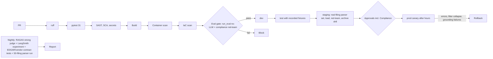

# 10 - CI/CD and MLOps / LLMOps

## Branching and promotion
Trunk-based. `main` -> dev; tag `vX.Y.Z` -> test -> staging -> prod. Prod requires green eval and compliance red-team, a change record, and approvals from Product Owner, Security and **Compliance** whenever `stockbrief/guardrails.py`, `stockbrief/prompts.py`, the lexicon, disclaimer text or refusal catalog change (CODEOWNERS). Production deploys outside trading hours (07:00-18:00 on trading days) unless emergency.

## Pipeline


## Eval gate (fails the build)
Parser checks 6/6 (synthetic) and required items on the real-filing set; retrieval hit@6 >= 0.95 and MRR >= 0.95; wrong-company chunks = 0; guardrail precision/recall 1.0; computed metrics 100%; **compliance filter: advice removed >= 99% and facts kept >= 95% on the fixed sets**; numeric grounding unit tests. Nightly: RAGAS precision/recall >= 0.95; faithfulness/groundedness >= 0.85 (Bedrock judge); vendor/EDGAR schema contracts.

## GitHub Actions - `.github/workflows/ci.yml`
```yaml
name: ci-stock-briefing
on:
  pull_request:
    paths: ["08-finance-stock-briefing/**"]
  push:
    branches: [main]
permissions: { contents: read, id-token: write }
jobs:
  test:
    runs-on: ubuntu-latest
    defaults: { run: { working-directory: 08-finance-stock-briefing } }
    steps:
      - uses: actions/checkout@v4
      - uses: actions/setup-python@v5
        with: { python-version: "3.12", cache: pip }
      - run: pip install -r requirements.txt ruff pytest pip-audit bandit
      - run: ruff check .
      - run: pytest -q                              # 31 tests: parser, metrics, guardrails, workflow, API
      - run: bandit -r stockbrief -ll
      - run: pip-audit -r requirements.txt
      - uses: gitleaks/gitleaks-action@v2
      - name: Eval gate (no LLM, no network)
        run: python -m eval.run_eval --threshold-file eval/thresholds.json   # threshold option planned (US-STB-14)
      - uses: actions/upload-artifact@v4
        with: { name: eval, path: 08-finance-stock-briefing/eval/results }
  image:
    needs: test
    runs-on: ubuntu-latest
    steps:
      - uses: actions/checkout@v4
      - uses: aws-actions/configure-aws-credentials@v4
        with: { role-to-assume: "${{ secrets.AWS_CI_ROLE }}", aws-region: us-east-1 }
      - uses: aws-actions/amazon-ecr-login@v2
      - run: docker build -t $ECR/stockbrief:${{ github.sha }} 08-finance-stock-briefing
      - uses: aquasecurity/trivy-action@0.24.0
        with: { image-ref: "${{ env.ECR }}/stockbrief:${{ github.sha }}", exit-code: "1", severity: "CRITICAL,HIGH" }
      - run: docker push $ECR/stockbrief:${{ github.sha }}
```
Nightly and real-filing parser jobs, `schedule:` triggers, vendor contract tests, `infra/` and smoke scripts are **to be created**; the CI never calls live vendors with production keys. Region/ECR values are placeholders.

## CD outline
Tag workflow: matrix dev -> test -> staging with `terraform apply -var image_tag=...` and `scripts/smoke.py` (quote, briefing synthetic, refusal, audit 403 for advisor, archive object written). Prod: protected environment (PO + Security + Compliance); deploy window check; ECS canary 10% / 10 min; alarms: 5xx > 5%, p95 > 60 s, removed-statement rate falling to 0 for 1 h when the baseline is > 0 (filter failure), numeric-grounding failures > 10%, archive write failures > 0.

## IaC layout
```
infra/ modules: network ecs_service opensearch redis s3_archive_lock iam waf monitoring eventbridge_jobs
      envs: dev test staging prod
```

## Versioning of models, prompts, lexicon, data
| Asset | Versioning |
|---|---|
| Prompts (`briefing/v1`, `qa/v1`) | Git; version in each archived briefing |
| Compliance lexicon, refusal catalog, disclaimer | Versioned file owned by Compliance; version stored per briefing; change = supervisory-procedure change |
| Models | Pinned IDs; swap = RFC + full eval + red-team + Compliance sample review |
| Index | Fingerprint (embedding model, chunker, BM25 weight 2.0, k); blue/green alias |
| Parser version | Stored with parsed items; change triggers re-parse of cached filings and the real-filing test set |
| Eval sets | Git; adversarial sets controlled access |
| Flags | AppConfig: live data, Q&A, classifier layer, cache TTL |

## Open questions
Can CI access recorded vendor data under the licence? Is a separate environment needed for the red-team set with sensitive wording?
